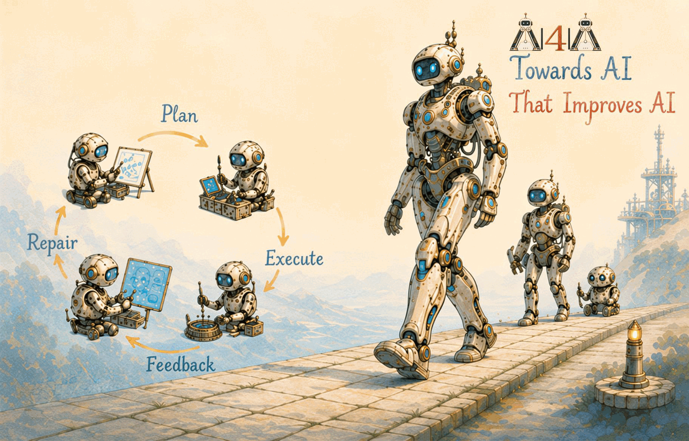
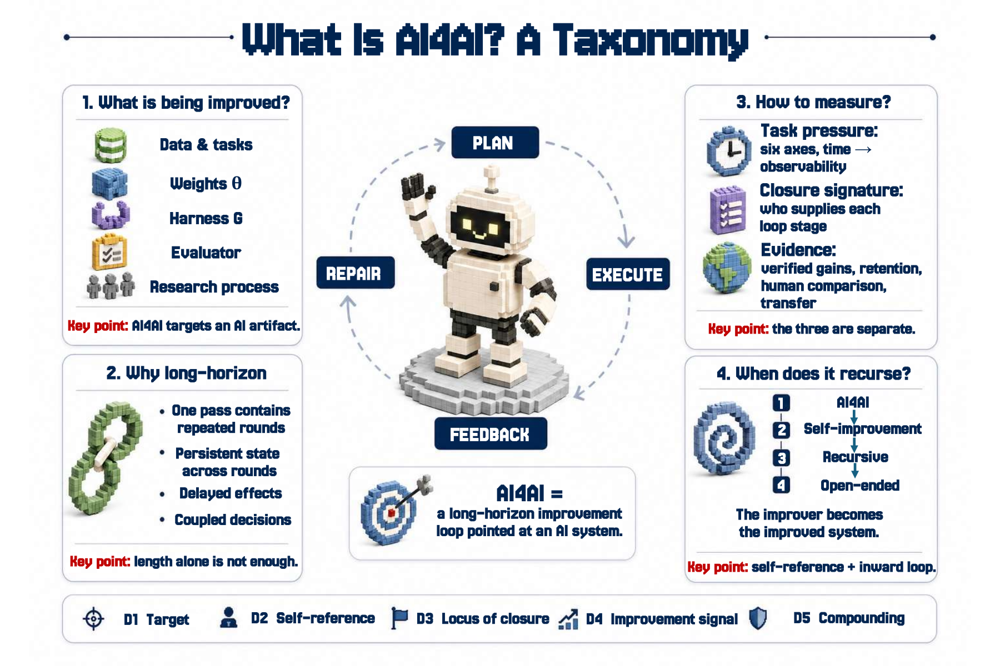
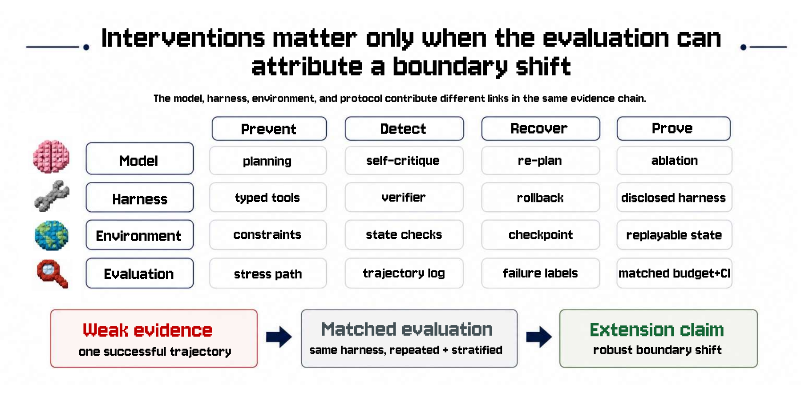
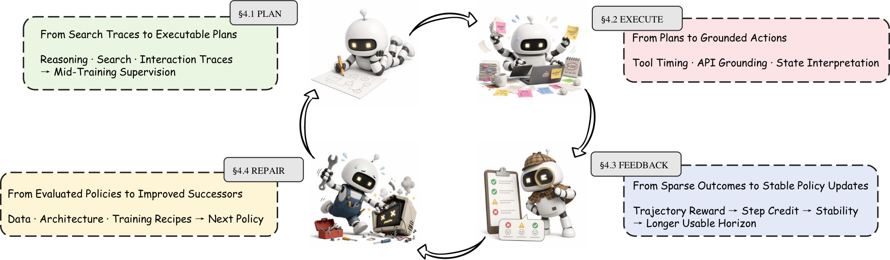
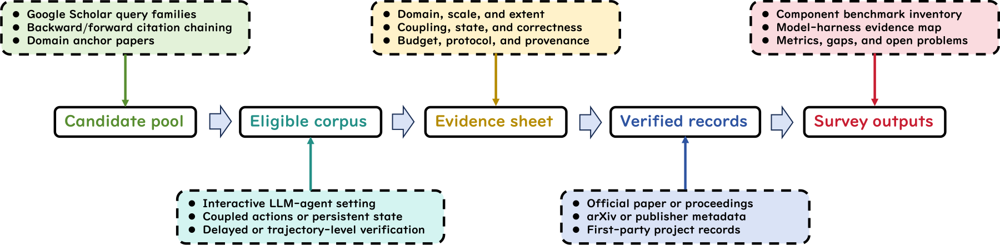

<div align="center">

<p>
  
</p>

<h1>🚀 Awesome AI4AI</h1>

<h3>🔄 Updated weekly — until humanity achieves AI4AI.</h3>

<p><strong>Follow the journey: <a href="https://github.com/KaiWU5/Awesome-AI4AI">Star ⭐</a> · <a href="https://github.com/KaiWU5/Awesome-AI4AI/subscription">Watch 👀 for weekly updates</a> · <a href="#weekly-news">Read this week's picks →</a></strong></p>

<p><strong><em>AI4AI Survey: From Long-Horizon Agents to Recursive Self-Improvement</em></strong><br>
<sub>Definitions, Reliable Horizons, and Open Problems · 23 authors · 7 institutions</sub></p>

<p>
  Top AI-for-AI papers, releases, and blogs — curated every week. <strong>Stay tuned 🔥</strong>
</p>

<p><strong>Living catalog: 437 papers</strong> · 191 benchmarks · 223 harness studies · 84 model studies<br><sub>Collections overlap. The original survey covers 223 papers.</sub></p>

<p>
  <a href="assets/AI4AI-Survey.pdf"></a>
  <a href="https://www.preprints.org/manuscript/202608.2108/v1"></a>
  <a href="https://kaiwu5.github.io/Awesome-AI4AI/"></a>
  <a href="https://github.com/simple-agent-lab/RSIHub"></a>
  <a href="https://simpleagentlab.com/ai4ai/"></a>
  <a href="https://doi.org/10.20944/preprints202608.2108.v1"></a>
</p>

</div>

<br>

## Why This Repo

<table>
<tr>
<td width="33%" align="center">
  <strong>🔄 Refreshed rankings</strong><br>
  <sub>Citations, GitHub stars, and rankings refresh with maintainer updates.</sub>
</td>
<td width="33%" align="center">
  <strong>🗞️ Weekly update</strong><br>
  <sub>New papers added to the catalog, plus source-verified papers and releases selected every week.</sub>
</td>
<td width="33%" align="center">
  <strong>🧭 Survey-grounded map</strong><br>
  <sub>From long-horizon agents to recursive self-improvement.</sub>
</td>
</tr>
</table>

<p align="center">
  <strong>Star ⭐ to save the map · Watch 👀 for weekly updates · Share 🔁 with your lab</strong>
</p>

## What's New

- 🤝 **2026-10-26 — Community paper recommendations added.** Added ReCreate, Meta-Team, and Agon to Harness Design, and PerspectiveGap to Benchmarks, with paper and official code links.

- 📚 **2026-10-25 — 136 papers added.** Expanded Benchmarks, Harness Design, and Model Design with verified new and previously missed papers; rebuilt the full catalog and both ranking families.
- 📄 **2026-08-30 — [Companion survey now online.](https://www.preprints.org/manuscript/202608.2108/v1)** Read *AI4AI Survey: From Long-Horizon Agents to Recursive Self-Improvement—Definitions, Reliable Horizons, and Open Problems*.
- 🔄 **Maintainer refresh.** Citations, GitHub stars, and recent-paper/yearly rankings are rebuilt from the catalog.
- 🚀 **2026-10-25 — Latest weekly edition published.** Read the source-verified news digest below.

<details open markdown="1">
<summary><b>🗂️ Explore the full collection</b></summary>

- [📅 Weekly News · Top 10](#weekly-news)
- [📈 Live Rankings](#-live-rankings)
  - [Top Ranking Papers by Average Monthly Citations](#top-ranking-papers-by-average-monthly-citations)
  - [🏆 Most-Cited Papers by Year](#-most-cited-papers-by-year)
- [🧪 Benchmarks](#-benchmarks)
- [🛠️ Harness Design](#-harness-design)
- [🧠 Model Design](#-model-design)
- [📚 How We Curate](#-how-we-curate)
- [📄 Citation](#-citation)
- [🤝 Contributing](#-contributing)

</details>

<br>

<a id="monthly-news"></a>
<a id="weekly-news"></a>

## 📅 Weekly News · Top 10

> **Updated 2026-10-25** · Weekly news picks, refreshed every Monday alongside citation rankings.
>
> **How we select:** The top stories from the trailing 30 days, scored on publisher authority, discussion volume, whether a concrete verifiable result is reported, whether it changes what agent builders do now, whether an artifact was released, and expected durability. Only primary sources are cited, and performance claims remain attributed to their publishers.

| Date · Type | News | Why it matters |
|:--|:--|:--|
| 2026‑10‑23<br><sub>Model release</sub> | [**Kimi K3.1 Pro series is live**](https://www.kimi.com/code/docs/en/kimi-code/whats-new.html)<br><sub>Moonshot AI</sub> | Moonshot rolls out Kimi K3.1 Pro and its Highspeed variant in Kimi Code, with a 1M-token context window and improved long-horizon agent capabilities. Its technical blog reports 65.7% on Terminal-Bench 4.0 and says full weights are planned by November 4; this edition treats the product launch and future weight release separately. |
| 2026‑10‑22<br><sub>Paper</sub> | [**HERD: Harness-Evolving Recursive Distillation for Continual Learning**](https://arxiv.org/abs/2610.31401)<br><sub>Sun, Xun et al. · arXiv</sub> | The authors introduce HERD, combining continual skill evolution and bounded residual memory with drift-constrained distillation into model parameters. On the 25-stage TRACE+17 stream under fixed memory and compute budgets, they report competitive new-task acquisition with the least forgetting among the compared methods. |
| 2026‑10‑21<br><sub>Open-weight release</sub> | [**Introducing Flint**](https://recursive.com/updates/introducing-recursive-flint)<br><sub>Recursive</sub> | Recursive releases Apache-2.0 Flint, a 40B-total / 2.5B-active MoE for local agentic coding. The team says its Eureka Machine helped build the data, training, quantization and inference stack; open weights and day-zero vLLM support make this an inspectable AI-built-AI release. |
| 2026‑10‑21<br><sub>Research release</sub> | [**Introducing Claude Duet**](https://claude.com/resources/articles/claude-duet)<br><sub>Anthropic</sub> | Anthropic opens a waitlisted US research preview of Claude Duet for Pro and Max subscribers. Built around Opus 5.5, the proactive agent carries account memory and skills into a persistent workflow, works in a cloud VM with a browser, and checks before consequential actions. |
| 2026‑10‑20<br><sub>Paper</sub> | [**Evolving Agent Interfaces**](https://arxiv.org/abs/2610.28601)<br><sub>Saaket Agashe et al. · arXiv</sub> | The authors introduce Agent S4, which evolves computer-use interfaces and usage knowledge from trajectories, then selects repositories using held-out validation tasks. They report a 21.3% OSWorld V2 binary score with Qwen3.8-27B and a ScienceBoard increase from 41.4% to 58.6%; code is public. |
| 2026‑10‑19<br><sub>Model release</sub> | [**MiniMax M3.1 Flash: Redefining Agent Performance and Cost**](https://www.minimax.io/blog/minimax-m31f)<br><sub>MiniMax</sub> | MiniMax releases M3.1 Flash through its API and coding products, reporting 73.7% on DeepSWE v1.1 and 70% lower agentic usage cost than its predecessor. The announcement targets coding, computer use and professional workflows; weights are promised later rather than released at launch. |
| 2026‑10‑18<br><sub>Paper</sub> | [**Epi: Towards a Persistent, Self-Improving Agent for Autonomous Research**](https://arxiv.org/abs/2610.24944)<br><sub>Yue Huang et al. · arXiv</sub> | The authors introduce Epi, combining persistent research history, hierarchical memory, branching and independent review across sessions under fixed verification. They report 120 record-setting mathematical results; on 30 FrontierOR tasks, Epi-turbo scores 5.4% above Codex at 64% of its model cost with the same backbone and effort. |
| 2026‑10‑16<br><sub>Open-weight release</sub> | [**Beam is now available**](https://reflection.ai/blog/beam-is-available)<br><sub>Reflection</sub> | Reflection releases Beam under Apache 2.0 with 501B total and 23B active parameters, multiple weight precisions, a speculative drafter, and the Mirror CLI harness. The release makes its coding and long-horizon agent stack available for deployment and customization. |
| 2026‑10‑12<br><sub>Model release</sub> | [**Muse Wonder: A Frontier Model For Personal & Professional AI Agents**](https://research.meta.ai/blog/muse-wonder)<br><sub>Meta</sub> | Meta introduces Muse Wonder and Muse Wonder Full for personal and professional agents, emphasizing Active Memory, sustained execution, and coding. Wonder is available through its API and Muse Code, while Full is available to Muse Code subscribers; the announcement does not release open weights. |
| 2026‑10‑09<br><sub>Paper</sub> | [**Harness²: Recursive Agent Harnessing for an Open World**](https://arxiv.org/abs/2610.14224)<br><sub>Google Research</sub> | Google Research introduces two connected loops that refine the current task harness and retain evidence-supported lessons for future tasks, with model weights fixed. The authors report gains across three professional benchmarks; the Apache-2.0 implementation supports OpenCode and Codex, parallel and sequential recursion, and reproducible benchmark runs. [Official code](https://github.com/google-research/harness2). |

> **Want next week's news?** Watch the repository. Citation counts, rankings, and the weekly news picks are published with maintainer updates. [Browse past editions →](highlights/README.md)

## 📈 Live Rankings

> Citation counts are current through **2026-10-17** from Semantic Scholar and OpenAlex. Rankings are discovery aids, not quality scores; audit evidence remains independent of popularity. GitHub stars are snapshots from **2026-10-25**. For papers indexed as multiple versions, retain the largest title-verified count reported by the configured sources. All yearly rankings use first public appearance year; a later venue year never moves a paper into a newer cohort.

> **Latest metric check: 2026-10-26.** Title-verified citations for 440/452 catalog records; 9 previously cited records retain older counts and 3 records remain without a verified index count. GitHub stars refreshed for 216 records across 211 repositories. The complete citation as-of date above advances only after unresolved counts are verified.

### Top Ranking Papers by Average Monthly Citations

| Paper | Venue | Date | Citations | Avg. cites/month | Code |
|:--|:--:|:--:|:--:|:--:|:--:|
| [**Terminal-Bench: Benchmarking Agents on Hard, Realistic Tasks in Command Line Interfaces**](https://arxiv.org/abs/2601.11868) | arXiv | <nobr>2026-01</nobr> | 612 | **68.0** | [GitHub](https://github.com/harbor-framework/terminal-bench-1) · ★ 2,606 |
| [**AlphaEvolve: A coding agent for scientific and algorithmic discovery**](https://arxiv.org/abs/2506.13131) | arXiv | <nobr>2025-06</nobr> | 1051 | **65.7** | — |
| [**Towards End-to-End Automation of AI Research**](https://doi.org/10.1038/s41586-026-10265-5) | Nature 2026 | <nobr>2026-03</nobr> | 317 | **45.3** | [GitHub](https://github.com/SakanaAI/AI-Scientist-v2) · ★ 7,395 |
| [**Mem0: Building Production-Ready AI Agents with Scalable Long-Term Memory**](https://doi.org/10.3233/faia251160) | European Conference on Artificial Intelligence (ECAI) | <nobr>2025-04</nobr> | 793 | **44.1** | [GitHub](https://github.com/mem0ai/mem0) · ★ 67,778 |
| [**Meta-Harness: End-to-End Optimization of Model Harnesses**](https://arxiv.org/abs/2603.28052) | arXiv | <nobr>2026-03</nobr> | 305 | **43.6** | [GitHub](https://github.com/stanford-iris-lab/meta-harness-tbench2-artifact) · ★ 1,244 |
| [**The Berkeley Function Calling Leaderboard (BFCL): From tool use to agentic evaluation of large language models**](https://proceedings.mlr.press/v267/patil25a.html) | Proceedings of the 42nd International Conference on Machine Learning | <nobr>2025</nobr> | 634 | **39.6** | [GitHub](https://github.com/ShishirPatil/gorilla) · ★ 13,058 |
| [**Agentic Context Engineering: Evolving Contexts for Self-Improving Language Models**](https://arxiv.org/abs/2510.04618) | arXiv | <nobr>2025-10</nobr> | 453 | **37.8** | [GitHub](https://github.com/ace-agent/ace) · ★ 1,391 |
| [**Kimi K3: Open Frontier Intelligence**](https://arxiv.org/abs/2607.24653) | arXiv | <nobr>2026-07</nobr> | 103 | **34.3** | [GitHub](https://github.com/MoonshotAI/Kimi-K3) · ★ 8,983 |
| [**Group-in-Group Policy Optimization for LLM Agent Training**](https://arxiv.org/abs/2505.10978) | Advances in Neural Information Processing Systems | <nobr>2025-05</nobr> | 548 | **32.2** | [GitHub](https://github.com/langfengQ/verl-agent) · ★ 2,399 |
| [**LLMs Get Lost In Multi-Turn Conversation**](https://arxiv.org/abs/2505.06120) | International Conference on Learning Representations | <nobr>2025-05</nobr> | 527 | **31.0** | [GitHub](https://github.com/microsoft/lost_in_conversation) · ★ 302 |

### 🏆 Most-Cited Papers by Year

<details open markdown="1">
<summary><b>Top 12 of 2026</b> by citations</summary>

| Paper | Date | Citations | Code |
|:--|:--:|:--:|:--:|
| [**Terminal-Bench: Benchmarking Agents on Hard, Realistic Tasks in Command Line Interfaces**](https://arxiv.org/abs/2601.11868)<br><sub>arXiv</sub> | <nobr>2026-01</nobr> | 612 | [GitHub](https://github.com/harbor-framework/terminal-bench-1) · ★ 2,606 |
| [**Towards End-to-End Automation of AI Research**](https://doi.org/10.1038/s41586-026-10265-5)<br><sub>Nature 2026</sub> | <nobr>2026-03</nobr> | 317 | [GitHub](https://github.com/SakanaAI/AI-Scientist-v2) · ★ 7,395 |
| [**Meta-Harness: End-to-End Optimization of Model Harnesses**](https://arxiv.org/abs/2603.28052)<br><sub>arXiv</sub> | <nobr>2026-03</nobr> | 305 | [GitHub](https://github.com/stanford-iris-lab/meta-harness-tbench2-artifact) · ★ 1,244 |
| [**Kimi K3: Open Frontier Intelligence**](https://arxiv.org/abs/2607.24653)<br><sub>arXiv</sub> | <nobr>2026-07</nobr> | 103 | [GitHub](https://github.com/MoonshotAI/Kimi-K3) · ★ 8,983 |
| [**Self-Harness: Harnesses That Improve Themselves**](https://arxiv.org/abs/2606.09498)<br><sub>arXiv</sub> | <nobr>2026-06</nobr> | 100 | [GitHub](https://github.com/qzzqzzb/Self-Harness) · ★ 132 |
| [**Externalization in LLM Agents: A Unified Review of Memory, Skills, Protocols and Harness Engineering**](https://arxiv.org/abs/2604.08224)<br><sub>arXiv preprint arXiv:2604.08224</sub> | <nobr>2026-04</nobr> | 73 | — |
| [**Hindsight Credit Assignment for Long-Horizon LLM Agents**](https://arxiv.org/abs/2603.08754)<br><sub>arXiv preprint arXiv:2603.08754</sub> | <nobr>2026-03</nobr> | 66 | — |
| [**DeepSWE: Measuring Frontier Coding Agents on Original, Long-Horizon Engineering Tasks**](https://arxiv.org/abs/2607.07946)<br><sub>arXiv preprint arXiv:2607.07946</sub> | <nobr>2026-07</nobr> | 61 | [GitHub](https://github.com/datacurve-ai/deep-swe) · ★ 1,864 |
| [**PostTrainBench: Can LLM Agents Automate LLM Post-Training?**](https://arxiv.org/abs/2603.08640)<br><sub>arXiv</sub> | <nobr>2026-03</nobr> | 60 | [GitHub](https://github.com/aisa-group/PostTrainBench) · ★ 608 |
| [**Natural-Language Agent Harnesses**](https://arxiv.org/abs/2603.25723)<br><sub>arXiv</sub> | <nobr>2026-03</nobr> | 58 | — |
| [**ProgramBench: Can Language Models Rebuild Programs From Scratch?**](https://arxiv.org/abs/2605.03546)<br><sub>arXiv</sub> | <nobr>2026-05</nobr> | 56 | [GitHub](https://github.com/facebookresearch/ProgramBench) · ★ 972 |
| [**SWE-Pruner: Self-Adaptive Context Pruning for Coding Agents**](https://arxiv.org/abs/2601.16746)<br><sub>arXiv preprint arXiv:2601.16746</sub> | <nobr>2026-01</nobr> | 56 | [GitHub](https://github.com/Ayanami1314/swe-pruner) · ★ 320 |

</details>

<details markdown="1">
<summary><b>Top 12 of 2025</b> by citations</summary>

| Paper | Date | Citations | Code |
|:--|:--:|:--:|:--:|
| [**A-MEM: Agentic Memory for LLM Agents**](https://arxiv.org/abs/2502.12110)<br><sub>Advances in Neural Information Processing Systems</sub> | <nobr>2025-02</nobr> | 1222 | [GitHub](https://github.com/WujiangXu/A-mem) · ★ 1,003 |
| [**AlphaEvolve: A coding agent for scientific and algorithmic discovery**](https://arxiv.org/abs/2506.13131)<br><sub>arXiv</sub> | <nobr>2025-06</nobr> | 1051 | — |
| [**Mem0: Building Production-Ready AI Agents with Scalable Long-Term Memory**](https://doi.org/10.3233/faia251160)<br><sub>European Conference on Artificial Intelligence (ECAI)</sub> | <nobr>2025-04</nobr> | 793 | [GitHub](https://github.com/mem0ai/mem0) · ★ 67,778 |
| [**Why Do Multi-Agent LLM Systems Fail?**](https://proceedings.neurips.cc/paper_files/paper/2025/hash/b1041e52d3be19f0a9bc491657488e4a-Abstract-Datasets_and_Benchmarks_Track.html)<br><sub>Advances in Neural Information Processing Systems</sub> | <nobr>2025-03</nobr> | 756 | [GitHub](https://github.com/multi-agent-systems-failure-taxonomy/MAST) · ★ 429 |
| [**The Berkeley Function Calling Leaderboard (BFCL): From tool use to agentic evaluation of large language models**](https://proceedings.mlr.press/v267/patil25a.html)<br><sub>Proceedings of the 42nd International Conference on Machine Learning</sub> | <nobr>2025</nobr> | 634 | [GitHub](https://github.com/ShishirPatil/gorilla) · ★ 13,058 |
| [**Group-in-Group Policy Optimization for LLM Agent Training**](https://arxiv.org/abs/2505.10978)<br><sub>Advances in Neural Information Processing Systems</sub> | <nobr>2025-05</nobr> | 548 | [GitHub](https://github.com/langfengQ/verl-agent) · ★ 2,399 |
| [**LLMs Get Lost In Multi-Turn Conversation**](https://arxiv.org/abs/2505.06120)<br><sub>International Conference on Learning Representations</sub> | <nobr>2025-05</nobr> | 527 | [GitHub](https://github.com/microsoft/lost_in_conversation) · ★ 302 |
| [**Agentic Context Engineering: Evolving Contexts for Self-Improving Language Models**](https://arxiv.org/abs/2510.04618)<br><sub>arXiv</sub> | <nobr>2025-10</nobr> | 453 | [GitHub](https://github.com/ace-agent/ace) · ★ 1,391 |
| [**Darwin Godel Machine: Open-ended evolution of self-improving agents**](https://openreview.net/forum?id=pUpzQZTvGY)<br><sub>arXiv</sub> | <nobr>2025-05</nobr> | 394 | [GitHub](https://github.com/jennyzzt/dgm) · ★ 2,452 |
| [**PaperBench: Evaluating AI's ability to replicate AI research**](https://arxiv.org/abs/2504.01848)<br><sub>arXiv</sub> | <nobr>2025-04</nobr> | 342 | [GitHub](https://github.com/openai/frontier-evals) · ★ 1,321 |
| [**SWE-Bench Pro: Can AI Agents Solve Long-Horizon Software Engineering Tasks?**](https://arxiv.org/abs/2509.16941)<br><sub>arXiv</sub> | <nobr>2025-09</nobr> | 308 | [GitHub](https://github.com/scaleapi/SWE-bench_Pro-os) · ★ 552 |
| [**Memory in the Age of AI Agents**](https://arxiv.org/abs/2512.13564)<br><sub>arXiv preprint arXiv:2512.13564</sub> | <nobr>2025-12</nobr> | 297 | — |

</details>

<details markdown="1">
<summary><b>Top 12 of 2024</b> by citations</summary>

| Paper | Date | Citations | Code |
|:--|:--:|:--:|:--:|
| [**τ-bench: A Benchmark for Tool-Agent-User Interaction in Real-World Domains**](https://arxiv.org/abs/2406.12045)<br><sub>arXiv</sub> | <nobr>2024-06</nobr> | 1502 | [GitHub](https://github.com/sierra-research/tau-bench) · ★ 1,477 |
| [**OSWorld: Benchmarking Multimodal Agents for Open-Ended Tasks in Real Computer Environments**](https://arxiv.org/abs/2404.07972)<br><sub>NeurIPS 2024</sub> | <nobr>2024-04</nobr> | 1356 | [GitHub](https://github.com/xlang-ai/OSWorld) · ★ 3,234 |
| [**Self-rewarding language models**](https://proceedings.mlr.press/v235/yuan24d.html)<br><sub>arXiv</sub> | <nobr>2024-01</nobr> | 774 | — |
| [**Demystifying LLM-Based Software Engineering Agents**](https://doi.org/10.1145/3715754)<br><sub>Proceedings of the ACM on Software Engineering</sub> | <nobr>2024-07</nobr> | 550 | [GitHub](https://github.com/OpenAutoCoder/Agentless) · ★ 2,132 |
| [**TravelPlanner: A Benchmark for Real-World Planning with Language Agents**](https://arxiv.org/abs/2402.01622)<br><sub>International Conference on Machine Learning</sub> | <nobr>2024-02</nobr> | 511 | [GitHub](https://github.com/OSU-NLP-Group/TravelPlanner) · ★ 563 |
| [**MLE-bench: Evaluating machine learning agents on machine learning engineering**](https://arxiv.org/abs/2410.07095)<br><sub>ICLR 2025</sub> | <nobr>2024-10</nobr> | 502 | [GitHub](https://github.com/openai/mle-bench) · ★ 1,782 |
| [**WebVoyager: Building an End-to-End Web Agent with Large Multimodal Models**](https://arxiv.org/abs/2401.13919)<br><sub>Proceedings of the 62nd Annual Meeting of the Association for Computational Linguistics (Volume 1: Long Papers)</sub> | <nobr>2024-01</nobr> | 494 | [GitHub](https://github.com/MinorJerry/WebVoyager) · ★ 1,127 |
| [**AndroidWorld: A Dynamic Benchmarking Environment for Autonomous Agents**](https://arxiv.org/abs/2405.14573)<br><sub>International Conference on Learning Representations</sub> | <nobr>2024-05</nobr> | 486 | [GitHub](https://github.com/google-research/android_world) · ★ 977 |
| [**Automated design of agentic systems**](https://arxiv.org/abs/2408.08435)<br><sub>ICLR 2025</sub> | <nobr>2024-08</nobr> | 444 | [GitHub](https://github.com/ShengranHu/ADAS) · ★ 1,658 |
| [**AppWorld: A Controllable World of Apps and People for Benchmarking Interactive Coding Agents**](https://arxiv.org/abs/2407.18901)<br><sub>ACL 2024</sub> | <nobr>2024-07</nobr> | 439 | [GitHub](https://github.com/StonyBrookNLP/appworld) · ★ 539 |
| [**HippoRAG: Neurobiologically Inspired Long-Term Memory for Large Language Models**](https://arxiv.org/abs/2405.14831)<br><sub>Advances in Neural Information Processing Systems</sub> | <nobr>2024-05</nobr> | 410 | [GitHub](https://github.com/OSU-NLP-Group/HippoRAG) · ★ 4,077 |
| [**WorkArena: How Capable are Web Agents at Solving Common Knowledge Work Tasks?**](https://proceedings.mlr.press/v235/drouin24a.html)<br><sub>Proceedings of the 41st International Conference on Machine Learning</sub> | <nobr>2024-03</nobr> | 407 | [GitHub](https://github.com/ServiceNow/WorkArena) · ★ 278 |

</details>

<details markdown="1">
<summary><b>Top 12 of 2023</b> by citations</summary>

| Paper | Date | Citations | Code |
|:--|:--:|:--:|:--:|
| [**Toolformer: Language Models Can Teach Themselves to Use Tools**](https://arxiv.org/abs/2302.04761)<br><sub>Advances in Neural Information Processing Systems</sub> | <nobr>2023-02</nobr> | 6192 | — |
| [**Reflexion: language agents with verbal reinforcement learning**](https://arxiv.org/abs/2303.11366)<br><sub>NeurIPS 2023</sub> | <nobr>2023-03</nobr> | 6117 | [GitHub](https://github.com/noahshinn/reflexion) · ★ 3,316 |
| [**Generative Agents: Interactive Simulacra of Human Behavior**](https://arxiv.org/abs/2304.03442)<br><sub>Proceedings of the 36th annual acm symposium on user interface software and technology</sub> | <nobr>2023-04</nobr> | 6015 | [GitHub](https://github.com/joonspk-research/generative_agents) · ★ 22,290 |
| [**Tree of Thoughts: Deliberate Problem Solving with Large Language Models**](https://arxiv.org/abs/2305.10601)<br><sub>Advances in Neural Information Processing Systems</sub> | <nobr>2023-05</nobr> | 5152 | [GitHub](https://github.com/princeton-nlp/tree-of-thought-llm) · ★ 6,083 |
| [**Self-Refine: Iterative refinement with self-feedback**](https://arxiv.org/abs/2303.17651)<br><sub>NeurIPS 2023</sub> | <nobr>2023-03</nobr> | 5147 | [GitHub](https://github.com/madaan/self-refine) · ★ 822 |
| [**SWE-bench: Can Language Models Resolve Real-World GitHub Issues?**](https://arxiv.org/abs/2310.06770)<br><sub>ICLR 2024</sub> | <nobr>2023-10</nobr> | 4403 | [GitHub](https://github.com/SWE-bench/SWE-bench) · ★ 6,083 |
| [**Voyager: An Open-Ended Embodied Agent with Large Language Models**](https://arxiv.org/abs/2305.16291)<br><sub>Transactions on Machine Learning Research</sub> | <nobr>2023-05</nobr> | 2647 | [GitHub](https://github.com/MineDojo/Voyager) · ★ 7,287 |
| [**ToolLLM: Facilitating Large Language Models to Master 16000+ Real-world APIs**](https://arxiv.org/abs/2307.16789)<br><sub>International Conference on Learning Representations</sub> | <nobr>2023-07</nobr> | 2466 | [GitHub](https://github.com/OpenBMB/ToolBench) · ★ 5,760 |
| [**WebArena: A Realistic Web Environment for Building Autonomous Agents**](https://arxiv.org/abs/2307.13854)<br><sub>ICLR 2024</sub> | <nobr>2023-07</nobr> | 2300 | [GitHub](https://github.com/web-arena-x/webarena) · ★ 1,635 |
| [**Gorilla: Large Language Model Connected with Massive APIs**](https://arxiv.org/abs/2305.15334)<br><sub>Advances in Neural Information Processing Systems</sub> | <nobr>2023-05</nobr> | 1767 | [GitHub](https://github.com/ShishirPatil/gorilla) · ★ 13,058 |
| [**MemGPT: Towards LLMs as Operating Systems**](https://arxiv.org/abs/2310.08560)<br><sub>arXiv preprint arXiv:2310.08560</sub> | <nobr>2023-10</nobr> | 1624 | [GitHub](https://github.com/letta-ai/letta) · ★ 25,251 |
| [**Mind2Web: Towards a Generalist Agent for the Web**](https://arxiv.org/abs/2306.06070)<br><sub>Advances in Neural Information Processing Systems</sub> | <nobr>2023-06</nobr> | 1554 | [GitHub](https://github.com/OSU-NLP-Group/Mind2Web) · ★ 1,036 |

</details>


## 🧪 Benchmarks

<p align="center">
  
</p>

> **191 papers** · Survey-curated collection, newest first. Cross-collection papers may appear in more than one section.

| Paper | Date | Citations | Code |
|:--|:--:|:--:|:--:|
| [**RIDAR: Safeguarding Research Integrity in Autonomous Research Agents via Automated Detection and Runtime Intervention**](https://arxiv.org/abs/2610.31372)<br><sub>arXiv</sub> | <nobr>2026-10</nobr> | 0 | — |
| [**AgentPhishing: A Benchmark of LLM Email Agents Under Adaptive Attack**](https://arxiv.org/abs/2610.31404)<br><sub>arXiv</sub> | <nobr>2026-10</nobr> | 0 | — |
| [**What the Specification Did Not Say: Specification-Oracle Gaps in Test-Graded Coding-Agent Benchmarks**](https://arxiv.org/abs/2610.30635)<br><sub>arXiv</sub> | <nobr>2026-10</nobr> | 0 | — |
| [**Beyond Watching and Searching: Benchmarking Agents for Video-centered Deep Research Reports**](https://arxiv.org/abs/2610.31158)<br><sub>arXiv</sub> | <nobr>2026-10</nobr> | 0 | [GitHub](https://github.com/Multimedia-Semantic-Analytics-Lab/OmniDR-Bench) · ★ 13 |
| [**EpiSEM-Bench: Evaluating Safety and Evidence Recovery in LLM Agents under Missing Evidence**](https://arxiv.org/abs/2610.31650)<br><sub>arXiv</sub> | <nobr>2026-10</nobr> | 0 | — |
| [**Simulated Control Evals**](https://arxiv.org/abs/2610.31593)<br><sub>arXiv</sub> | <nobr>2026-10</nobr> | 0 | — |
| [**Can LLMs Improve Their Own Harness? A Controlled Study on ARC-AGI-3**](https://arxiv.org/abs/2610.30499)<br><sub>arXiv</sub> | <nobr>2026-10</nobr> | 0 | — |
| [**From Prose to Properties: Testing Research Claims with ARATest for Agent-Native Science**](https://arxiv.org/abs/2610.30495)<br><sub>arXiv</sub> | <nobr>2026-10</nobr> | 0 | [GitHub](https://github.com/ARA-Labs/aratest) · ★ 4 |
| [**Why Bother Me Again? Benchmarking Personal Agent Memory for Interaction Preferences**](https://arxiv.org/abs/2610.30485)<br><sub>arXiv</sub> | <nobr>2026-10</nobr> | 0 | — |
| [**GAV: A scientific experimentation environment for PDE agents**](https://arxiv.org/abs/2610.30292)<br><sub>arXiv</sub> | <nobr>2026-10</nobr> | 0 | [GitHub](https://github.com/PotatoJnny/PDE-GAV) · ★ 4 |
| [**Real PMIDs, Wrong Papers: Harness Design for Biomedical Claim-Verification Agents**](https://arxiv.org/abs/2610.29812)<br><sub>arXiv</sub> | <nobr>2026-10</nobr> | 0 | [GitHub](https://github.com/saqlain2204/real-pmids-wrong-papers) · ★ 0 |
| [**PreCoMem: Predictive Cognitive Memory for Self-Evolving Long-Term Dialogue Agents**](https://arxiv.org/abs/2610.29467)<br><sub>arXiv</sub> | <nobr>2026-10</nobr> | 0 | [GitHub](https://github.com/ZhongWishing/PreCoMem) · ★ 1 |
| [**GenXR-Bench: Benchmarking Coding Agents for Interactive XR Development**](https://arxiv.org/abs/2610.29014)<br><sub>arXiv</sub> | <nobr>2026-10</nobr> | 0 | [GitHub](https://github.com/whuang37/genxr-bench) · ★ 0 |
| [**Quant-Arena: Benchmarking LLM Agents for Quantitative Trading Research**](https://arxiv.org/abs/2610.30113)<br><sub>arXiv</sub> | <nobr>2026-10</nobr> | 0 | — |
| [**MOSAIC: An Omni-Modal Benchmark for Long-Term Memory and Cross-Modal Reasoning in Conversational Agents**](https://arxiv.org/abs/2610.29249)<br><sub>arXiv</sub> | <nobr>2026-10</nobr> | 0 | — |
| [**IFC-MCQ: Automatically Generating Multiple-Choice Benchmarks for Evaluating LLM Agents on IFC Data Retrieval**](https://arxiv.org/abs/2610.30533)<br><sub>arXiv</sub> | <nobr>2026-10</nobr> | 0 | — |
| [**AgentPolicyForge: From Executable Environments to Policy Benchmarks and Adaptive Guards**](https://arxiv.org/abs/2610.28989)<br><sub>arXiv</sub> | <nobr>2026-10</nobr> | 0 | — |
| [**RSI Control: Can AI Models Perform Covert Sabotage in the Self-Improvement Process?**](https://arxiv.org/abs/2610.27735)<br><sub>arXiv</sub> | <nobr>2026-10</nobr> | 0 | — |
| [**CUA-Recovery: Benchmarking Error Recovery in Long-Horizon Computer-Use Agents**](https://arxiv.org/abs/2610.27645)<br><sub>arXiv</sub> | <nobr>2026-10</nobr> | 0 | [GitHub](https://github.com/xu-hu-2002/CUA-Recovery) · ★ 1 |
| [**DuplexLedger: Benchmarking Transactional Memory in Full-Duplex Speech Agents**](https://arxiv.org/abs/2610.27581)<br><sub>arXiv</sub> | <nobr>2026-10</nobr> | 0 | [GitHub](https://github.com/lyx-researcher/DuplexLedger) · ★ 1 |
| [**Act on Your Behalf, Beyond Your Authorization: Benchmarking LLM Agent Authorization Alignment**](https://arxiv.org/abs/2610.27548)<br><sub>arXiv</sub> | <nobr>2026-10</nobr> | 0 | [GitHub](https://github.com/PEACH-Research-Lab/AuthorizationBench) · ★ 1 |
| [**MemDev-Bench: Does Memory Help Code Agents?Benchmarking Memory Systems over Real Repository Histories**](https://arxiv.org/abs/2610.27524)<br><sub>arXiv</sub> | <nobr>2026-10</nobr> | 0 | — |
| [**Recoverability and Verifier Strength: Two Measured Preconditions for Unattended Agent Self-Improvement**](https://arxiv.org/abs/2610.27465)<br><sub>arXiv</sub> | <nobr>2026-10</nobr> | 0 | — |
| [**After the Attacker Leaves: Benchmarking Carryover Attacks on LLM Agents**](https://arxiv.org/abs/2610.28425)<br><sub>arXiv</sub> | <nobr>2026-10</nobr> | 0 | — |
| [**Auditing the Product, Not the Recursion: The Evaluation Evidence Behind Recursive Self-Improvement Claims**](https://arxiv.org/abs/2610.27610)<br><sub>arXiv</sub> | <nobr>2026-10</nobr> | 0 | — |
| [**Is Anyone Enforcing the Cartel? What Reinforcement Learning Teaches LLM Agents in Markets**](https://arxiv.org/abs/2610.28787)<br><sub>arXiv</sub> | <nobr>2026-10</nobr> | 0 | — |
| [**CAPSafe: A Benchmark for Contextual Action and Plan Safety Reasoning in Embodied Agents**](https://arxiv.org/abs/2610.28381)<br><sub>arXiv</sub> | <nobr>2026-10</nobr> | 0 | — |
| [**VerifierBench: Benchmarking the Generation of Executable Verifiers for LLM Agents**](https://arxiv.org/abs/2610.28679)<br><sub>arXiv</sub> | <nobr>2026-10</nobr> | 0 | — |
| [**ReuF2F: Benchmarking Coding Agents on Formalized Undergraduate Research Problems**](https://arxiv.org/abs/2610.27046)<br><sub>arXiv</sub> | <nobr>2026-10</nobr> | 0 | [GitHub](https://github.com/cmu-l3/reuF2F) · ★ 23 |
| [**LoWAgent: A Low-Resource Multilingual Benchmark for Web Agents**](https://arxiv.org/abs/2610.27205)<br><sub>arXiv</sub> | <nobr>2026-10</nobr> | 0 | — |
| [**When the harness decides success: state that cannot be re-observed**](https://arxiv.org/abs/2610.26632)<br><sub>arXiv</sub> | <nobr>2026-10</nobr> | 0 | [GitHub](https://github.com/raimondasl/persistgym) · ★ 0 |
| [**VibeTraining-Bench: Data-Trainer-Harness Co-Design for Iterative System Improvement**](https://arxiv.org/abs/2610.26342)<br><sub>arXiv</sub> | <nobr>2026-10</nobr> | 0 | [GitHub](https://github.com/D2I-ai/VibeTraining-Bench) · ★ 4 |
| [**Reliable Before Profitable: QuantHarness for Governing Financial Strategy Development with LLM Agents**](https://arxiv.org/abs/2610.26101)<br><sub>arXiv</sub> | <nobr>2026-10</nobr> | 0 | — |
| [**CXBench: A Benchmark for Process-Compliant LLM Agents in Regulated Customer-Experience Workflows**](https://arxiv.org/abs/2610.25954)<br><sub>arXiv</sub> | <nobr>2026-10</nobr> | 0 | — |
| [**When Should AI Chime In? Benchmarking Timely Contribution of Proactive Agents in Multi-Party Chat**](https://arxiv.org/abs/2610.25896)<br><sub>arXiv</sub> | <nobr>2026-10</nobr> | 0 | — |
| [**Are Self-Evolving Agents Continual Learners?**](https://arxiv.org/abs/2610.25858)<br><sub>arXiv</sub> | <nobr>2026-10</nobr> | 0 | — |
| [**RefCraft: Benchmarking Visual-Reference-Conditioned Agentic Generation through Web Development**](https://arxiv.org/abs/2610.26826)<br><sub>arXiv</sub> | <nobr>2026-10</nobr> | 0 | — |
| [**AdaExploreBench: Benchmarking LLM Agents for Proactive Exploration and Test-time Adaptation in Evolving Environments**](https://arxiv.org/abs/2610.25950)<br><sub>arXiv</sub> | <nobr>2026-10</nobr> | 0 | — |
| [**RealControlBench: A Benchmark for Interpretability-Informed Fine-Grained Control of LLMs and Agents**](https://arxiv.org/abs/2610.27295)<br><sub>arXiv</sub> | <nobr>2026-10</nobr> | 0 | — |
| [**What Can't Jev Decide? Probing the Limits of One-Pass Decision Models**](https://arxiv.org/abs/2610.24929)<br><sub>arXiv</sub> | <nobr>2026-10</nobr> | 0 | — |
| [**BrandEval: A Two-Track Multi-Agent Benchmark for Risk-Sensitive LLM Crisis Communication**](https://arxiv.org/abs/2610.25208)<br><sub>arXiv</sub> | <nobr>2026-10</nobr> | 0 | [GitHub](https://github.com/htgan-ai/BrandEval) · ★ 1 |
| [**MemDerive: A Diagnostic Benchmark for Agent Memory over Evolving Data**](https://arxiv.org/abs/2610.25373)<br><sub>arXiv</sub> | <nobr>2026-10</nobr> | 0 | — |
| [**Auto-MD-bench: Evaluating Autoresearch Agents for Real-World Medical Tasks**](https://arxiv.org/abs/2610.25069)<br><sub>arXiv</sub> | <nobr>2026-10</nobr> | 0 | [GitHub](https://github.com/Edwin0080/Auto-MD-bench) · ★ 0 |
| [**MemBubble: Benchmarking How Agent Memory Shapes LLM Response Diversity**](https://arxiv.org/abs/2610.25127)<br><sub>arXiv</sub> | <nobr>2026-10</nobr> | 0 | — |
| [**HSPR: Recovering Software-Agent Benchmark Scores via Hierarchical Posterior Inference**](https://arxiv.org/abs/2610.24611)<br><sub>arXiv</sub> | <nobr>2026-10</nobr> | 0 | — |
| [**OR-License: Evaluating LLM Agents as Real-World Operations Research Practitioners**](https://arxiv.org/abs/2610.24087)<br><sub>arXiv</sub> | <nobr>2026-10</nobr> | 0 | [GitHub](https://github.com/NineAbyss/OR-License) · ★ 8 |
| [**WebCoder: Scaling General Frontend Development with Artifact-Grounded Agentic Reinforcement Learning**](https://arxiv.org/abs/2610.23104)<br><sub>arXiv</sub> | <nobr>2026-10</nobr> | 0 | — |
| [**From Approval to Abuse: Privilege Escalation Attacks on Harness-Protected Coding Agents**](https://arxiv.org/abs/2610.22987)<br><sub>arXiv</sub> | <nobr>2026-10</nobr> | 0 | — |
| [**MS-Eval: Benchmarking Sub-Agent Delegation and Orchestration in MCP-Intensive Working Scenarios**](https://arxiv.org/abs/2610.22869)<br><sub>arXiv</sub> | <nobr>2026-10</nobr> | 0 | — |
| [**PersonaCUABench: Benchmarking Computer-Use Agents Serving Diverse Personas**](https://arxiv.org/abs/2610.22990)<br><sub>arXiv</sub> | <nobr>2026-10</nobr> | 0 | [GitHub](https://github.com/MatrAIx-ai/PersonaCUABench) · ★ 2 |
| [**Self-Evolving Agents Can Repair Failures but Struggle to Generalize from Them**](https://arxiv.org/abs/2610.22984)<br><sub>arXiv</sub> | <nobr>2026-10</nobr> | 0 | — |
| [**ToolBottleneckBench: Measuring Tool-Agent Performance under Controlled Pressures and Fixed Harness Budgets**](https://arxiv.org/abs/2610.21098)<br><sub>arXiv</sub> | <nobr>2026-10</nobr> | 0 | [GitHub](https://github.com/zichuanxu/tool-bottleneck-bench) · ★ 1 |
| [**Harness-Delta Attribution: Dissecting Gains From Harness Evolution**](https://arxiv.org/abs/2610.22466)<br><sub>arXiv</sub> | <nobr>2026-10</nobr> | 0 | — |
| [**AuditKIT: A Unified Evaluation Spine for Benchmarking, Judging, and Comparing Large Language Models and Agentic Systems**](https://arxiv.org/abs/2610.22511)<br><sub>arXiv</sub> | <nobr>2026-10</nobr> | 0 | [GitHub](https://github.com/Lexsi-Labs/AuditKIT) · ★ 14 |
| [**From Research Goals to Scientific Closure: Evaluating Agents Through Evidence-Supported Physics Research**](https://arxiv.org/abs/2610.21767)<br><sub>arXiv</sub> | <nobr>2026-10</nobr> | 0 | — |
| [**Doc2Harness: Benchmarking LLMs on Long-Horizon Harness Engineering of Coding Agents**](https://arxiv.org/abs/2610.20344)<br><sub>arXiv</sub> | <nobr>2026-10</nobr> | 0 | — |
| [**SEAR: Self-Evolving Agentic Robotics**](https://arxiv.org/abs/2610.18792)<br><sub>arXiv</sub> | <nobr>2026-10</nobr> | 0 | — |
| [**Agent Plasticity: Measuring Self-Improvement Through Experience**](https://arxiv.org/abs/2610.08902)<br><sub>arXiv</sub> | <nobr>2026-10</nobr> | 0 | — |
| [**GeoNatureAgent (GNA): A Framework and Benchmark for Pre-Production Evaluation of Tool-Using Agents on Geospatial and Environmental Tasks**](https://arxiv.org/abs/2610.09112)<br><sub>arXiv</sub> | <nobr>2026-10</nobr> | 0 | — |
| [**AutoSciBench: Autonomous Benchmark Generation for Evaluating Scientific Agents**](https://arxiv.org/abs/2610.05140)<br><sub>arXiv</sub> | <nobr>2026-10</nobr> | 0 | — |
| [**Complex Agents, Shallow Tests: Demystifying and Enhancing Test Adequacy of Agent Harness in the Wild**](https://arxiv.org/abs/2610.04921)<br><sub>arXiv</sub> | <nobr>2026-10</nobr> | 0 | — |
| [**Probe the Harness: Setup Checks for Stale-Data RL Comparisons in Language Models**](https://arxiv.org/abs/2610.02911)<br><sub>arXiv</sub> | <nobr>2026-10</nobr> | 0 | — |
| [**ReFract: Benchmarking Perspective Awareness in Language Model Agents with Text World Models**](https://arxiv.org/abs/2610.03356)<br><sub>arXiv</sub> | <nobr>2026-10</nobr> | 0 | — |
| [**Safety Must Survive Self-Improvement: Why Failures Persist and How Agents Recover**](https://arxiv.org/abs/2610.01073)<br><sub>arXiv</sub> | <nobr>2026-10</nobr> | 0 | — |
| [**Auditing Web Agent Evaluation on WebArena-Lite: Human Review of Outcomes and Trajectories**](https://arxiv.org/abs/2610.01491)<br><sub>arXiv</sub> | <nobr>2026-10</nobr> | 0 | — |
| [**Harnessing LLMs as Agents: What Does It Cost?**](https://arxiv.org/abs/2610.02488)<br><sub>arXiv</sub> | <nobr>2026-10</nobr> | 0 | — |
| [**Agent Error Dataset: Scaling 50,000 Error--Diagnosis Pairs for Failure Analysis and Error-Aware Post-Training**](https://arxiv.org/abs/2609.40111)<br><sub>arXiv</sub> | <nobr>2026-09</nobr> | 0 | — |
| [**CompMat-Bench: Benchmarking AI Agents for Computational Materials Science**](https://arxiv.org/abs/2610.00636)<br><sub>arXiv</sub> | <nobr>2026-09</nobr> | 0 | — |
| [**EurekaBench: Measuring Agentic Ability to Discover New Scientific Insights**](https://arxiv.org/abs/2610.00492)<br><sub>arXiv</sub> | <nobr>2026-09</nobr> | 0 | — |
| [**Harness Evolution as Learning: Approximation, Generalization, and Optimization Limits of Self-Improving Personal Agents**](https://arxiv.org/abs/2609.36892)<br><sub>arXiv</sub> | <nobr>2026-09</nobr> | 0 | — |
| [**LLM Agents Can Easily Tamper With Their Own Traces**](https://arxiv.org/abs/2609.30266)<br><sub>arXiv</sub> | <nobr>2026-09</nobr> | 0 | — |
| [**SWE-Bench Pro Verified: A Reliable Benchmark for Software Engineering Agents**](https://arxiv.org/abs/2609.08149)<br><sub>arXiv</sub> | <nobr>2026-09</nobr> | 0 | — |
| [**$\tau^\tau$-Bench: An Environment for End-To-End, Realistic Agent Construction**](https://arxiv.org/abs/2609.04611)<br><sub>arXiv</sub> | <nobr>2026-09</nobr> | 0 | — |
| [**EvoHarnessBench: Can Your Agents Keep Pace with an Evolving Harness?**](https://arxiv.org/abs/2609.04280)<br><sub>arXiv</sub> | <nobr>2026-09</nobr> | 0 | — |
| [**HarnessDev: Can LLMs Create and Evolve Their Own Agent Harness?**](https://arxiv.org/abs/2609.01437)<br><sub>arXiv</sub> | <nobr>2026-09</nobr> | 0 | — |
| [**E-Commerce Bench: Evaluating LLM Agents on Long-Horizon Autonomous Business Operation**](https://arxiv.org/abs/2608.30730)<br><sub>arXiv</sub> | <nobr>2026-08</nobr> | 0 | [GitHub](https://github.com/QwenLM/E-CommerceBench) · ★ 118 |
| [**SWE Refactor Bench: Can Coding Agents Complete a Long-Horizon, Whole-Repository Stack Migration?**](https://arxiv.org/abs/2608.23564)<br><sub>arXiv</sub> | <nobr>2026-08</nobr> | 0 | — |
| [**AI4AI-Bench: Benchmarking LLM Agents in Algorithmic Design for Recursive Self-Improvement**](https://arxiv.org/abs/2608.20318)<br><sub>arXiv</sub> | <nobr>2026-08</nobr> | 0 | — |
| [**PAST-Bench: Benchmarking the Foundations of Recursive Self-Improvement in Personal Agents**](https://arxiv.org/abs/2608.04003)<br><sub>arXiv</sub> | <nobr>2026-08</nobr> | 0 | [GitHub](https://github.com/Gen-Verse/PAST-Bench) · ★ 35 |
| [**SWE-Bench ProMax: Benchmarking Agents on Large-Scale Multilingual Code Refactoring**](https://arxiv.org/abs/2608.09802)<br><sub>arXiv</sub> | <nobr>2026-08</nobr> | 9 | — |
| [**HarnessOpt-Bench: Evaluating LLMs at Harness Optimization**](https://arxiv.org/abs/2608.06301)<br><sub>arXiv preprint arXiv:2608.06301</sub> | <nobr>2026-08</nobr> | 9 | — |
| [**When History Lies: Evaluating and Improving Tool Use under Misleading Multi-Turn Histories**](https://arxiv.org/abs/2608.06057)<br><sub>arXiv preprint arXiv:2608.06057</sub> | <nobr>2026-08</nobr> | 0 | — |
| [**DeepSWE: Measuring Frontier Coding Agents on Original, Long-Horizon Engineering Tasks**](https://arxiv.org/abs/2607.07946)<br><sub>arXiv preprint arXiv:2607.07946</sub> | <nobr>2026-07</nobr> | 61 | [GitHub](https://github.com/datacurve-ai/deep-swe) · ★ 1,864 |
| [**ChainSWE: Benchmarking Coding Agents on Multi-Bug Software Maintenance**](https://arxiv.org/abs/2607.02606)<br><sub>arXiv preprint arXiv:2607.02606</sub> | <nobr>2026-07</nobr> | 7 | — |
| [**Kimi K3: Open Frontier Intelligence**](https://arxiv.org/abs/2607.24653)<br><sub>arXiv</sub> | <nobr>2026-07</nobr> | 103 | [GitHub](https://github.com/MoonshotAI/Kimi-K3) · ★ 8,983 |
| [**Can AI Agents Conduct Open-Ended AI Research? Early Evidence from Two Case Studies**](https://arxiv.org/abs/2607.27191)<br><sub>arXiv</sub> | <nobr>2026-07</nobr> | 14 | — |
| [**RSIBench-Data: Benchmarking Data-Centric Research for Recursive Self-Improvement**](https://arxiv.org/abs/2607.25886)<br><sub>arXiv</sub> | <nobr>2026-07</nobr> | 22 | [GitHub](https://github.com/evolvent-ai/RSIBench-Data) · ★ 176 |
| [**Do Agent Benchmarks Measure Capability? Protocol Validity in the Age of Agentic AI**](https://arxiv.org/abs/2607.22368)<br><sub>arXiv preprint arXiv:2607.22368</sub> | <nobr>2026-07</nobr> | 6 | — |
| [**Do Agent Optimizers Compound? A Continual-Learning Evaluation on Terminal-Bench 2.0**](https://arxiv.org/abs/2607.14004)<br><sub>arXiv preprint arXiv:2607.14004</sub> | <nobr>2026-07</nobr> | 5 | [GitHub](https://github.com/relai-ai/Continual-Learning-Terminal-Bench) · ★ 8 |
| [**Frontis-MA1: Training an AI4AI Model towards Recursive Self-Improvement in Machine Learning Engineering**](https://arxiv.org/abs/2607.28568)<br><sub>arXiv</sub> | <nobr>2026-07</nobr> | 8 | [GitHub](https://github.com/FrontisAI/OpenRSI) · ★ 853 |
| [**PerspectiveGap: A Benchmark for Multi-Agent Orchestration Prompting**](https://arxiv.org/abs/2606.08878)<br><sub>arXiv</sub> | <nobr>2026-06</nobr> | 0 | [GitHub](https://github.com/WhymustIhaveaname/PerspectiveGap) · ★ 3 |
| [**FrontierSWE**](https://frontierswe.com/blog)<br><sub>Proximal Blog</sub> | <nobr>2026</nobr> | — | [GitHub](https://github.com/Proximal-Labs/frontier-swe) · ★ 235 |
| [**WeaveBench: A Long-Horizon, Real-World Benchmark for Computer-Use Agents with Hybrid Interfaces**](https://arxiv.org/abs/2606.09426)<br><sub>arXiv preprint arXiv:2606.09426</sub> | <nobr>2026-06</nobr> | 11 | — |
| [**Do LLMs Catch Their Own Mistakes? A Comprehensive Benchmark for Reflective Tool Use LLMs**](https://aclanthology.org/2026.findings-acl.86/)<br><sub>Findings of the Association for Computational Linguistics: ACL 2026</sub> | <nobr>2026</nobr> | 0 | — |
| [**The Meta-Agent Challenge: Are Current Agents Capable of Autonomous Agent Development?**](https://arxiv.org/abs/2606.04455)<br><sub>arXiv preprint arXiv:2606.04455</sub> | <nobr>2026-06</nobr> | 9 | [GitHub](https://github.com/ant-research/meta-agent-challenge) · ★ 24 |
| [**SWE-Explore: Benchmarking How Coding Agents Explore Repositories**](https://arxiv.org/abs/2606.07297)<br><sub>arXiv</sub> | <nobr>2026-06</nobr> | 21 | [GitHub](https://github.com/Qiushao-E/SWE-Explore-Bench) · ★ 43 |
| [**SWE-InfraBench: Evaluating Language Models on Cloud Infrastructure Code**](https://arxiv.org/abs/2606.05249)<br><sub>arXiv</sub> | <nobr>2026-06</nobr> | 0 | — |
| [**SWE-Marathon: Can Agents Autonomously Complete Ultra-Long-Horizon Software Work?**](https://arxiv.org/abs/2606.07682)<br><sub>arXiv</sub> | <nobr>2026-06</nobr> | 21 | — |
| [**FARS: A Fully Automated Research System Deployed at Scale**](https://arxiv.org/abs/2606.31651)<br><sub>arXiv</sub> | <nobr>2026-06</nobr> | 7 | — |
| [**DeskCraft: Benchmarking Desktop Agents on Professional Workflows and Human-in-the-Loop Collaboration**](https://arxiv.org/abs/2606.03103)<br><sub>arXiv preprint arXiv:2606.03103</sub> | <nobr>2026-06</nobr> | 3 | [GitHub](https://github.com/mrwwk/DeskCraft) · ★ 89 |
| [**NatureBench: Can Coding Agents Match the Published SOTA of Nature-Family Papers?**](https://arxiv.org/abs/2606.24530)<br><sub>arXiv</sub> | <nobr>2026-06</nobr> | 9 | [GitHub](https://github.com/FrontisAI/NatureBench) · ★ 137 |
| [**OSWorld 2.0: Benchmarking Computer Use Agents on Long-Horizon Real-World Tasks**](https://arxiv.org/abs/2606.29537)<br><sub>arXiv</sub> | <nobr>2026-06</nobr> | 39 | [GitHub](https://github.com/xlang-ai/OSWorld-V2) · ★ 383 |
| [**MLS-Bench: A Holistic and Rigorous Assessment of AI Systems on Building Better AI**](https://arxiv.org/abs/2605.08678)<br><sub>arXiv preprint arXiv:2605.08678</sub> | <nobr>2026-05</nobr> | 18 | [GitHub](https://github.com/Imbernoulli/MLS-Bench) · ★ 124 |
| [**ProgramBench: Can Language Models Rebuild Programs From Scratch?**](https://arxiv.org/abs/2605.03546)<br><sub>arXiv</sub> | <nobr>2026-05</nobr> | 56 | [GitHub](https://github.com/facebookresearch/ProgramBench) · ★ 972 |
| [**RoadmapBench: Evaluating Long-Horizon Agentic Software Development Across Version Upgrades**](https://arxiv.org/abs/2605.15846)<br><sub>arXiv</sub> | <nobr>2026-05</nobr> | 3 | [GitHub](https://github.com/UniPat-AI/RoadmapBench) · ★ 17 |
| [**SWE Atlas: Benchmarking Coding Agents Beyond Issue Resolution**](https://arxiv.org/abs/2605.08366)<br><sub>arXiv</sub> | <nobr>2026-05</nobr> | 7 | [GitHub](https://github.com/scaleapi/SWE-Atlas) · ★ 82 |
| [**SWE-Chain: Benchmarking Coding Agents on Chained Release-Level Package Upgrades**](https://arxiv.org/abs/2605.14415)<br><sub>arXiv</sub> | <nobr>2026-05</nobr> | 11 | [GitHub](https://github.com/CUHK-ARISE/SWE-Chain) · ★ 17 |
| [**SWE-Cycle: Benchmarking Code Agents across the Complete Issue Resolution Cycle**](https://arxiv.org/abs/2605.13139)<br><sub>arXiv</sub> | <nobr>2026-05</nobr> | 5 | [GitHub](https://github.com/tubehao/SWE-Cycle) · ★ 0 |
| [**Breaking, Stale, or Missing? Benchmarking Coding Agents on Project-Level Test Evolution**](https://arxiv.org/abs/2605.06125)<br><sub>arXiv</sub> | <nobr>2026-05</nobr> | 2 | [GitHub](https://github.com/iSEngLab/TEBench) · ★ 5 |
| [**How Far Are We From True Auto-Research?**](https://arxiv.org/abs/2605.19156)<br><sub>arXiv</sub> | <nobr>2026-05</nobr> | 9 | — |
| [**Agent^2 RL-Bench: Can LLM Agents Engineer Agentic RL Post-Training?**](https://arxiv.org/abs/2604.10547)<br><sub>arXiv preprint arXiv:2604.10547</sub> | <nobr>2026-04</nobr> | 9 | [GitHub](https://github.com/microsoft/RD-Agent) · ★ 15,057 |
| [**Toward autonomous long-horizon engineering for ML research**](https://arxiv.org/abs/2604.13018)<br><sub>arXiv</sub> | <nobr>2026-04</nobr> | 14 | [GitHub](https://github.com/AweAI-Team/AiScientist) · ★ 147 |
| [**KnowU-Bench: Towards Interactive, Proactive, and Personalized Mobile Agent Evaluation**](https://arxiv.org/abs/2604.08455)<br><sub>arXiv preprint arXiv:2604.08455</sub> | <nobr>2026-04</nobr> | 25 | [GitHub](https://github.com/ZJU-REAL/KnowU-Bench) · ★ 80 |
| [**CI-Repair-Bench: A Repository-Aware Benchmark for Automated Patch Validation via CI Workflows**](https://arxiv.org/abs/2604.27148)<br><sub>arXiv</sub> | <nobr>2026-04</nobr> | 2 | [GitHub](https://github.com/RabeyaMuna/CI-REPAIR-BENCH) · ★ 1 |
| [**Evaluating LLM-Based 0-to-1 Software Generation in End-to-End CLI Tool Scenarios**](https://arxiv.org/abs/2604.06742)<br><sub>arXiv</sub> | <nobr>2026-04</nobr> | 4 | [GitHub](https://github.com/kinesiatricssxilm14/CLI-Tool-Bench) · ★ 2 |
| [**AutoSOTA: An End-to-End Automated Research System for State-of-the-Art AI Model Discovery**](https://arxiv.org/abs/2604.05550)<br><sub>arXiv</sub> | <nobr>2026-04</nobr> | 21 | [GitHub](https://github.com/tsinghua-fib-lab/AutoSOTA) · ★ 699 |
| [**The Long-Horizon Task Mirage? Diagnosing Where and Why Agentic Systems Break**](https://arxiv.org/abs/2604.11978)<br><sub>arXiv preprint arXiv:2604.11978</sub> | <nobr>2026-04</nobr> | 28 | — |
| [**SWE-Milestone: Evaluating AI Agents on Continuous Software Evolution**](https://arxiv.org/abs/2603.13428)<br><sub>International Conference on Machine Learning</sub> | <nobr>2026-03</nobr> | 11 | [GitHub](https://github.com/DeepCommit-ai/SWE-Milestone) · ★ 76 |
| [**Beyond pass@1: A Reliability Science Framework for Long-Horizon LLM Agents**](https://arxiv.org/abs/2603.29231)<br><sub>arXiv preprint arXiv:2603.29231</sub> | <nobr>2026-03</nobr> | 10 | — |
| [**Towards End-to-End Automation of AI Research**](https://doi.org/10.1038/s41586-026-10265-5)<br><sub>Nature 2026</sub> | <nobr>2026-03</nobr> | 317 | [GitHub](https://github.com/SakanaAI/AI-Scientist-v2) · ★ 7,395 |
| [**PostTrainBench: Can LLM Agents Automate LLM Post-Training?**](https://arxiv.org/abs/2603.08640)<br><sub>arXiv</sub> | <nobr>2026-03</nobr> | 60 | [GitHub](https://github.com/aisa-group/PostTrainBench) · ★ 608 |
| [**ReCUBE: Evaluating Repository-Level Context Utilization in Code Generation**](https://arxiv.org/abs/2603.25770)<br><sub>arXiv</sub> | <nobr>2026-03</nobr> | 1 | [GitHub](https://github.com/JiseungHong/ReCUBE) · ★ 1 |
| [**SWE-CI: Evaluating Agent Capabilities in Maintaining Codebases via Continuous Integration**](https://arxiv.org/abs/2603.03823)<br><sub>arXiv</sub> | <nobr>2026-03</nobr> | 28 | [GitHub](https://github.com/SKYLENAGE-AI/SWE-CI) · ★ 181 |
| [**FeatureBench: Benchmarking Agentic Coding for Complex Feature Development**](https://arxiv.org/abs/2602.10975)<br><sub>arXiv</sub> | <nobr>2026-02</nobr> | 40 | [GitHub](https://github.com/LiberCoders/FeatureBench) · ★ 99 |
| [**LongCLI-Bench: A Preliminary Benchmark and Study for Long-horizon Agentic Programming in Command-Line Interfaces**](https://arxiv.org/abs/2602.14337)<br><sub>arXiv</sub> | <nobr>2026-02</nobr> | 35 | [GitHub](https://github.com/finyorko/longcli-bench) · ★ 49 |
| [**AIRS-Bench: A Suite of Tasks for Frontier AI Research Science Agents**](https://arxiv.org/abs/2602.06855)<br><sub>arXiv</sub> | <nobr>2026-02</nobr> | 29 | [GitHub](https://github.com/facebookresearch/airs-bench) · ★ 125 |
| [**SWE-rebench V2: Language-Agnostic SWE Task Collection at Scale**](https://arxiv.org/abs/2602.23866)<br><sub>arXiv preprint arXiv:2602.23866</sub> | <nobr>2026-02</nobr> | 29 | — |
| [**LUMINA: Long-horizon Understanding for Multi-turn Interactive Agents**](https://aclanthology.org/2026.findings-acl.190/)<br><sub>Findings of the Association for Computational Linguistics: ACL 2026</sub> | <nobr>2026-01</nobr> | 3 | — |
| [**RepoGenesis: Benchmarking End-to-End Microservice Generation from Readme to Repository**](https://arxiv.org/abs/2601.13943)<br><sub>arXiv</sub> | <nobr>2026-01</nobr> | 13 | [GitHub](https://github.com/pzy2000/RepoGenesis) · ★ 102 |
| [**Terminal-Bench: Benchmarking Agents on Hard, Realistic Tasks in Command Line Interfaces**](https://arxiv.org/abs/2601.11868)<br><sub>arXiv</sub> | <nobr>2026-01</nobr> | 612 | [GitHub](https://github.com/harbor-framework/terminal-bench-1) · ★ 2,606 |
| [**ARC: Active and Reflection-driven Context Management for Long-Horizon Information Seeking Agents**](https://aclanthology.org/2026.findings-acl.930/)<br><sub>Findings of the Association for Computational Linguistics: ACL 2026</sub> | <nobr>2026-01</nobr> | 8 | — |
| [**DeepPlanning: Benchmarking Long-Horizon Agentic Planning with Verifiable Constraints**](https://arxiv.org/abs/2601.18137)<br><sub>arXiv preprint arXiv:2601.18137</sub> | <nobr>2026-01</nobr> | 45 | — |
| [**Toward ultra-long-horizon agentic science: Cognitive accumulation for machine learning engineering**](https://arxiv.org/abs/2601.10402)<br><sub>arXiv</sub> | <nobr>2026-01</nobr> | 28 | — |
| [**Towards a Science of Scaling Agent Systems**](https://arxiv.org/abs/2512.08296)<br><sub>arXiv</sub> | <nobr>2025-12</nobr> | 153 | [GitHub](https://github.com/ybkim95/agent-scaling) · ★ 62 |
| [**DoVer: Intervention-Driven Auto Debugging for LLM Multi-Agent Systems**](https://arxiv.org/abs/2512.06749)<br><sub>International Conference on Learning Representations</sub> | <nobr>2025-12</nobr> | 31 | [GitHub](https://github.com/microsoft/ACV) · ★ 44 |
| [**NL2Repo-Bench: Towards Long-Horizon Repository Generation Evaluation of Coding Agents**](https://arxiv.org/abs/2512.12730)<br><sub>arXiv</sub> | <nobr>2025-12</nobr> | 74 | [GitHub](https://github.com/multimodal-art-projection/NL2RepoBench) · ★ 188 |
| [**SWE-EVO: Benchmarking Coding Agents in Long-Horizon Software Evolution Scenarios**](https://arxiv.org/abs/2512.18470)<br><sub>arXiv</sub> | <nobr>2025-12</nobr> | 64 | [GitHub](https://github.com/SWE-EVO/SWE-EVO) · ★ 61 |
| [**Holistic Agent Leaderboard: The Missing Infrastructure for AI Agent Evaluation**](https://arxiv.org/abs/2510.11977)<br><sub>arXiv preprint arXiv:2510.11977</sub> | <nobr>2025-10</nobr> | 101 | [GitHub](https://github.com/princeton-pli/hal-harness) · ★ 308 |
| [**BuildBench: Benchmarking LLM Agents on Compiling Real-World Open-Source Software**](https://arxiv.org/abs/2509.25248)<br><sub>arXiv</sub> | <nobr>2025-09</nobr> | 2 | — |
| [**SWE-Bench Pro: Can AI Agents Solve Long-Horizon Software Engineering Tasks?**](https://arxiv.org/abs/2509.16941)<br><sub>arXiv</sub> | <nobr>2025-09</nobr> | 308 | [GitHub](https://github.com/scaleapi/SWE-bench_Pro-os) · ★ 552 |
| [**HeroBench: A Benchmark for Long-Horizon Planning and Structured Reasoning in Virtual Worlds**](https://arxiv.org/abs/2508.12782)<br><sub>arXiv preprint arXiv:2508.12782</sub> | <nobr>2025-08</nobr> | 7 | [GitHub](https://github.com/stefanrer/HeroBench) · ★ 14 |
| [**Hell or High Water: Evaluating Agentic Recovery from External Failures**](https://arxiv.org/abs/2508.11027)<br><sub>Second Conference on Language Modeling</sub> | <nobr>2025-08</nobr> | 11 | [GitHub](https://github.com/JHU-CLSP/hell-or-high-water) · ★ 5 |
| [**OdysseyBench: Evaluating LLM Agents on Long-Horizon Complex Office Application Workflows**](https://arxiv.org/abs/2508.09124)<br><sub>arXiv preprint arXiv:2508.09124</sub> | <nobr>2025-08</nobr> | 58 | [GitHub](https://github.com/microsoft/OdysseyBench) · ★ 19 |
| [**Evaluation and Benchmarking of LLM Agents: A Survey**](https://arxiv.org/abs/2507.21504)<br><sub>Proceedings of the 31st ACM SIGKDD Conference on Knowledge Discovery and Data Mining V.2</sub> | <nobr>2025-07</nobr> | 231 | [GitHub](https://github.com/SAP-samples/llm-agents-eval-tutorial) · ★ 21 |
| [**SWE-MERA: A Dynamic Benchmark for Agenticly Evaluating Large Language Models on Software Engineering Tasks**](https://arxiv.org/abs/2507.11059)<br><sub>Proceedings of the 2025 Conference on Empirical Methods in Natural Language Processing: System Demonstrations</sub> | <nobr>2025-07</nobr> | 8 | — |
| [**The Berkeley Function Calling Leaderboard (BFCL): From tool use to agentic evaluation of large language models**](https://proceedings.mlr.press/v267/patil25a.html)<br><sub>Proceedings of the 42nd International Conference on Machine Learning</sub> | <nobr>2025</nobr> | 634 | [GitHub](https://github.com/ShishirPatil/gorilla) · ★ 13,058 |
| [**DeepResearch Bench: A Comprehensive Benchmark for Deep Research Agents**](https://arxiv.org/abs/2506.11763)<br><sub>arXiv preprint arXiv:2506.11763</sub> | <nobr>2025-06</nobr> | 262 | [GitHub](https://github.com/Ayanami0730/deep_research_bench) · ★ 842 |
| [**Mind2Web 2: Evaluating Agentic Search with Agent-as-a-Judge**](https://arxiv.org/abs/2506.21506)<br><sub>arXiv preprint arXiv:2506.21506</sub> | <nobr>2025-06</nobr> | 84 | [GitHub](https://github.com/OSU-NLP-Group/Mind2Web-2) · ★ 114 |
| [**RoboCerebra: A Large-scale Benchmark for Long-horizon Robotic Manipulation Evaluation**](https://arxiv.org/abs/2506.06677)<br><sub>Advances in Neural Information Processing Systems</sub> | <nobr>2025-06</nobr> | 45 | [GitHub](https://github.com/buaa-colalab/RoboCerebra) · ★ 78 |
| [**ALE-Bench: A Benchmark for Long-Horizon Objective-Driven Algorithm Engineering**](https://arxiv.org/abs/2506.09050)<br><sub>Advances in Neural Information Processing Systems</sub> | <nobr>2025-06</nobr> | 44 | [GitHub](https://github.com/SakanaAI/ALE-Bench) · ★ 230 |
| [**ML-Master: Towards AI-for-AI via integration of exploration and reasoning**](https://arxiv.org/abs/2506.16499)<br><sub>arXiv</sub> | <nobr>2025-06</nobr> | 63 | [GitHub](https://github.com/sjtu-sai-agents/ML-Master) · ★ 455 |
| [**MLR-Bench: Evaluating AI Agents on Open-Ended Machine Learning Research**](https://arxiv.org/abs/2505.19955)<br><sub>arXiv preprint arXiv:2505.19955</sub> | <nobr>2025-05</nobr> | 69 | [GitHub](https://github.com/chchenhui/mlrbench) · ★ 38 |
| [**LLMs Get Lost In Multi-Turn Conversation**](https://arxiv.org/abs/2505.06120)<br><sub>International Conference on Learning Representations</sub> | <nobr>2025-05</nobr> | 527 | [GitHub](https://github.com/microsoft/lost_in_conversation) · ★ 302 |
| [**SWE-bench Goes Live!**](https://arxiv.org/abs/2505.23419)<br><sub>Advances in Neural Information Processing Systems</sub> | <nobr>2025-05</nobr> | 85 | [GitHub](https://github.com/microsoft/SWE-bench-Live) · ★ 259 |
| [**PaperBench: Evaluating AI's ability to replicate AI research**](https://arxiv.org/abs/2504.01848)<br><sub>arXiv</sub> | <nobr>2025-04</nobr> | 342 | [GitHub](https://github.com/openai/frontier-evals) · ★ 1,321 |
| [**Why Do Multi-Agent LLM Systems Fail?**](https://proceedings.neurips.cc/paper_files/paper/2025/hash/b1041e52d3be19f0a9bc491657488e4a-Abstract-Datasets_and_Benchmarks_Track.html)<br><sub>Advances in Neural Information Processing Systems</sub> | <nobr>2025-03</nobr> | 756 | [GitHub](https://github.com/multi-agent-systems-failure-taxonomy/MAST) · ★ 429 |
| [**A Survey on Evaluation of LLM-based Agents**](https://arxiv.org/abs/2503.16416)<br><sub>Findings of the Association for Computational Linguistics: ACL 2026</sub> | <nobr>2025-03</nobr> | 250 | — |
| [**Robotouille: An Asynchronous Planning Benchmark for LLM Agents**](https://arxiv.org/abs/2502.05227)<br><sub>International Conference on Learning Representations</sub> | <nobr>2025-02</nobr> | 43 | [GitHub](https://github.com/portal-cornell/robotouille) · ★ 49 |
| [**DI-BENCH: Benchmarking Large Language Models on Dependency Inference with Testable Repositories at Scale**](https://arxiv.org/abs/2501.13699)<br><sub>Findings of the Association for Computational Linguistics: ACL 2025</sub> | <nobr>2025-01</nobr> | 9 | [GitHub](https://github.com/microsoft/DI-Bench) · ★ 8 |
| [**TheAgentCompany: Benchmarking LLM Agents on Consequential Real World Tasks**](https://arxiv.org/abs/2412.14161)<br><sub>Advances in Neural Information Processing Systems (NeurIPS) Datasets and Benchmarks Track</sub> | <nobr>2024-12</nobr> | 358 | [GitHub](https://github.com/TheAgentCompany/TheAgentCompany) · ★ 802 |
| [**RE-Bench: Evaluating frontier AI R&D capabilities of language model agents against human experts**](https://arxiv.org/abs/2411.15114)<br><sub>arXiv</sub> | <nobr>2024-11</nobr> | 191 | [GitHub](https://github.com/METR/RE-Bench) · ★ 171 |
| [**MLE-bench: Evaluating machine learning agents on machine learning engineering**](https://arxiv.org/abs/2410.07095)<br><sub>ICLR 2025</sub> | <nobr>2024-10</nobr> | 502 | [GitHub](https://github.com/openai/mle-bench) · ★ 1,782 |
| [**Agent-as-a-Judge: Evaluate Agents with Agents**](https://arxiv.org/abs/2410.10934)<br><sub>Forty-second International Conference on Machine Learning</sub> | <nobr>2024-10</nobr> | 269 | [GitHub](https://github.com/metauto-ai/agent-as-a-judge) · ★ 840 |
| [**Windows Agent Arena: Evaluating Multi-Modal OS Agents at Scale**](https://arxiv.org/abs/2409.08264)<br><sub>International Conference on Machine Learning</sub> | <nobr>2024-09</nobr> | 225 | [GitHub](https://github.com/microsoft/WindowsAgentArena) · ★ 912 |
| [**ToolSandbox: A Stateful, Conversational, Interactive Evaluation Benchmark for LLM Tool Use Capabilities**](https://aclanthology.org/2025.findings-naacl.65/)<br><sub>Findings of the Association for Computational Linguistics: NAACL 2025</sub> | <nobr>2024-08</nobr> | 347 | [GitHub](https://github.com/apple-aiml-research/ToolSandbox) · ★ 289 |
| [**OfficeBench: Benchmarking Language Agents across Multiple Applications for Office Automation**](https://arxiv.org/abs/2407.19056)<br><sub>arXiv preprint arXiv:2407.19056</sub> | <nobr>2024-07</nobr> | 66 | [GitHub](https://github.com/zlwang-cs/OfficeBench) · ★ 48 |
| [**AppWorld: A Controllable World of Apps and People for Benchmarking Interactive Coding Agents**](https://arxiv.org/abs/2407.18901)<br><sub>ACL 2024</sub> | <nobr>2024-07</nobr> | 439 | [GitHub](https://github.com/StonyBrookNLP/appworld) · ★ 539 |
| [**Introducing SWE-bench Verified**](https://openai.com/index/introducing-swe-bench-verified/)<br><sub>—</sub> | <nobr>2024</nobr> | — | — |
| [**WebCanvas: Benchmarking Web Agents in Online Environments**](https://arxiv.org/abs/2406.12373)<br><sub>ICML 2024 Workshop on Agentic Markets</sub> | <nobr>2024-06</nobr> | 128 | [GitHub](https://github.com/iMeanAI/WebCanvas) · ★ 282 |
| [**τ-bench: A Benchmark for Tool-Agent-User Interaction in Real-World Domains**](https://arxiv.org/abs/2406.12045)<br><sub>arXiv</sub> | <nobr>2024-06</nobr> | 1502 | [GitHub](https://github.com/sierra-research/tau-bench) · ★ 1,477 |
| [**NATURAL PLAN: Benchmarking LLMs on Natural Language Planning**](https://arxiv.org/abs/2406.04520)<br><sub>arXiv preprint arXiv:2406.04520</sub> | <nobr>2024-06</nobr> | 148 | [GitHub](https://github.com/google-deepmind/natural-plan) · ★ 59 |
| [**AndroidWorld: A Dynamic Benchmarking Environment for Autonomous Agents**](https://arxiv.org/abs/2405.14573)<br><sub>International Conference on Learning Representations</sub> | <nobr>2024-05</nobr> | 486 | [GitHub](https://github.com/google-research/android_world) · ★ 977 |
| [**Benchmarking Mobile Device Control Agents across Diverse Configurations**](https://arxiv.org/abs/2404.16660)<br><sub>arXiv preprint arXiv:2404.16660</sub> | <nobr>2024-04</nobr> | 54 | [GitHub](https://github.com/jylee425/b-moca) · ★ 33 |
| [**OSWorld: Benchmarking Multimodal Agents for Open-Ended Tasks in Real Computer Environments**](https://arxiv.org/abs/2404.07972)<br><sub>NeurIPS 2024</sub> | <nobr>2024-04</nobr> | 1356 | [GitHub](https://github.com/xlang-ai/OSWorld) · ★ 3,234 |
| [**WorkArena: How Capable are Web Agents at Solving Common Knowledge Work Tasks?**](https://proceedings.mlr.press/v235/drouin24a.html)<br><sub>Proceedings of the 41st International Conference on Machine Learning</sub> | <nobr>2024-03</nobr> | 407 | [GitHub](https://github.com/ServiceNow/WorkArena) · ★ 278 |
| [**OmniACT: A Dataset and Benchmark for Enabling Multimodal Generalist Autonomous Agents for Desktop and Web**](https://arxiv.org/abs/2402.17553)<br><sub>Computer Vision -- ECCV 2024</sub> | <nobr>2024-02</nobr> | 172 | — |
| [**WebLINX: Real-World Website Navigation with Multi-Turn Dialogue**](https://arxiv.org/abs/2402.05930)<br><sub>International Conference on Machine Learning</sub> | <nobr>2024-02</nobr> | 195 | [GitHub](https://github.com/McGill-NLP/weblinx) · ★ 164 |
| [**TravelPlanner: A Benchmark for Real-World Planning with Language Agents**](https://arxiv.org/abs/2402.01622)<br><sub>International Conference on Machine Learning</sub> | <nobr>2024-02</nobr> | 511 | [GitHub](https://github.com/OSU-NLP-Group/TravelPlanner) · ★ 563 |
| [**WebVoyager: Building an End-to-End Web Agent with Large Multimodal Models**](https://arxiv.org/abs/2401.13919)<br><sub>Proceedings of the 62nd Annual Meeting of the Association for Computational Linguistics (Volume 1: Long Papers)</sub> | <nobr>2024-01</nobr> | 494 | [GitHub](https://github.com/MinorJerry/WebVoyager) · ★ 1,127 |
| [**VisualWebArena: Evaluating Multimodal Agents on Realistic Visual Web Tasks**](https://arxiv.org/abs/2401.13649)<br><sub>Proceedings of the 62nd Annual Meeting of the Association for Computational Linguistics (Volume 1: Long Papers)</sub> | <nobr>2024-01</nobr> | 41 | [GitHub](https://github.com/web-arena-x/visualwebarena) · ★ 490 |
| [**MinePlanner: A Benchmark for Long-Horizon Planning in Large Minecraft Worlds**](https://arxiv.org/abs/2312.12891)<br><sub>Proceedings of the 6th ICAPS Workshop on the International Planning Competition (WIPC)</sub> | <nobr>2023-12</nobr> | 9 | [GitHub](https://github.com/IretonLiu/mine-pddl) · ★ 23 |
| [**SWE-bench: Can Language Models Resolve Real-World GitHub Issues?**](https://arxiv.org/abs/2310.06770)<br><sub>ICLR 2024</sub> | <nobr>2023-10</nobr> | 4403 | [GitHub](https://github.com/SWE-bench/SWE-bench) · ★ 6,083 |
| [**AgentBench: Evaluating LLMs as Agents**](https://arxiv.org/abs/2308.03688)<br><sub>International Conference on Learning Representations</sub> | <nobr>2023-08</nobr> | 1494 | [GitHub](https://github.com/THUDM/AgentBench) · ★ 3,790 |
| [**ToolLLM: Facilitating Large Language Models to Master 16000+ Real-world APIs**](https://arxiv.org/abs/2307.16789)<br><sub>International Conference on Learning Representations</sub> | <nobr>2023-07</nobr> | 2466 | [GitHub](https://github.com/OpenBMB/ToolBench) · ★ 5,760 |
| [**WebArena: A Realistic Web Environment for Building Autonomous Agents**](https://arxiv.org/abs/2307.13854)<br><sub>ICLR 2024</sub> | <nobr>2023-07</nobr> | 2300 | [GitHub](https://github.com/web-arena-x/webarena) · ★ 1,635 |
| [**Mind2Web: Towards a Generalist Agent for the Web**](https://arxiv.org/abs/2306.06070)<br><sub>Advances in Neural Information Processing Systems</sub> | <nobr>2023-06</nobr> | 1554 | [GitHub](https://github.com/OSU-NLP-Group/Mind2Web) · ★ 1,036 |
| [**WebShop: Towards Scalable Real-World Web Interaction with Grounded Language Agents**](https://arxiv.org/abs/2207.01206)<br><sub>Advances in Neural Information Processing Systems</sub> | <nobr>2022-07</nobr> | 1544 | [GitHub](https://github.com/princeton-nlp/WebShop) · ★ 609 |
| [**BEHAVIOR-1K: A benchmark for embodied AI with 1,000 everyday activities and realistic simulation**](https://proceedings.mlr.press/v205/li23a.html)<br><sub>Proceedings of The 6th Conference on Robot Learning</sub> | <nobr>2022</nobr> | 474 | [GitHub](https://github.com/StanfordVL/BEHAVIOR-1K) · ★ 1,778 |
| [**WebGPT: Browser-assisted question-answering with human feedback**](https://arxiv.org/abs/2112.09332)<br><sub>arXiv preprint arXiv:2112.09332</sub> | <nobr>2021-12</nobr> | 2138 | — |
| [**ALFRED: A Benchmark for Interpreting Grounded Instructions for Everyday Tasks**](https://openaccess.thecvf.com/content_CVPR_2020/html/Shridhar_ALFRED_A_Benchmark_for_Interpreting_Grounded_Instructions_for_Everyday_Tasks_CVPR_2020_paper.html)<br><sub>Proceedings of the IEEE/CVF conference on computer vision and pattern recognition</sub> | <nobr>2019-12</nobr> | 1243 | [GitHub](https://github.com/askforalfred/alfred) · ★ 531 |
| [**World of Bits: An Open-Domain Platform for Web-Based Agents**](https://proceedings.mlr.press/v70/shi17a.html)<br><sub>Proceedings of the 34th International Conference on Machine Learning</sub> | <nobr>2017</nobr> | 352 | — |

## 🛠️ Harness Design

<p align="center">
  
</p>

> **223 papers** · Survey-curated collection, newest first. Cross-collection papers may appear in more than one section.

| Paper | Date | Citations | Code |
|:--|:--:|:--:|:--:|
| [**Certified Execution Harness for Agentic AI: Safe and Least-Intrusive Petri-Net Supervisory Control Between Reasoning and Action**](https://arxiv.org/abs/2610.31376)<br><sub>arXiv</sub> | <nobr>2026-10</nobr> | 0 | — |
| [**RIDAR: Safeguarding Research Integrity in Autonomous Research Agents via Automated Detection and Runtime Intervention**](https://arxiv.org/abs/2610.31372)<br><sub>arXiv</sub> | <nobr>2026-10</nobr> | 0 | — |
| [**Harnessing Language Models as Optimization Modeling Agents**](https://arxiv.org/abs/2610.30917)<br><sub>arXiv</sub> | <nobr>2026-10</nobr> | 0 | — |
| [**ADAPT for Science: A Multi-Agent System for Self-Evolving Scientific Optimization**](https://arxiv.org/abs/2610.30851)<br><sub>arXiv</sub> | <nobr>2026-10</nobr> | 0 | — |
| [**Governed Self-Evolution for Autonomous Investing: A Multi-Agent LLM System with an Invariant Core**](https://arxiv.org/abs/2610.30557)<br><sub>arXiv</sub> | <nobr>2026-10</nobr> | 0 | [GitHub](https://github.com/yebof/quant-agent) · ★ 11 |
| [**HERD: Harness-Evolving Recursive Distillation for Continual Learning**](https://arxiv.org/abs/2610.31401)<br><sub>arXiv</sub> | <nobr>2026-10</nobr> | 0 | — |
| [**From Prose to Properties: Testing Research Claims with ARATest for Agent-Native Science**](https://arxiv.org/abs/2610.30495)<br><sub>arXiv</sub> | <nobr>2026-10</nobr> | 0 | [GitHub](https://github.com/ARA-Labs/aratest) · ★ 4 |
| [**RoleFlow: Self-Evolving Multi-Role Agentic Collaboration via Structural Adaptation**](https://arxiv.org/abs/2610.30429)<br><sub>arXiv</sub> | <nobr>2026-10</nobr> | 0 | — |
| [**GAV: A scientific experimentation environment for PDE agents**](https://arxiv.org/abs/2610.30292)<br><sub>arXiv</sub> | <nobr>2026-10</nobr> | 0 | [GitHub](https://github.com/PotatoJnny/PDE-GAV) · ★ 4 |
| [**HGM-Dual: Lineage-Aware Guided Agent Harness Optimization for Long-Horizon Planning**](https://arxiv.org/abs/2610.30042)<br><sub>arXiv</sub> | <nobr>2026-10</nobr> | 0 | — |
| [**GuideEvolve: Self-Evolving Agent Framework with Expert Guidance and 3Ts Mechanisms**](https://arxiv.org/abs/2610.30017)<br><sub>arXiv</sub> | <nobr>2026-10</nobr> | 0 | — |
| [**Real PMIDs, Wrong Papers: Harness Design for Biomedical Claim-Verification Agents**](https://arxiv.org/abs/2610.29812)<br><sub>arXiv</sub> | <nobr>2026-10</nobr> | 0 | [GitHub](https://github.com/saqlain2204/real-pmids-wrong-papers) · ★ 0 |
| [**PreCoMem: Predictive Cognitive Memory for Self-Evolving Long-Term Dialogue Agents**](https://arxiv.org/abs/2610.29467)<br><sub>arXiv</sub> | <nobr>2026-10</nobr> | 0 | [GitHub](https://github.com/ZhongWishing/PreCoMem) · ★ 1 |
| [**Recursive Self-Improvement on a Budget: Scoring Code Edits Before They Run**](https://arxiv.org/abs/2610.29121)<br><sub>arXiv</sub> | <nobr>2026-10</nobr> | 0 | — |
| [**Harness Scaling for Generalizable Agentic Reinforcement Learning**](https://arxiv.org/abs/2610.29458)<br><sub>arXiv</sub> | <nobr>2026-10</nobr> | 0 | — |
| [**TrainBridge: Agentic NPU Training Optimization Guided by GPU Compilation Evidence**](https://arxiv.org/abs/2610.29171)<br><sub>arXiv</sub> | <nobr>2026-10</nobr> | 0 | — |
| [**Evolving with Open Worlds: Towards Recursive Self-Improvement for Future Forecasting**](https://arxiv.org/abs/2610.29784)<br><sub>arXiv</sub> | <nobr>2026-10</nobr> | 0 | — |
| [**BIRD-RL: Scaling Agentic Reinforcement Learning over Stateful Data-Centric Environments**](https://arxiv.org/abs/2610.29426)<br><sub>arXiv</sub> | <nobr>2026-10</nobr> | 0 | — |
| [**Harness Self-Evolution for Long-Horizon Terminal Agents**](https://arxiv.org/abs/2610.27435)<br><sub>arXiv</sub> | <nobr>2026-10</nobr> | 0 | — |
| [**MaD-RSI: Model-as-Data for Recursive Self-Improvement of Agent Harnesses**](https://arxiv.org/abs/2610.28201)<br><sub>arXiv</sub> | <nobr>2026-10</nobr> | 0 | — |
| [**COMPASS: Routing via Capability-Oriented Model Profiling with Adaptive Search, Selection, and Tool Use**](https://arxiv.org/abs/2610.27822)<br><sub>arXiv</sub> | <nobr>2026-10</nobr> | 0 | — |
| [**Evolving Agent Interfaces**](https://arxiv.org/abs/2610.28601)<br><sub>arXiv</sub> | <nobr>2026-10</nobr> | 0 | [GitHub](https://github.com/simular-ai/Agent-S) · ★ 12,731 |
| [**Self-Evolving Static Analysis via LLM Pseudo-Labeling**](https://arxiv.org/abs/2610.30184)<br><sub>arXiv</sub> | <nobr>2026-10</nobr> | 0 | — |
| [**AgentPolicyForge: From Executable Environments to Policy Benchmarks and Adaptive Guards**](https://arxiv.org/abs/2610.28989)<br><sub>arXiv</sub> | <nobr>2026-10</nobr> | 0 | — |
| [**Self-Improving Agents with World Model Predictive Paths**](https://arxiv.org/abs/2610.28945)<br><sub>arXiv</sub> | <nobr>2026-10</nobr> | 0 | — |
| [**Forging More Tasks into Better Harnesses: Agentic Harness Evolution via Successive Scale Racing**](https://arxiv.org/abs/2610.28815)<br><sub>arXiv</sub> | <nobr>2026-10</nobr> | 0 | — |
| [**FALCA: Falsification-Aware Reinforcement Learning with Hierarchical Credit Assignment for Long-Horizon Deep Search Agents**](https://arxiv.org/abs/2610.28361)<br><sub>arXiv</sub> | <nobr>2026-10</nobr> | 0 | — |
| [**ChartEvo: Self-Evolving Agent Harnesses for Long-Tail Chart Reasoning**](https://arxiv.org/abs/2610.28282)<br><sub>arXiv</sub> | <nobr>2026-10</nobr> | 0 | — |
| [**DuplexLedger: Benchmarking Transactional Memory in Full-Duplex Speech Agents**](https://arxiv.org/abs/2610.27581)<br><sub>arXiv</sub> | <nobr>2026-10</nobr> | 0 | [GitHub](https://github.com/lyx-researcher/DuplexLedger) · ★ 1 |
| [**RaspAssistant as an Agentic Framework for Automating Adsorption Simulation Research in Porous Materials**](https://arxiv.org/abs/2610.27572)<br><sub>arXiv</sub> | <nobr>2026-10</nobr> | 0 | — |
| [**Recoverability and Verifier Strength: Two Measured Preconditions for Unattended Agent Self-Improvement**](https://arxiv.org/abs/2610.27465)<br><sub>arXiv</sub> | <nobr>2026-10</nobr> | 0 | — |
| [**KPHarness: Co-Evolving Knowledge and Probing for Long-Horizon Gaming Harnesses**](https://arxiv.org/abs/2610.27417)<br><sub>arXiv</sub> | <nobr>2026-10</nobr> | 0 | — |
| [**GBClaw: An agentic AI framework for atomistic grain boundary research and mechanistic discovery**](https://arxiv.org/abs/2610.28629)<br><sub>arXiv</sub> | <nobr>2026-10</nobr> | 0 | — |
| [**VisualEvolve: A Skill Self-Evolution Framework for Visual Reasoning**](https://arxiv.org/abs/2610.28386)<br><sub>arXiv</sub> | <nobr>2026-10</nobr> | 0 | — |
| [**World2HOSI: A Multi-Expert Harness for Long-Horizon Human-Object-Scene Interaction Generation**](https://arxiv.org/abs/2610.27725)<br><sub>arXiv</sub> | <nobr>2026-10</nobr> | 0 | — |
| [**Self-Evolving Agents through Privileged Retrospective Distillation**](https://arxiv.org/abs/2610.27495)<br><sub>arXiv</sub> | <nobr>2026-10</nobr> | 0 | — |
| [**Measure First, Then Allocate: Calibrated Rollout Budgets for MCP Agents in Reinforcement Learning**](https://arxiv.org/abs/2610.28785)<br><sub>arXiv</sub> | <nobr>2026-10</nobr> | 0 | — |
| [**Object-Oriented Harness: Evolving Agent Harnesses through Object-Oriented Design**](https://arxiv.org/abs/2610.28380)<br><sub>arXiv</sub> | <nobr>2026-10</nobr> | 0 | — |
| [**Learning What to Remember: Resource-Efficient Self-Improvement for Lifelong Agents**](https://arxiv.org/abs/2610.26453)<br><sub>arXiv</sub> | <nobr>2026-10</nobr> | 0 | [GitHub](https://github.com/AIGNLAI/TokenWorth) · ★ 3 |
| [**Reliable Before Profitable: QuantHarness for Governing Financial Strategy Development with LLM Agents**](https://arxiv.org/abs/2610.26101)<br><sub>arXiv</sub> | <nobr>2026-10</nobr> | 0 | — |
| [**EvoSkill v2: Fully Agentic Skill Evolution from Benchmark Adaptation to a Stateful Evolver**](https://arxiv.org/abs/2610.25931)<br><sub>arXiv</sub> | <nobr>2026-10</nobr> | 0 | — |
| [**OpenSaC: A Python Library for Search as Code in Deep Research Agents**](https://arxiv.org/abs/2610.25779)<br><sub>arXiv</sub> | <nobr>2026-10</nobr> | 0 | [GitHub](https://github.com/liuqi6777/OpenSaC) · ★ 3 |
| [**OpenVLHarness: Real World Visual Agentic Tool-Use with Multimodal Memory**](https://arxiv.org/abs/2610.26860)<br><sub>arXiv</sub> | <nobr>2026-10</nobr> | 0 | — |
| [**HarnessRL: Co-Evolving Policies with a Just-in-Time Training Harness for Open-Ended RL**](https://arxiv.org/abs/2610.26426)<br><sub>arXiv</sub> | <nobr>2026-10</nobr> | 0 | [GitHub](https://github.com/Tongyi-ConvAI/Qwen-Character) · ★ 61 |
| [**HarnessPro: Recursive Harness Self-Improvement with Pareto Optimization for Performance-Cost Trade-offs**](https://arxiv.org/abs/2610.26770)<br><sub>arXiv</sub> | <nobr>2026-10</nobr> | 0 | [GitHub](https://github.com/pzs19/HarnessPro) · ★ 84 |
| [**Epi: Towards a Persistent, Self-Improving Agent for Autonomous Research**](https://arxiv.org/abs/2610.24944)<br><sub>arXiv</sub> | <nobr>2026-10</nobr> | 0 | — |
| [**Design and Cross-Domain Evaluation of an Agent Execution Harness**](https://arxiv.org/abs/2610.25568)<br><sub>arXiv</sub> | <nobr>2026-10</nobr> | 0 | — |
| [**Symbolic Constraint Agents: Mining Formal Tool-Call Constraints to Prevent Agent Errors**](https://arxiv.org/abs/2610.25552)<br><sub>arXiv</sub> | <nobr>2026-10</nobr> | 0 | — |
| [**Bud ContextCompact 2.0: Context Compaction for Agent Success and Accuracy with Small Language Models and Constrained Context Windows**](https://arxiv.org/abs/2610.25516)<br><sub>arXiv</sub> | <nobr>2026-10</nobr> | 0 | — |
| [**Bridging Concepts: Multi-Agent Reasoning over Scientific Concept Graphs for High-Impact Research Prediction**](https://arxiv.org/abs/2610.25281)<br><sub>arXiv</sub> | <nobr>2026-10</nobr> | 0 | — |
| [**Compile Once, Run Cheap: Frozen, Portable Skills for Embodied Agents, and What Recursive Self-Improvement Adds**](https://arxiv.org/abs/2610.25114)<br><sub>arXiv</sub> | <nobr>2026-10</nobr> | 0 | [GitHub](https://github.com/Orillusion/embodied-skill-rsi) · ★ 1 |
| [**Trackable Skill Library Lifecycle Management for Agentic Reinforcement Learning**](https://arxiv.org/abs/2610.25126)<br><sub>arXiv</sub> | <nobr>2026-10</nobr> | 0 | — |
| [**CoEvo-RSI: When Harnesses Evolve, Which Models Should Follow?**](https://arxiv.org/abs/2610.25078)<br><sub>arXiv</sub> | <nobr>2026-10</nobr> | 0 | — |
| [**ReTRACE: Feedback-Guided LLM Agent in a Chemistry Harness for Retrosynthesis Planning**](https://arxiv.org/abs/2610.24744)<br><sub>arXiv</sub> | <nobr>2026-10</nobr> | 0 | — |
| [**Selm: Self-Evolving Library Management for Multi-Skill Agent Optimization**](https://arxiv.org/abs/2610.24630)<br><sub>arXiv</sub> | <nobr>2026-10</nobr> | 0 | — |
| [**Learning to Compose: Recursive Self-Improvement of Shared Executable Stacks for Zero-Shot Long-Horizon Robot Manipulation**](https://arxiv.org/abs/2610.24464)<br><sub>arXiv</sub> | <nobr>2026-10</nobr> | 0 | — |
| [**MELD: Recursive Self-Improvement via Hierarchical Coordination for Multi-Agent Scientific Discovery**](https://arxiv.org/abs/2610.24454)<br><sub>arXiv</sub> | <nobr>2026-10</nobr> | 0 | — |
| [**Hippo: Training-Free Agent Self-Evolution via Hippocampal Replay**](https://arxiv.org/abs/2610.24453)<br><sub>arXiv</sub> | <nobr>2026-10</nobr> | 0 | — |
| [**Self-Evolving Coding Agents via Harness-Policy Optimization**](https://arxiv.org/abs/2610.22791)<br><sub>arXiv</sub> | <nobr>2026-10</nobr> | 0 | [GitHub](https://github.com/MSR-Orchard/Self-HPO) · ★ 44 |
| [**DrugHarness: An Evolvable Agent Harness for Computational Drug Discovery**](https://arxiv.org/abs/2610.23791)<br><sub>arXiv</sub> | <nobr>2026-10</nobr> | 0 | — |
| [**From Trajectories to Differentiated Skills: Cognitive Differentiation for Self-Improving Agents**](https://arxiv.org/abs/2610.23599)<br><sub>arXiv</sub> | <nobr>2026-10</nobr> | 0 | — |
| [**Darwin-Claw: Environment-Adaptive Experience Consolidation for Recursively Self-Evolving Agents**](https://arxiv.org/abs/2610.23574)<br><sub>arXiv</sub> | <nobr>2026-10</nobr> | 0 | — |
| [**Optimist Deep Research: An Iterative, State-Centric Agent for Autonomous Literature Research**](https://arxiv.org/abs/2610.23299)<br><sub>arXiv</sub> | <nobr>2026-10</nobr> | 0 | — |
| [**WebCoder: Scaling General Frontend Development with Artifact-Grounded Agentic Reinforcement Learning**](https://arxiv.org/abs/2610.23104)<br><sub>arXiv</sub> | <nobr>2026-10</nobr> | 0 | — |
| [**Reward Engine: Reward-Centric Self-Evolution for Open-Ended Tool Agents**](https://arxiv.org/abs/2610.22915)<br><sub>arXiv</sub> | <nobr>2026-10</nobr> | 0 | — |
| [**MuninAI: A Self-Hosted Agentic Framework for Independent Research Groups**](https://arxiv.org/abs/2610.23480)<br><sub>arXiv</sub> | <nobr>2026-10</nobr> | 0 | [GitHub](https://github.com/elgetilab/munin) · ★ 0 |
| [**Federation over Harness**](https://arxiv.org/abs/2610.24007)<br><sub>arXiv</sub> | <nobr>2026-10</nobr> | 0 | — |
| [**Agentic Interpretation: Harness-Governed Evidence Construction for Software Agents**](https://arxiv.org/abs/2610.23996)<br><sub>arXiv</sub> | <nobr>2026-10</nobr> | 0 | — |
| [**R$^2$Orch: Recursive Self-Improvement for Agent Orchestration via Self-Play within a Skill-Internalization Loop**](https://arxiv.org/abs/2610.22740)<br><sub>arXiv</sub> | <nobr>2026-10</nobr> | 0 | [GitHub](https://github.com/beita6969/R2Orch) · ★ 0 |
| [**NoveltyScope: A Multi-Agent Research Assistant for Evidence-Grounded Novelty Assessment of Scientific Papers**](https://arxiv.org/abs/2610.22703)<br><sub>arXiv</sub> | <nobr>2026-10</nobr> | 0 | — |
| [**A Self-Improving Agent that Grows its Own DSL: Oracle-Free Operator Induction for Exact Question Answering**](https://arxiv.org/abs/2610.20809)<br><sub>arXiv</sub> | <nobr>2026-10</nobr> | 0 | — |
| [**CausalEvo: Causal Skill Self-Evolution for Health LLM Agents**](https://arxiv.org/abs/2610.21016)<br><sub>arXiv</sub> | <nobr>2026-10</nobr> | 0 | [GitHub](https://github.com/txbrook/CausalEvo) · ★ 0 |
| [**Verifier-Harness Co-Evolution for Training-Free Self-Improvement on Open-Ended Tasks**](https://arxiv.org/abs/2610.17609)<br><sub>arXiv</sub> | <nobr>2026-10</nobr> | 0 | [GitHub](https://github.com/tianyi0216/Unified-Co-Evolution) · ★ 1 |
| [**SEAR: Self-Evolving Agentic Robotics**](https://arxiv.org/abs/2610.18792)<br><sub>arXiv</sub> | <nobr>2026-10</nobr> | 0 | — |
| [**Coupled Harness--Model Evolution for Scientific Equation Discovery**](https://arxiv.org/abs/2610.17740)<br><sub>arXiv</sub> | <nobr>2026-10</nobr> | 0 | — |
| [**Drafting Agents, Not Just Tokens: Speculative Recursive Self-Improvement for Agentic Systems**](https://arxiv.org/abs/2610.16491)<br><sub>arXiv</sub> | <nobr>2026-10</nobr> | 0 | [GitHub](https://github.com/SpecRSI-GPR/SpecRSI) · ★ 3 |
| [**Harmony Harness: Multi-Objective Self-Evolution of Agent Harnesses**](https://arxiv.org/abs/2610.15150)<br><sub>arXiv</sub> | <nobr>2026-10</nobr> | 0 | — |
| [**Triage-PiEvo: Evidence Admission for Principle-Evolving Scientific Agents**](https://arxiv.org/abs/2610.14683)<br><sub>arXiv</sub> | <nobr>2026-10</nobr> | 0 | — |
| [**Proactive Agentic Orchestration**](https://arxiv.org/abs/2610.13485)<br><sub>arXiv</sub> | <nobr>2026-10</nobr> | 0 | [GitHub](https://github.com/XueyangFeng/POrchestra) · ★ 0 |
| [**Harness^2: Recursive Agent Harnessing for an Open World**](https://arxiv.org/abs/2610.14224)<br><sub>arXiv</sub> | <nobr>2026-10</nobr> | 1 | [GitHub](https://github.com/google-research/harness2) · ★ 19,419 |
| [**RSI-Anything: Unlocking Recursive Self-Improvement with World Models**](https://arxiv.org/abs/2610.13912)<br><sub>arXiv</sub> | <nobr>2026-10</nobr> | 0 | [GitHub](https://github.com/Gen-Verse/RSI-Anything) · ★ 829 |
| [**Memento 3: Model-Based Recursive Self-Improvement through Reflective Rulebooks**](https://arxiv.org/abs/2610.11794)<br><sub>arXiv</sub> | <nobr>2026-10</nobr> | 0 | — |
| [**Harness Evolution Hits a Ceiling: When Weight Training Should Begin**](https://arxiv.org/abs/2610.11655)<br><sub>arXiv</sub> | <nobr>2026-10</nobr> | 0 | — |
| [**Recursive Self-Improvement through Multi-Agent Self-Supervision**](https://arxiv.org/abs/2610.12176)<br><sub>arXiv</sub> | <nobr>2026-10</nobr> | 0 | — |
| [**ReSI: Recursive Safety Improvement toward Resistant and Resilient AI**](https://arxiv.org/abs/2610.12233)<br><sub>arXiv</sub> | <nobr>2026-10</nobr> | 0 | — |
| [**Stateless Language Agents: Scaling Long-Horizon Automated Research**](https://arxiv.org/abs/2610.07625)<br><sub>arXiv</sub> | <nobr>2026-10</nobr> | 0 | — |
| [**ImproveAnyTask: An Autonomous Post-Training Harness for Iterative Model Self-Improvement**](https://arxiv.org/abs/2610.06347)<br><sub>arXiv</sub> | <nobr>2026-10</nobr> | 0 | — |
| [**AgentDiscover: Autonomous Discovery with Minimal Search Scaffolding**](https://arxiv.org/abs/2610.05334)<br><sub>arXiv</sub> | <nobr>2026-10</nobr> | 0 | [GitHub](https://github.com/mhdfb/AgentDiscover) · ★ 6 |
| [**Complex Agents, Shallow Tests: Demystifying and Enhancing Test Adequacy of Agent Harness in the Wild**](https://arxiv.org/abs/2610.04921)<br><sub>arXiv</sub> | <nobr>2026-10</nobr> | 0 | — |
| [**MESH-Harness: Self-Improving Agent Harnesses via Bandit-Guided Compositional Evolution**](https://arxiv.org/abs/2610.05300)<br><sub>arXiv</sub> | <nobr>2026-10</nobr> | 0 | — |
| [**Recursive Harness Self-Improvement for Frontier Reasoning Data Synthesis**](https://arxiv.org/abs/2610.03548)<br><sub>arXiv</sub> | <nobr>2026-10</nobr> | 0 | — |
| [**Learning What to Investigate Next: Meta-Reasoning for Long-Horizon Research Agents**](https://arxiv.org/abs/2610.02525)<br><sub>arXiv</sub> | <nobr>2026-10</nobr> | 0 | — |
| [**Safety Must Survive Self-Improvement: Why Failures Persist and How Agents Recover**](https://arxiv.org/abs/2610.01073)<br><sub>arXiv</sub> | <nobr>2026-10</nobr> | 0 | — |
| [**Auditing Web Agent Evaluation on WebArena-Lite: Human Review of Outcomes and Trajectories**](https://arxiv.org/abs/2610.01491)<br><sub>arXiv</sub> | <nobr>2026-10</nobr> | 0 | — |
| [**RSIGame: Autonomous Agentic Game Development with Recursive Self-improvement**](https://arxiv.org/abs/2609.39045)<br><sub>arXiv</sub> | <nobr>2026-09</nobr> | 0 | — |
| [**SelfSearch: Reward-Free Search for Self-Improving Agents**](https://arxiv.org/abs/2609.37968)<br><sub>arXiv</sub> | <nobr>2026-09</nobr> | 0 | — |
| [**Self-Evolving Harness on Multiple Tasks with the Agent as Its Own Optimizer**](https://arxiv.org/abs/2609.38372)<br><sub>arXiv</sub> | <nobr>2026-09</nobr> | 0 | — |
| [**Mixture of Self-Improving Branches For Agent Harness Optimization**](https://arxiv.org/abs/2609.37834)<br><sub>arXiv</sub> | <nobr>2026-09</nobr> | 0 | — |
| [**Learning Meta-Skills for Agent Harness Design in Test-Time AI4AI**](https://arxiv.org/abs/2609.38143)<br><sub>arXiv</sub> | <nobr>2026-09</nobr> | 0 | — |
| [**Collaborative Principle Evolution via Evidence Transfer for Scientific Discovery**](https://arxiv.org/abs/2609.35315)<br><sub>arXiv</sub> | <nobr>2026-09</nobr> | 0 | — |
| [**Recursive Harness Distillation across Agents for Robot Manipulation**](https://arxiv.org/abs/2609.33378)<br><sub>arXiv</sub> | <nobr>2026-09</nobr> | 0 | — |
| [**Breaking the Environment Wall: A Unified Framework for Preparing and Evolving Agent-Native Environments**](https://arxiv.org/abs/2609.29773)<br><sub>arXiv</sub> | <nobr>2026-09</nobr> | 0 | — |
| [**LLM Agents Can Easily Tamper With Their Own Traces**](https://arxiv.org/abs/2609.30266)<br><sub>arXiv</sub> | <nobr>2026-09</nobr> | 0 | — |
| [**Recursive self-improvement of AI research agents**](https://arxiv.org/abs/2609.26457)<br><sub>arXiv</sub> | <nobr>2026-09</nobr> | 0 | — |
| [**RRSI: Regularized Recursive Self-Improvement of Agent Harnesses**](https://arxiv.org/abs/2609.24972)<br><sub>arXiv</sub> | <nobr>2026-09</nobr> | 0 | [GitHub](https://github.com/google-research/rrsi) · ★ 1,631 |
| [**SoL-Pi: Recursively Scaling Auto-Research Loops for Efficient Agent Harness**](https://arxiv.org/abs/2609.20519)<br><sub>arXiv</sub> | <nobr>2026-09</nobr> | 0 | [GitHub](https://github.com/NVlabs/SoL-Pi) · ★ 3,570 |
| [**ModularRSI: Modular and Generalizable Recursive Harness Self-Improvement**](https://arxiv.org/abs/2609.14857)<br><sub>arXiv</sub> | <nobr>2026-09</nobr> | 0 | — |
| [**RSIAgent: Autonomous Exploration for Recursive Self-improvement in New Environments**](https://arxiv.org/abs/2609.15364)<br><sub>arXiv</sub> | <nobr>2026-09</nobr> | 0 | — |
| [**NeoHorse-1: Towards Recursive Self-Improvement via Agentic Post-Training with Routing Harness**](https://arxiv.org/abs/2609.08183)<br><sub>arXiv</sub> | <nobr>2026-09</nobr> | 0 | [GitHub](https://github.com/TokenRhythm/NeoHorse) · ★ 1,691 |
| [**Harness-of-Harness: Multi-Day Autonomous Software Development with Continual Improvement**](https://arxiv.org/abs/2609.01481)<br><sub>arXiv</sub> | <nobr>2026-09</nobr> | 0 | [GitHub](https://github.com/Flesymeb/HarnessOfHarness) · ★ 180 |
| [**HarnessEvolve: Learning from Reference Trajectories for Reliable Agent Self-Evolution**](https://arxiv.org/abs/2609.00829)<br><sub>arXiv</sub> | <nobr>2026-09</nobr> | 0 | — |
| [**AutoRef: Harness Optimization for Agentic Multi-Reference Image Generation**](https://arxiv.org/abs/2609.35530)<br><sub>arXiv</sub> | <nobr>2026-09</nobr> | 0 | [GitHub](https://github.com/KuOnoda/AutoRef) · ★ 33 |
| [**WHALE: A Simple Recipe for Joint Harness-Weight Optimization**](https://arxiv.org/abs/2609.00196)<br><sub>arXiv</sub> | <nobr>2026-08</nobr> | 0 | [GitHub](https://github.com/krafton-ai/WHALE) · ★ 61 |
| [**Context as an Environment: Programmatic Context Management for Long-Horizon Agents**](https://arxiv.org/abs/2608.21690)<br><sub>arXiv</sub> | <nobr>2026-08</nobr> | 0 | — |
| [**Agent Lightning v1.0: Towards Harnessed Agentic RL**](https://arxiv.org/abs/2608.17528)<br><sub>arXiv</sub> | <nobr>2026-08</nobr> | 0 | — |
| [**Self-Evolving Embodied Agents via Skill-Harness Evolution**](https://arxiv.org/abs/2608.11350)<br><sub>arXiv</sub> | <nobr>2026-08</nobr> | 0 | — |
| [**PAST-Bench: Benchmarking the Foundations of Recursive Self-Improvement in Personal Agents**](https://arxiv.org/abs/2608.04003)<br><sub>arXiv</sub> | <nobr>2026-08</nobr> | 0 | [GitHub](https://github.com/Gen-Verse/PAST-Bench) · ★ 35 |
| [**HarnessCompass: Guiding Automatic Harness Evolution toward Generalizable and Effective Agent Harnesses**](https://arxiv.org/abs/2608.01918)<br><sub>arXiv</sub> | <nobr>2026-08</nobr> | 0 | — |
| [**PILOT in the Loop: Live Self-Improvement for Long-Horizon Agents**](https://arxiv.org/abs/2608.26530)<br><sub>arXiv</sub> | <nobr>2026-08</nobr> | 4 | — |
| [**Recursive Experiential-Working Memory Evolution for Long-Horizon Agent Harnesses**](https://arxiv.org/abs/2608.24876)<br><sub>arXiv</sub> | <nobr>2026-08</nobr> | 10 | [GitHub](https://github.com/Gen-Verse/Recuris) · ★ 246 |
| [**Prime Agent: A Self-Improving RLM Harness**](https://arxiv.org/abs/2608.23552)<br><sub>arXiv</sub> | <nobr>2026-08</nobr> | 17 | [GitHub](https://github.com/PrimeIntellect-ai/prime-agent) · ★ 22,319 |
| [**Recursive Self-Improvement in AI: From Bounded Self-Refinement to Autonomous Research Loops**](https://arxiv.org/abs/2607.07663)<br><sub>—</sub> | <nobr>2026-07</nobr> | 38 | — |
| [**Kimi K3: Open Frontier Intelligence**](https://arxiv.org/abs/2607.24653)<br><sub>arXiv</sub> | <nobr>2026-07</nobr> | 103 | [GitHub](https://github.com/MoonshotAI/Kimi-K3) · ★ 8,983 |
| [**Recursive harness self-improvement**](https://arxiv.org/abs/2607.15524)<br><sub>arXiv</sub> | <nobr>2026-07</nobr> | 31 | — |
| [**ACM: Agentic Context Management for Long Horizon Tasks**](https://arxiv.org/abs/2607.23809)<br><sub>arXiv</sub> | <nobr>2026-07</nobr> | 13 | [GitHub](https://github.com/lixiaochuan2020/agentic-context-management) · ★ 45 |
| [**CompactionRL: Reinforcement Learning with Context Compaction for Long-Horizon Agents**](https://arxiv.org/abs/2607.05378)<br><sub>arXiv</sub> | <nobr>2026-07</nobr> | 15 | — |
| [**Structured Feedback Improves Repair in an LLM Agent Loop**](https://arxiv.org/abs/2607.14167)<br><sub>arXiv</sub> | <nobr>2026-07</nobr> | 3 | — |
| [**Self-Improvements in Modern Agentic Systems: A Survey**](https://arxiv.org/abs/2607.13104)<br><sub>—</sub> | <nobr>2026-07</nobr> | 19 | [GitHub](https://github.com/selfimproving-agent/Awesome-Self-Improving-Agents) · ★ 592 |
| [**MetaSkill-Evolve: Recursive Self-Improvement of LLM Agents via Two-Timescale Meta-Skill Evolution**](https://arxiv.org/abs/2607.05297)<br><sub>arXiv</sub> | <nobr>2026-07</nobr> | 23 | — |
| [**Rethinking the Evaluation of Harness Evolution for Agents**](https://arxiv.org/abs/2607.12227)<br><sub>arXiv</sub> | <nobr>2026-07</nobr> | 51 | [GitHub](https://github.com/rethinking-harness-evolution/code) · ★ 46 |
| [**Frontis-MA1: Training an AI4AI Model towards Recursive Self-Improvement in Machine Learning Engineering**](https://arxiv.org/abs/2607.28568)<br><sub>arXiv</sub> | <nobr>2026-07</nobr> | 8 | [GitHub](https://github.com/FrontisAI/OpenRSI) · ★ 853 |
| [**Agon: An Autonomous Large-Scale Omnidisciplinary Research System Built on Prompt Economy**](https://arxiv.org/abs/2606.24177)<br><sub>arXiv</sub> | <nobr>2026-06</nobr> | 0 | [GitHub](https://github.com/AutoResearch-Factory/Agon) · ★ 54 |
| [**HarnessX: A Composable, Adaptive, and Evolvable Agent Harness Foundry**](https://arxiv.org/abs/2606.14249)<br><sub>arXiv</sub> | <nobr>2026-06</nobr> | 49 | — |
| [**The Past Is Prologue: A Plug-in Controller for Selective Updates in Sequentially Evolving LLM Memory**](https://arxiv.org/abs/2606.31121)<br><sub>arXiv</sub> | <nobr>2026-06</nobr> | 1 | — |
| [**From Question Answering to Task Completion: A Survey on Agent System and Harness Design**](https://arxiv.org/abs/2606.20683)<br><sub>arXiv</sub> | <nobr>2026-06</nobr> | 13 | — |
| [**Agent Harness for Large Language Model Agents: A Survey**](https://doi.org/10.20944/preprints202604.0428.v3)<br><sub>Preprints</sub> | <nobr>2026</nobr> | 3 | [GitHub](https://github.com/Gloriaameng/Awesome-Agent-Harness) · ★ 374 |
| [**Scaffold Effects on GAIA: A Controlled Comparison**](https://arxiv.org/abs/2606.08529)<br><sub>arXiv</sub> | <nobr>2026-06</nobr> | 7 | — |
| [**Context Compression for LLM Agents: A Survey of Methods, Failure Modes, and Evaluation**](https://doi.org/10.20944/preprints202605.2065.v1)<br><sub>Preprints</sub> | <nobr>2026</nobr> | 0 | — |
| [**The Verification Horizon: No Silver Bullet for Coding Agent Rewards**](https://arxiv.org/abs/2606.26300)<br><sub>arXiv</sub> | <nobr>2026-06</nobr> | 8 | — |
| [**Self-Harness: Harnesses That Improve Themselves**](https://arxiv.org/abs/2606.09498)<br><sub>arXiv</sub> | <nobr>2026-06</nobr> | 100 | [GitHub](https://github.com/qzzqzzb/Self-Harness) · ★ 132 |
| [**Stop Comparing LLM Agents Without Disclosing the Harness**](https://openreview.net/forum?id=ffKHSraOIK)<br><sub>Second Workshop on Agents in the Wild: Safety, Security, and Beyond</sub> | <nobr>2026</nobr> | 8 | — |
| [**Are We Ready For An Agent-Native Memory System?**](https://arxiv.org/abs/2606.24775)<br><sub>arXiv</sub> | <nobr>2026-06</nobr> | 17 | [GitHub](https://github.com/OpenDataBox/MemoryData) · ★ 150 |
| [**Evolve as a Team: Collaborative Self-Evolution for LLM-based Multi-Agent Systems**](https://arxiv.org/abs/2605.29790)<br><sub>arXiv</sub> | <nobr>2026-05</nobr> | 0 | [GitHub](https://github.com/zz-haooo/Meta-Team) · ★ 63 |
| [**MOSS: Self-Evolution through Source-Level Rewriting in Autonomous Agent Systems**](https://arxiv.org/abs/2605.22794)<br><sub>arXiv</sub> | <nobr>2026-05</nobr> | 12 | [GitHub](https://github.com/hkgai-official/Moss) · ★ 27 |
| [**Ask Early, Ask Late, Ask Right: When Does Clarification Timing Matter for Long-Horizon Agents?**](https://arxiv.org/abs/2605.07937)<br><sub>arXiv</sub> | <nobr>2026-05</nobr> | 5 | — |
| [**From Raw Experience to Skill Consumption: A Systematic Study of Model-Generated Agent Skills**](https://arxiv.org/abs/2605.23899)<br><sub>arXiv</sub> | <nobr>2026-05</nobr> | 20 | — |
| [**Code as Agent Harness**](https://arxiv.org/abs/2605.18747)<br><sub>arXiv</sub> | <nobr>2026-05</nobr> | 47 | [GitHub](https://github.com/YennNing/Awesome-Code-as-Agent-Harness-Papers) · ★ 721 |
| [**SkillOS: Learning Skill Curation for Self-Evolving Agents**](https://arxiv.org/abs/2605.06614)<br><sub>arXiv</sub> | <nobr>2026-05</nobr> | 53 | — |
| [**Adapting the Interface, Not the Model: Runtime Harness Adaptation for Deterministic LLM Agents**](https://arxiv.org/abs/2605.22166)<br><sub>arXiv</sub> | <nobr>2026-05</nobr> | 29 | [GitHub](https://github.com/Tianshi-Xu/Life-Harness) · ★ 226 |
| [**LoopTrap: Termination Poisoning Attacks on LLM Agents**](https://arxiv.org/abs/2605.05846)<br><sub>arXiv</sub> | <nobr>2026-05</nobr> | 1 | — |
| [**Learning Agent-Compatible Context Management for Long-Horizon Tasks**](https://arxiv.org/abs/2605.30785)<br><sub>arXiv</sub> | <nobr>2026-05</nobr> | 15 | — |
| [**SpecBench: Measuring Reward Hacking in Long-Horizon Coding Agents**](https://arxiv.org/abs/2605.21384)<br><sub>arXiv</sub> | <nobr>2026-05</nobr> | 29 | [GitHub](https://github.com/WecoAI/SpecBench) · ★ 15 |
| [**Toward autonomous long-horizon engineering for ML research**](https://arxiv.org/abs/2604.13018)<br><sub>arXiv</sub> | <nobr>2026-04</nobr> | 14 | [GitHub](https://github.com/AweAI-Team/AiScientist) · ★ 147 |
| [**Squeez: Task-Conditioned Tool-Output Pruning for Coding Agents**](https://arxiv.org/abs/2604.04979)<br><sub>arXiv preprint arXiv:2604.04979</sub> | <nobr>2026-04</nobr> | 2 | [GitHub](https://github.com/KRLabsOrg/squeez) · ★ 24 |
| [**Dive into Claude Code: The Design Space of Today's and Future AI Agent Systems**](https://arxiv.org/abs/2604.14228)<br><sub>arXiv</sub> | <nobr>2026-04</nobr> | 48 | [GitHub](https://github.com/VILA-Lab/Dive-into-Claude-Code) · ★ 2,192 |
| [**Escher-Loop: Mutual Evolution by Closed-Loop Self-Referential Optimization**](https://arxiv.org/abs/2604.23472)<br><sub>arXiv</sub> | <nobr>2026-04</nobr> | 9 | [GitHub](https://github.com/scaling-group/escher-loop) · ★ 8 |
| [**Reinforced Agent: Inference-Time Feedback for Tool-Calling Agents**](https://aclanthology.org/2026.gem-main.13/)<br><sub>Proceedings of the Fifth Workshop on Generation, Evaluation and Metrics (GEM)</sub> | <nobr>2026-04</nobr> | 7 | — |
| [**From Agent Loops to Structured Graphs:A Scheduler-Theoretic Framework for LLM Agent Execution**](https://arxiv.org/abs/2604.11378)<br><sub>arXiv</sub> | <nobr>2026-04</nobr> | 3 | — |
| [**ContextBudget: Budget-Aware Context Management for Long-Horizon Search Agents**](https://arxiv.org/abs/2604.01664)<br><sub>arXiv preprint arXiv:2604.01664</sub> | <nobr>2026-04</nobr> | 14 | [GitHub](https://github.com/yw-0311/ContextBudget) · ★ 9 |
| [**ContextWeaver: Selective and Dependency-Structured Memory Construction for LLM Agents**](https://arxiv.org/abs/2604.23069)<br><sub>arXiv preprint arXiv:2604.23069</sub> | <nobr>2026-04</nobr> | 4 | — |
| [**Externalization in LLM Agents: A Unified Review of Memory, Skills, Protocols and Harness Engineering**](https://arxiv.org/abs/2604.08224)<br><sub>arXiv preprint arXiv:2604.08224</sub> | <nobr>2026-04</nobr> | 73 | — |
| [**Harness Engineering for Language Agents: The Harness Layer as Control, Agency, and Runtime**](https://doi.org/10.20944/preprints202603.1756.v2)<br><sub>Preprints</sub> | <nobr>2026-03</nobr> | — | — |
| [**Meta-Harness: End-to-End Optimization of Model Harnesses**](https://arxiv.org/abs/2603.28052)<br><sub>arXiv</sub> | <nobr>2026-03</nobr> | 305 | [GitHub](https://github.com/stanford-iris-lab/meta-harness-tbench2-artifact) · ★ 1,244 |
| [**Natural-Language Agent Harnesses**](https://arxiv.org/abs/2603.25723)<br><sub>arXiv</sub> | <nobr>2026-03</nobr> | 58 | — |
| [**Bilevel Autoresearch: Meta-Autoresearching Itself**](https://arxiv.org/abs/2603.23420)<br><sub>arXiv</sub> | <nobr>2026-03</nobr> | 8 | [GitHub](https://github.com/EdwardOptimization/Bilevel-Autoresearch) · ★ 209 |
| [**Schema First Tool APIs for LLM Agents: A Controlled Study of Tool Misuse, Recovery, and Budgeted Performance**](https://arxiv.org/abs/2603.13404)<br><sub>arXiv</sub> | <nobr>2026-03</nobr> | 8 | [GitHub](https://github.com/akgitrepos/schema-first-tool-apis-experiments) · ★ 0 |
| [**DARWIN: Dynamic Agentically Rewriting Self-Improving Network**](https://arxiv.org/abs/2602.05848)<br><sub>arXiv</sub> | <nobr>2026-02</nobr> | 1 | [GitHub](https://github.com/henryyjiang/DARWIN) · ★ 0 |
| [**ReCreate: Reasoning and Creating Domain Agents Driven by Experience**](https://aclanthology.org/2026.acl-long.1432/)<br><sub>ACL 2026</sub> | <nobr>2026-01</nobr> | 0 | [GitHub](https://github.com/zz-haooo/ReCreate) · ★ 169 |
| [**SWE-Pruner: Self-Adaptive Context Pruning for Coding Agents**](https://arxiv.org/abs/2601.16746)<br><sub>arXiv preprint arXiv:2601.16746</sub> | <nobr>2026-01</nobr> | 56 | [GitHub](https://github.com/Ayanami1314/swe-pruner) · ★ 320 |
| [**Beyond Static Summarization: Proactive Memory Extraction for LLM Agents**](https://arxiv.org/abs/2601.04463)<br><sub>arXiv preprint arXiv:2601.04463</sub> | <nobr>2026-01</nobr> | 20 | — |
| [**Memory in the Age of AI Agents**](https://arxiv.org/abs/2512.13564)<br><sub>arXiv preprint arXiv:2512.13564</sub> | <nobr>2025-12</nobr> | 297 | — |
| [**Step-DeepResearch Technical Report**](https://arxiv.org/abs/2512.20491)<br><sub>arXiv preprint arXiv:2512.20491</sub> | <nobr>2025-12</nobr> | 13 | [GitHub](https://github.com/stepfun-ai/StepDeepResearch) · ★ 575 |
| [**Towards a Science of Scaling Agent Systems**](https://arxiv.org/abs/2512.08296)<br><sub>arXiv</sub> | <nobr>2025-12</nobr> | 153 | [GitHub](https://github.com/ybkim95/agent-scaling) · ★ 62 |
| [**DoVer: Intervention-Driven Auto Debugging for LLM Multi-Agent Systems**](https://arxiv.org/abs/2512.06749)<br><sub>International Conference on Learning Representations</sub> | <nobr>2025-12</nobr> | 31 | [GitHub](https://github.com/microsoft/ACV) · ★ 44 |
| [**PARC: An Autonomous Self-Reflective Coding Agent for Robust Execution of Long-Horizon Tasks**](https://arxiv.org/abs/2512.03549)<br><sub>arXiv</sub> | <nobr>2025-12</nobr> | 3 | — |
| [**Solving a Million-Step LLM Task with Zero Errors**](https://arxiv.org/abs/2511.09030)<br><sub>arXiv preprint arXiv:2511.09030</sub> | <nobr>2025-11</nobr> | 26 | [GitHub](https://github.com/cognizant-ai-lab/neuro-san-benchmarking) · ★ 46 |
| [**LongCodeZip: Compress Long Context for Code Language Models**](https://doi.org/10.1109/ase63991.2025.00020)<br><sub>2025 40th IEEE/ACM International Conference on Automated Software Engineering (ASE)</sub> | <nobr>2025-10</nobr> | 51 | [GitHub](https://github.com/YerbaPage/LongCodeZip) · ★ 168 |
| [**ACON: Optimizing Context Compression for Long-horizon LLM Agents**](https://arxiv.org/abs/2510.00615)<br><sub>arXiv preprint arXiv:2510.00615</sub> | <nobr>2025-10</nobr> | 145 | [GitHub](https://github.com/microsoft/acon) · ★ 127 |
| [**Scaling Long-Horizon LLM Agent via Context-Folding**](https://arxiv.org/abs/2510.11967)<br><sub>arXiv preprint arXiv:2510.11967</sub> | <nobr>2025-10</nobr> | 149 | [GitHub](https://github.com/sunnweiwei/FoldAgent) · ★ 198 |
| [**AgentFold: Long-Horizon Web Agents with Proactive Context Management**](https://arxiv.org/abs/2510.24699)<br><sub>arXiv preprint arXiv:2510.24699</sub> | <nobr>2025-10</nobr> | 96 | [GitHub](https://github.com/Alibaba-NLP/DeepResearch) · ★ 20,078 |
| [**Agentic Context Engineering: Evolving Contexts for Self-Improving Language Models**](https://arxiv.org/abs/2510.04618)<br><sub>arXiv</sub> | <nobr>2025-10</nobr> | 453 | [GitHub](https://github.com/ace-agent/ace) · ★ 1,391 |
| [**WebWeaver: Structuring Web-Scale Evidence with Dynamic Outlines for Open-Ended Deep Research**](https://arxiv.org/abs/2509.13312)<br><sub>arXiv preprint arXiv:2509.13312</sub> | <nobr>2025-09</nobr> | 50 | [GitHub](https://github.com/Alibaba-NLP/DeepResearch) · ★ 20,078 |
| [**ReSum: Unlocking Long-Horizon Search Intelligence via Context Summarization**](https://arxiv.org/abs/2509.13313)<br><sub>arXiv preprint arXiv:2509.13313</sub> | <nobr>2025-09</nobr> | 141 | [GitHub](https://github.com/Alibaba-NLP/DeepResearch) · ★ 20,078 |
| [**Reducing Cost of LLM Agents with Trajectory Reduction**](https://arxiv.org/abs/2509.23586)<br><sub>Proceedings of the ACM on Software Engineering</sub> | <nobr>2025-09</nobr> | 60 | — |
| [**Where LLM Agents Fail and How They can Learn From Failures**](https://arxiv.org/abs/2509.25370)<br><sub>arXiv</sub> | <nobr>2025-09</nobr> | 146 | [GitHub](https://github.com/ulab-uiuc/AgentDebug) · ★ 108 |
| [**Memp: Exploring Agent Procedural Memory**](https://aclanthology.org/2026.findings-acl.866/)<br><sub>Findings of the Association for Computational Linguistics: ACL 2026</sub> | <nobr>2025-08</nobr> | 95 | [GitHub](https://github.com/zjunlp/MemP) · ★ 41 |
| [**The Complexity Trap: Simple Observation Masking Is as Efficient as LLM Summarization for Agent Context Management**](https://arxiv.org/abs/2508.21433)<br><sub>arXiv preprint arXiv:2508.21433</sub> | <nobr>2025-08</nobr> | 56 | — |
| [**Magentic-UI: Towards Human-in-the-loop Agentic Systems**](https://arxiv.org/abs/2507.22358)<br><sub>arXiv</sub> | <nobr>2025-07</nobr> | 60 | [GitHub](https://github.com/microsoft/magentic-ui) · ★ 10,095 |
| [**ReVeal: Self-Evolving Code Agents via Reliable Self-Verification**](https://arxiv.org/abs/2506.11442)<br><sub>The Fourteenth International Conference on Learning Representations</sub> | <nobr>2025-06</nobr> | 14 | — |
| [**SWE-Dev: Building Software Engineering Agents with Training and Inference Scaling**](https://aclanthology.org/2025.findings-acl.193/)<br><sub>Findings of the Association for Computational Linguistics: ACL 2025</sub> | <nobr>2025-06</nobr> | 34 | [GitHub](https://github.com/THUDM/SWE-Dev) · ★ 67 |
| [**MEM1: Learning to Synergize Memory and Reasoning for Efficient Long-Horizon Agents**](https://arxiv.org/abs/2506.15841)<br><sub>arXiv preprint arXiv:2506.15841</sub> | <nobr>2025-06</nobr> | 241 | [GitHub](https://github.com/MIT-MI/MEM1) · ★ 351 |
| [**Runaway is Ashamed, But Helpful: On the Early-Exit Behavior of Large Language Model-based Agents in Embodied Environments**](https://aclanthology.org/2025.findings-emnlp.1304/)<br><sub>Findings of the Association for Computational Linguistics: EMNLP 2025</sub> | <nobr>2025-05</nobr> | 14 | [GitHub](https://github.com/Coldmist-Lu/AgentExit) · ★ 2 |
| [**Is there a half-life for the success rates of AI agents?**](https://arxiv.org/abs/2505.05115)<br><sub>arXiv preprint arXiv:2505.05115</sub> | <nobr>2025-05</nobr> | 7 | — |
| [**Darwin Godel Machine: Open-ended evolution of self-improving agents**](https://openreview.net/forum?id=pUpzQZTvGY)<br><sub>arXiv</sub> | <nobr>2025-05</nobr> | 394 | [GitHub](https://github.com/jennyzzt/dgm) · ★ 2,452 |
| [**Mem0: Building Production-Ready AI Agents with Scalable Long-Term Memory**](https://doi.org/10.3233/faia251160)<br><sub>European Conference on Artificial Intelligence (ECAI)</sub> | <nobr>2025-04</nobr> | 793 | [GitHub](https://github.com/mem0ai/mem0) · ★ 67,778 |
| [**Process Reward Models That Think**](https://arxiv.org/abs/2504.16828)<br><sub>Transactions on Machine Learning Research</sub> | <nobr>2025-04</nobr> | 120 | [GitHub](https://github.com/mukhal/ThinkPRM) · ★ 93 |
| [**Why Do Multi-Agent LLM Systems Fail?**](https://proceedings.neurips.cc/paper_files/paper/2025/hash/b1041e52d3be19f0a9bc491657488e4a-Abstract-Datasets_and_Benchmarks_Track.html)<br><sub>Advances in Neural Information Processing Systems</sub> | <nobr>2025-03</nobr> | 756 | [GitHub](https://github.com/multi-agent-systems-failure-taxonomy/MAST) · ★ 429 |
| [**Learning to Contextualize Web Pages for Enhanced Decision Making by LLM Agents**](https://arxiv.org/abs/2503.10689)<br><sub>The Thirteenth International Conference on Learning Representations</sub> | <nobr>2025-03</nobr> | 24 | [GitHub](https://github.com/dgjun32/lcow_iclr2025) · ★ 7 |
| [**Process Reward Models for LLM Agents: Practical Framework and Directions**](https://arxiv.org/abs/2502.10325)<br><sub>arXiv</sub> | <nobr>2025-02</nobr> | 98 | [GitHub](https://github.com/sanjibanc/agent_prm) · ★ 64 |
| [**A-MEM: Agentic Memory for LLM Agents**](https://arxiv.org/abs/2502.12110)<br><sub>Advances in Neural Information Processing Systems</sub> | <nobr>2025-02</nobr> | 1222 | [GitHub](https://github.com/WujiangXu/A-mem) · ★ 1,003 |
| [**Practical Considerations for Agentic LLM Systems**](https://arxiv.org/abs/2412.04093)<br><sub>arXiv</sub> | <nobr>2024-12</nobr> | 18 | — |
| [**Godel Agent: A self-referential agent framework for recursive self-improvement**](https://aclanthology.org/2025.acl-long.1354/)<br><sub>arXiv</sub> | <nobr>2024-10</nobr> | 25 | [GitHub](https://github.com/Arvid-pku/Godel_Agent) · ★ 240 |
| [**Agent-as-a-Judge: Evaluate Agents with Agents**](https://arxiv.org/abs/2410.10934)<br><sub>Forty-second International Conference on Machine Learning</sub> | <nobr>2024-10</nobr> | 269 | [GitHub](https://github.com/metauto-ai/agent-as-a-judge) · ★ 840 |
| [**Agent Workflow Memory**](https://arxiv.org/abs/2409.07429)<br><sub>Forty-second International Conference on Machine Learning</sub> | <nobr>2024-09</nobr> | 399 | [GitHub](https://github.com/zorazrw/agent-workflow-memory) · ★ 478 |
| [**Automated design of agentic systems**](https://arxiv.org/abs/2408.08435)<br><sub>ICLR 2025</sub> | <nobr>2024-08</nobr> | 444 | [GitHub](https://github.com/ShengranHu/ADAS) · ★ 1,658 |
| [**LLM Critics Help Catch LLM Bugs**](https://arxiv.org/abs/2407.00215)<br><sub>arXiv preprint arXiv:2407.00215</sub> | <nobr>2024-07</nobr> | 176 | — |
| [**Demystifying LLM-Based Software Engineering Agents**](https://doi.org/10.1145/3715754)<br><sub>Proceedings of the ACM on Software Engineering</sub> | <nobr>2024-07</nobr> | 550 | [GitHub](https://github.com/OpenAutoCoder/Agentless) · ★ 2,132 |
| [**When Can LLMs Actually Correct Their Own Mistakes? A Critical Survey of Self-Correction of LLMs**](https://arxiv.org/abs/2406.01297)<br><sub>Transactions of the Association for Computational Linguistics</sub> | <nobr>2024-06</nobr> | 389 | — |
| [**HippoRAG: Neurobiologically Inspired Long-Term Memory for Large Language Models**](https://arxiv.org/abs/2405.14831)<br><sub>Advances in Neural Information Processing Systems</sub> | <nobr>2024-05</nobr> | 410 | [GitHub](https://github.com/OSU-NLP-Group/HippoRAG) · ★ 4,077 |
| [**JARVIS-1: Open-World Multi-Task Agents With Memory-Augmented Multimodal Language Models**](https://doi.ieeecomputersociety.org/10.1109/TPAMI.2024.3511593)<br><sub>IEEE Transactions on Pattern Analysis & Machine Intelligence</sub> | <nobr>2023-11</nobr> | 231 | [GitHub](https://github.com/CraftJarvis/JARVIS-1) · ★ 417 |
| [**Large Language Models Cannot Self-Correct Reasoning Yet**](https://arxiv.org/abs/2310.01798)<br><sub>International Conference on Learning Representations</sub> | <nobr>2023-10</nobr> | 1339 | — |
| [**MemGPT: Towards LLMs as Operating Systems**](https://arxiv.org/abs/2310.08560)<br><sub>arXiv preprint arXiv:2310.08560</sub> | <nobr>2023-10</nobr> | 1624 | [GitHub](https://github.com/letta-ai/letta) · ★ 25,251 |
| [**Self-Taught Optimizer (STOP): Recursively self-improving code generation**](https://arxiv.org/abs/2310.02304)<br><sub>Conference on Language Modeling</sub> | <nobr>2023-10</nobr> | 193 | [GitHub](https://github.com/microsoft/stop) · ★ 57 |
| [**Language Agent Tree Search Unifies Reasoning Acting and Planning in Language Models**](https://arxiv.org/abs/2310.04406)<br><sub>International Conference on Machine Learning</sub> | <nobr>2023-10</nobr> | 714 | [GitHub](https://github.com/andyz245/LanguageAgentTreeSearch) · ★ 866 |
| [**Cognitive Architectures for Language Agents**](https://arxiv.org/abs/2309.02427)<br><sub>Transactions on Machine Learning Research</sub> | <nobr>2023-09</nobr> | 556 | — |
| [**ExpeL: LLM Agents Are Experiential Learners**](https://arxiv.org/abs/2308.10144)<br><sub>AAAI 2024</sub> | <nobr>2023-08</nobr> | 1144 | [GitHub](https://github.com/LeapLabTHU/ExpeL) · ★ 247 |
| [**CRITIC: Large Language Models Can Self-Correct with Tool-Interactive Critiquing**](https://arxiv.org/abs/2305.11738)<br><sub>International Conference on Learning Representations</sub> | <nobr>2023-05</nobr> | 1036 | [GitHub](https://github.com/microsoft/ProphetNet) · ★ 746 |
| [**AdaPlanner: Adaptive Planning from Feedback with Language Models**](https://arxiv.org/abs/2305.16653)<br><sub>Advances in Neural Information Processing Systems</sub> | <nobr>2023-05</nobr> | 264 | [GitHub](https://github.com/haotiansun14/AdaPlanner) · ★ 129 |
| [**Voyager: An Open-Ended Embodied Agent with Large Language Models**](https://arxiv.org/abs/2305.16291)<br><sub>Transactions on Machine Learning Research</sub> | <nobr>2023-05</nobr> | 2647 | [GitHub](https://github.com/MineDojo/Voyager) · ★ 7,287 |
| [**Generative Agents: Interactive Simulacra of Human Behavior**](https://arxiv.org/abs/2304.03442)<br><sub>Proceedings of the 36th annual acm symposium on user interface software and technology</sub> | <nobr>2023-04</nobr> | 6015 | [GitHub](https://github.com/joonspk-research/generative_agents) · ★ 22,290 |
| [**Self-Refine: Iterative refinement with self-feedback**](https://arxiv.org/abs/2303.17651)<br><sub>NeurIPS 2023</sub> | <nobr>2023-03</nobr> | 5147 | [GitHub](https://github.com/madaan/self-refine) · ★ 822 |
| [**Reflexion: language agents with verbal reinforcement learning**](https://arxiv.org/abs/2303.11366)<br><sub>NeurIPS 2023</sub> | <nobr>2023-03</nobr> | 6117 | [GitHub](https://github.com/noahshinn/reflexion) · ★ 3,316 |
| [**ReAct: Synergizing Reasoning and Acting in Language Models**](https://arxiv.org/abs/2210.03629)<br><sub>International Conference on Learning Representations (ICLR)</sub> | <nobr>2022-10</nobr> | 12662 | [GitHub](https://github.com/ysymyth/ReAct) · ★ 4,247 |

## 🧠 Model Design

<p align="center">
  
</p>

> **84 papers** · Survey-curated collection, newest first. Cross-collection papers may appear in more than one section.

| Paper | Date | Citations | Code |
|:--|:--:|:--:|:--:|
| [**HERD: Harness-Evolving Recursive Distillation for Continual Learning**](https://arxiv.org/abs/2610.31401)<br><sub>arXiv</sub> | <nobr>2026-10</nobr> | 0 | — |
| [**RoleFlow: Self-Evolving Multi-Role Agentic Collaboration via Structural Adaptation**](https://arxiv.org/abs/2610.30429)<br><sub>arXiv</sub> | <nobr>2026-10</nobr> | 0 | — |
| [**Harness Scaling for Generalizable Agentic Reinforcement Learning**](https://arxiv.org/abs/2610.29458)<br><sub>arXiv</sub> | <nobr>2026-10</nobr> | 0 | — |
| [**Evolving with Open Worlds: Towards Recursive Self-Improvement for Future Forecasting**](https://arxiv.org/abs/2610.29784)<br><sub>arXiv</sub> | <nobr>2026-10</nobr> | 0 | — |
| [**BIRD-RL: Scaling Agentic Reinforcement Learning over Stateful Data-Centric Environments**](https://arxiv.org/abs/2610.29426)<br><sub>arXiv</sub> | <nobr>2026-10</nobr> | 0 | — |
| [**AgentPolicyForge: From Executable Environments to Policy Benchmarks and Adaptive Guards**](https://arxiv.org/abs/2610.28989)<br><sub>arXiv</sub> | <nobr>2026-10</nobr> | 0 | — |
| [**Scaling in Games: Continued Pre-Training For Embodied Agents In Diverse Virtual Worlds**](https://arxiv.org/abs/2610.28698)<br><sub>arXiv</sub> | <nobr>2026-10</nobr> | 0 | — |
| [**Black-Box Red-Teaming of Multi-Agent Systems via Reinforcement Learning**](https://arxiv.org/abs/2610.28966)<br><sub>arXiv</sub> | <nobr>2026-10</nobr> | 0 | — |
| [**FALCA: Falsification-Aware Reinforcement Learning with Hierarchical Credit Assignment for Long-Horizon Deep Search Agents**](https://arxiv.org/abs/2610.28361)<br><sub>arXiv</sub> | <nobr>2026-10</nobr> | 0 | — |
| [**DuplexLedger: Benchmarking Transactional Memory in Full-Duplex Speech Agents**](https://arxiv.org/abs/2610.27581)<br><sub>arXiv</sub> | <nobr>2026-10</nobr> | 0 | [GitHub](https://github.com/lyx-researcher/DuplexLedger) · ★ 1 |
| [**Rewards for Budget-Aware Multi-Turn Agents That Adapt to Arbitrary Test-Time Constraints**](https://arxiv.org/abs/2610.28409)<br><sub>arXiv</sub> | <nobr>2026-10</nobr> | 0 | — |
| [**Self-Evolving Agents through Privileged Retrospective Distillation**](https://arxiv.org/abs/2610.27495)<br><sub>arXiv</sub> | <nobr>2026-10</nobr> | 0 | — |
| [**Measure First, Then Allocate: Calibrated Rollout Budgets for MCP Agents in Reinforcement Learning**](https://arxiv.org/abs/2610.28785)<br><sub>arXiv</sub> | <nobr>2026-10</nobr> | 0 | — |
| [**Train An Imaginative Agent**](https://arxiv.org/abs/2610.26845)<br><sub>arXiv</sub> | <nobr>2026-10</nobr> | 0 | — |
| [**HarnessRL: Co-Evolving Policies with a Just-in-Time Training Harness for Open-Ended RL**](https://arxiv.org/abs/2610.26426)<br><sub>arXiv</sub> | <nobr>2026-10</nobr> | 0 | [GitHub](https://github.com/Tongyi-ConvAI/Qwen-Character) · ★ 61 |
| [**CoworkEnv: Synthesizing Training Environments for Long-Horizon Cowork Agents**](https://arxiv.org/abs/2610.24960)<br><sub>arXiv</sub> | <nobr>2026-10</nobr> | 0 | — |
| [**Indistinguishable Agents: Training Agent Privacy as Twin-World Indistinguishability**](https://arxiv.org/abs/2610.25161)<br><sub>arXiv</sub> | <nobr>2026-10</nobr> | 0 | — |
| [**Trackable Skill Library Lifecycle Management for Agentic Reinforcement Learning**](https://arxiv.org/abs/2610.25126)<br><sub>arXiv</sub> | <nobr>2026-10</nobr> | 0 | — |
| [**CoEvo-RSI: When Harnesses Evolve, Which Models Should Follow?**](https://arxiv.org/abs/2610.25078)<br><sub>arXiv</sub> | <nobr>2026-10</nobr> | 0 | — |
| [**HybridResearcher: Bridging the Structured-Unstructured Boundary for Deep Research Agents**](https://arxiv.org/abs/2610.24899)<br><sub>arXiv</sub> | <nobr>2026-10</nobr> | 0 | — |
| [**MELD: Recursive Self-Improvement via Hierarchical Coordination for Multi-Agent Scientific Discovery**](https://arxiv.org/abs/2610.24454)<br><sub>arXiv</sub> | <nobr>2026-10</nobr> | 0 | — |
| [**Train Locally, Learn Together: Distributed Multi-Agent Training via ADMM**](https://arxiv.org/abs/2610.24380)<br><sub>arXiv</sub> | <nobr>2026-10</nobr> | 0 | — |
| [**Arctic-SWE: Revisiting the Long Horizon Agent Training by Modeling-System Co-Design**](https://arxiv.org/abs/2610.24914)<br><sub>arXiv</sub> | <nobr>2026-10</nobr> | 0 | — |
| [**Self-Evolving Coding Agents via Harness-Policy Optimization**](https://arxiv.org/abs/2610.22791)<br><sub>arXiv</sub> | <nobr>2026-10</nobr> | 0 | [GitHub](https://github.com/MSR-Orchard/Self-HPO) · ★ 44 |
| [**Not Every User Says It All: Training Tool-Using Agents Beyond Ideal Simulated Users**](https://arxiv.org/abs/2610.24294)<br><sub>arXiv</sub> | <nobr>2026-10</nobr> | 0 | — |
| [**Self-Improving Video-to-Action Models**](https://arxiv.org/abs/2610.24177)<br><sub>arXiv</sub> | <nobr>2026-10</nobr> | 0 | — |
| [**WebCoder: Scaling General Frontend Development with Artifact-Grounded Agentic Reinforcement Learning**](https://arxiv.org/abs/2610.23104)<br><sub>arXiv</sub> | <nobr>2026-10</nobr> | 0 | — |
| [**Tree-Aware Posterior Distillation for Long-Horizon Agentic Reinforcement Learning**](https://arxiv.org/abs/2610.23181)<br><sub>arXiv</sub> | <nobr>2026-10</nobr> | 0 | — |
| [**MultiAgent-OPD: End-to-End Training of Hierarchical Multi-Agent Systems with On-Policy Distillation**](https://arxiv.org/abs/2610.23234)<br><sub>arXiv</sub> | <nobr>2026-10</nobr> | 0 | — |
| [**Recursive Reward Improvement via Adversarial Meta-Prompt Evolution**](https://arxiv.org/abs/2610.21040)<br><sub>arXiv</sub> | <nobr>2026-10</nobr> | 0 | — |
| [**R$^2$Orch: Recursive Self-Improvement for Agent Orchestration via Self-Play within a Skill-Internalization Loop**](https://arxiv.org/abs/2610.22740)<br><sub>arXiv</sub> | <nobr>2026-10</nobr> | 0 | [GitHub](https://github.com/beita6969/R2Orch) · ★ 0 |
| [**AlphaBet: Reinforcement Learning for LLM Event Forecasting Agents**](https://arxiv.org/abs/2610.22684)<br><sub>arXiv</sub> | <nobr>2026-10</nobr> | 0 | — |
| [**Navalia: Advancing Cowork Agents through Verifiable Task Synthesis and Long-Horizon Post-Training**](https://arxiv.org/abs/2610.26887)<br><sub>arXiv</sub> | <nobr>2026-10</nobr> | 0 | — |
| [**ProAS: A Progress-Aware Advantage Shaping Framework for Multi-Turn Agentic Reinforcement Learning**](https://arxiv.org/abs/2610.18683)<br><sub>arXiv</sub> | <nobr>2026-10</nobr> | 0 | [GitHub](https://github.com/LINs-lab/ProAS) · ★ 1 |
| [**Coupled Harness--Model Evolution for Scientific Equation Discovery**](https://arxiv.org/abs/2610.17740)<br><sub>arXiv</sub> | <nobr>2026-10</nobr> | 0 | — |
| [**Drafting Agents, Not Just Tokens: Speculative Recursive Self-Improvement for Agentic Systems**](https://arxiv.org/abs/2610.16491)<br><sub>arXiv</sub> | <nobr>2026-10</nobr> | 0 | [GitHub](https://github.com/SpecRSI-GPR/SpecRSI) · ★ 3 |
| [**Proactive Agentic Orchestration**](https://arxiv.org/abs/2610.13485)<br><sub>arXiv</sub> | <nobr>2026-10</nobr> | 0 | [GitHub](https://github.com/XueyangFeng/POrchestra) · ★ 0 |
| [**RSI-Anything: Unlocking Recursive Self-Improvement with World Models**](https://arxiv.org/abs/2610.13912)<br><sub>arXiv</sub> | <nobr>2026-10</nobr> | 0 | [GitHub](https://github.com/Gen-Verse/RSI-Anything) · ★ 829 |
| [**Harness Evolution Hits a Ceiling: When Weight Training Should Begin**](https://arxiv.org/abs/2610.11655)<br><sub>arXiv</sub> | <nobr>2026-10</nobr> | 0 | — |
| [**Recursive Self-Improvement through Multi-Agent Self-Supervision**](https://arxiv.org/abs/2610.12176)<br><sub>arXiv</sub> | <nobr>2026-10</nobr> | 0 | — |
| [**How Data Scales in Agentic Reinforcement Learning: Laws and Synthesis Strategies**](https://arxiv.org/abs/2610.23946)<br><sub>arXiv</sub> | <nobr>2026-10</nobr> | 0 | — |
| [**ReSI: Recursive Safety Improvement toward Resistant and Resilient AI**](https://arxiv.org/abs/2610.12233)<br><sub>arXiv</sub> | <nobr>2026-10</nobr> | 0 | — |
| [**ImproveAnyTask: An Autonomous Post-Training Harness for Iterative Model Self-Improvement**](https://arxiv.org/abs/2610.06347)<br><sub>arXiv</sub> | <nobr>2026-10</nobr> | 0 | — |
| [**Recursive Harness Self-Improvement for Frontier Reasoning Data Synthesis**](https://arxiv.org/abs/2610.03548)<br><sub>arXiv</sub> | <nobr>2026-10</nobr> | 0 | — |
| [**Harness-Aware Distillation for Small Language Model Agents**](https://arxiv.org/abs/2610.02858)<br><sub>arXiv</sub> | <nobr>2026-10</nobr> | 0 | — |
| [**AutoCompact: Learning When to Compact Context in Long-Horizon Coding Agents**](https://arxiv.org/abs/2610.02163)<br><sub>arXiv</sub> | <nobr>2026-10</nobr> | 0 | — |
| [**Learning What to Investigate Next: Meta-Reasoning for Long-Horizon Research Agents**](https://arxiv.org/abs/2610.02525)<br><sub>arXiv</sub> | <nobr>2026-10</nobr> | 0 | — |
| [**Harness Annealing: Learning to Act with Less External Control**](https://arxiv.org/abs/2610.01235)<br><sub>arXiv</sub> | <nobr>2026-10</nobr> | 0 | — |
| [**Cross-Benchmark Transfer from RL on Agentic Coding Tasks**](https://arxiv.org/abs/2610.00890)<br><sub>arXiv</sub> | <nobr>2026-10</nobr> | 0 | — |
| [**Agent Error Dataset: Scaling 50,000 Error--Diagnosis Pairs for Failure Analysis and Error-Aware Post-Training**](https://arxiv.org/abs/2609.40111)<br><sub>arXiv</sub> | <nobr>2026-09</nobr> | 0 | — |
| [**RSIGame: Autonomous Agentic Game Development with Recursive Self-improvement**](https://arxiv.org/abs/2609.39045)<br><sub>arXiv</sub> | <nobr>2026-09</nobr> | 0 | — |
| [**Self-Play Pretraining with Zero Data**](https://arxiv.org/abs/2609.30063)<br><sub>arXiv</sub> | <nobr>2026-09</nobr> | 0 | — |
| [**Breaking the Environment Wall: A Unified Framework for Preparing and Evolving Agent-Native Environments**](https://arxiv.org/abs/2609.29773)<br><sub>arXiv</sub> | <nobr>2026-09</nobr> | 0 | — |
| [**Harness-Zero: Harness Distillation via Agent-as-Harness**](https://arxiv.org/abs/2609.24974)<br><sub>arXiv</sub> | <nobr>2026-09</nobr> | 0 | — |
| [**NeoHorse-1: Towards Recursive Self-Improvement via Agentic Post-Training with Routing Harness**](https://arxiv.org/abs/2609.08183)<br><sub>arXiv</sub> | <nobr>2026-09</nobr> | 0 | [GitHub](https://github.com/TokenRhythm/NeoHorse) · ★ 1,691 |
| [**WHALE: A Simple Recipe for Joint Harness-Weight Optimization**](https://arxiv.org/abs/2609.00196)<br><sub>arXiv</sub> | <nobr>2026-08</nobr> | 0 | [GitHub](https://github.com/krafton-ai/WHALE) · ★ 61 |
| [**Agent Lightning v1.0: Towards Harnessed Agentic RL**](https://arxiv.org/abs/2608.17528)<br><sub>arXiv</sub> | <nobr>2026-08</nobr> | 0 | — |
| [**Single-Rollout Asynchronous Optimization for Agentic Reinforcement Learning**](https://arxiv.org/abs/2607.07508)<br><sub>arXiv preprint arXiv:2607.07508</sub> | <nobr>2026-07</nobr> | 40 | — |
| [**Kimi K3: Open Frontier Intelligence**](https://arxiv.org/abs/2607.24653)<br><sub>arXiv</sub> | <nobr>2026-07</nobr> | 103 | [GitHub](https://github.com/MoonshotAI/Kimi-K3) · ★ 8,983 |
| [**Frontis-MA1: Training an AI4AI Model towards Recursive Self-Improvement in Machine Learning Engineering**](https://arxiv.org/abs/2607.28568)<br><sub>arXiv</sub> | <nobr>2026-07</nobr> | 8 | [GitHub](https://github.com/FrontisAI/OpenRSI) · ★ 853 |
| [**Autodata: An Agentic Data Scientist to Create High Quality Synthetic Data**](https://arxiv.org/abs/2606.25996)<br><sub>arXiv</sub> | <nobr>2026-06</nobr> | 16 | — |
| [**TREX: Automating LLM Fine-tuning via Agent-Driven Tree-based Exploration**](https://arxiv.org/abs/2604.14116)<br><sub>arXiv preprint arXiv:2604.14116</sub> | <nobr>2026-04</nobr> | 9 | — |
| [**CAPO: Critic-Guided Action-Aligned Policy Optimization for Advancing LLM Agent Capabilities**](https://arxiv.org/abs/2604.18401)<br><sub>arXiv preprint arXiv:2604.18401</sub> | <nobr>2026-04</nobr> | 10 | [GitHub](https://github.com/AgentR1/Agent-R1) · ★ 1,706 |
| [**PostTrainBench: Can LLM Agents Automate LLM Post-Training?**](https://arxiv.org/abs/2603.08640)<br><sub>arXiv</sub> | <nobr>2026-03</nobr> | 60 | [GitHub](https://github.com/aisa-group/PostTrainBench) · ★ 608 |
| [**Hindsight Credit Assignment for Long-Horizon LLM Agents**](https://arxiv.org/abs/2603.08754)<br><sub>arXiv preprint arXiv:2603.08754</sub> | <nobr>2026-03</nobr> | 66 | — |
| [**ASI-Evolve: AI Accelerates AI**](https://arxiv.org/abs/2603.29640)<br><sub>arXiv</sub> | <nobr>2026-03</nobr> | 5 | [GitHub](https://github.com/GAIR-NLP/ASI-Evolve) · ★ 872 |
| [**Web Agent Agentic Reinforcement Learning Decision Model Under Multi-Cost and Failure Risk**](https://arxiv.org/abs/2610.23857)<br><sub>arXiv</sub> | <nobr>2026-01</nobr> | 0 | — |
| [**Towards Execution-Grounded Automated AI Research**](https://arxiv.org/abs/2601.14525)<br><sub>arXiv</sub> | <nobr>2026-01</nobr> | 20 | [GitHub](https://github.com/NoviScl/Automated-AI-Researcher) · ★ 86 |
| [**IterResearch: Rethinking Long-Horizon Agents with Interaction Scaling**](https://arxiv.org/abs/2511.07327)<br><sub>arXiv preprint arXiv:2511.07327</sub> | <nobr>2025-11</nobr> | 18 | [GitHub](https://github.com/Alibaba-NLP/DeepResearch) · ★ 20,078 |
| [**Stabilizing Off-Policy Training for Long-Horizon LLM Agent via Turn-Level Importance Sampling and Clipping-Triggered Normalization**](https://arxiv.org/abs/2511.20718)<br><sub>arXiv preprint arXiv:2511.20718</sub> | <nobr>2025-11</nobr> | 8 | [GitHub](https://github.com/Cloud0723/SORL) · ★ 0 |
| [**SALT: Step-level Advantage Assignment for Long-horizon Agents via Trajectory Graph**](https://arxiv.org/abs/2510.20022)<br><sub>Findings of the Association for Computational Linguistics: EACL 2026</sub> | <nobr>2025-10</nobr> | 30 | — |
| [**AgentGym-RL: Training LLM Agents for Long-Horizon Decision Making through Multi-Turn Reinforcement Learning**](https://arxiv.org/abs/2509.08755)<br><sub>arXiv preprint arXiv:2509.08755</sub> | <nobr>2025-09</nobr> | 74 | [GitHub](https://github.com/WooooDyy/AgentGym-RL) · ★ 881 |
| [**AlphaEvolve: A coding agent for scientific and algorithmic discovery**](https://arxiv.org/abs/2506.13131)<br><sub>arXiv</sub> | <nobr>2025-06</nobr> | 1051 | — |
| [**Group-in-Group Policy Optimization for LLM Agent Training**](https://arxiv.org/abs/2505.10978)<br><sub>Advances in Neural Information Processing Systems</sub> | <nobr>2025-05</nobr> | 548 | [GitHub](https://github.com/langfengQ/verl-agent) · ★ 2,399 |
| [**Plan-and-Act: Improving Planning of Agents for Long-Horizon Tasks**](https://arxiv.org/abs/2503.09572)<br><sub>International Conference on Machine Learning</sub> | <nobr>2025-03</nobr> | 232 | [GitHub](https://github.com/SqueezeAILab/plan-and-act) · ★ 47 |
| [**Reinforcement Learning for Long-Horizon Interactive LLM Agents**](https://arxiv.org/abs/2502.01600)<br><sub>arXiv preprint arXiv:2502.01600</sub> | <nobr>2025-02</nobr> | 117 | — |
| [**Self-rewarding language models**](https://proceedings.mlr.press/v235/yuan24d.html)<br><sub>arXiv</sub> | <nobr>2024-01</nobr> | 774 | — |
| [**Language Agent Tree Search Unifies Reasoning Acting and Planning in Language Models**](https://arxiv.org/abs/2310.04406)<br><sub>International Conference on Machine Learning</sub> | <nobr>2023-10</nobr> | 714 | [GitHub](https://github.com/andyz245/LanguageAgentTreeSearch) · ★ 866 |
| [**Gorilla: Large Language Model Connected with Massive APIs**](https://arxiv.org/abs/2305.15334)<br><sub>Advances in Neural Information Processing Systems</sub> | <nobr>2023-05</nobr> | 1767 | [GitHub](https://github.com/ShishirPatil/gorilla) · ★ 13,058 |
| [**Tree of Thoughts: Deliberate Problem Solving with Large Language Models**](https://arxiv.org/abs/2305.10601)<br><sub>Advances in Neural Information Processing Systems</sub> | <nobr>2023-05</nobr> | 5152 | [GitHub](https://github.com/princeton-nlp/tree-of-thought-llm) · ★ 6,083 |
| [**Toolformer: Language Models Can Teach Themselves to Use Tools**](https://arxiv.org/abs/2302.04761)<br><sub>Advances in Neural Information Processing Systems</sub> | <nobr>2023-02</nobr> | 6192 | — |
| [**ReAct: Synergizing Reasoning and Acting in Language Models**](https://arxiv.org/abs/2210.03629)<br><sub>International Conference on Learning Representations (ICLR)</sub> | <nobr>2022-10</nobr> | 12662 | [GitHub](https://github.com/ysymyth/ReAct) · ★ 4,247 |
| [**STaR: Bootstrapping reasoning with reasoning**](https://proceedings.neurips.cc/paper_files/paper/2022/hash/639a9a172c044fbb64175b5fad42e9a5-Abstract-Conference.html)<br><sub>NeurIPS 2022</sub> | <nobr>2022-03</nobr> | 1176 | — |
| [**Chain-Of-Thought Prompting Elicits Reasoning in Large Language Models**](https://arxiv.org/abs/2201.11903)<br><sub>Advances in Neural Information Processing Systems</sub> | <nobr>2022-01</nobr> | 22953 | [GitHub](https://github.com/jasonwei20/chain-of-thought-prompting) · ★ 41 |

## 📚 How We Curate

<p align="center">
  
</p>

1. **Discover:** survey searches, backward/forward citation chaining, and community suggestions.
2. **Verify:** exact title and identifier checks against primary scholarly sources.
3. **Classify:** Benchmarks, Harness Design, and Model Design, allowing justified overlap.
4. **Audit when evidence permits:** stage ownership plus independent G/R/H/T coordinates.
5. **Refresh weekly:** discover and deduplicate new papers, add them to the relevant collections, refresh citations and GitHub stars, and rebuild all collection lists and rankings alongside the selected research news. The growing catalog extends the original survey; its historical paper counts and fixed evidence-audit sample remain separately identified.

## 📄 Citation

If this map or its evidence audit helps your work, please cite the companion survey:

<details markdown="1">
<summary><b>Copy BibTeX</b></summary>

```bibtex
@misc{wu2026eveai4ai,
  title   = {{AI4AI} Survey: From Long-Horizon Agents to Recursive Self-Improvement---Definitions, Reliable Horizons, and Open Problems},
  author  = {Wu, Kai and Lyu, Hao and Luo, Zhen and Wang, Chaofan and
             Ye, Siyu and Lin, Jinghao and Ji, Xiaozhong and Jiang, Boyuan and
             Wang, Shengzhi and Wang, Zihan and Ye, Yiwen and Wang, Hao and
             Wang, Zimu and Liu, Wenzhe and Wang, Ruobing and Cai, Kai and
             Xiong, Mingliang and Fang, Wen and Liu, Mingqing and
             Zhang, Yifan and Yang, Lei and Hu, Xiaobin and Liu, Qingwen},
  howpublished = {Preprints.org},
  year    = {2026},
  doi     = {10.20944/preprints202608.2108.v1},
  url     = {https://doi.org/10.20944/preprints202608.2108.v1}
}
```

</details>

## 🤝 Contributing

> **Have something to add?** Missing a paper, official code link, or stronger
> primary-source evidence? Open a pull request or use the
> **[paper-suggestion form](https://github.com/KaiWU5/Awesome-AI4AI/issues/new?template=add-paper.yml)**.
> **[Read the contribution guide →](CONTRIBUTING.md)**
