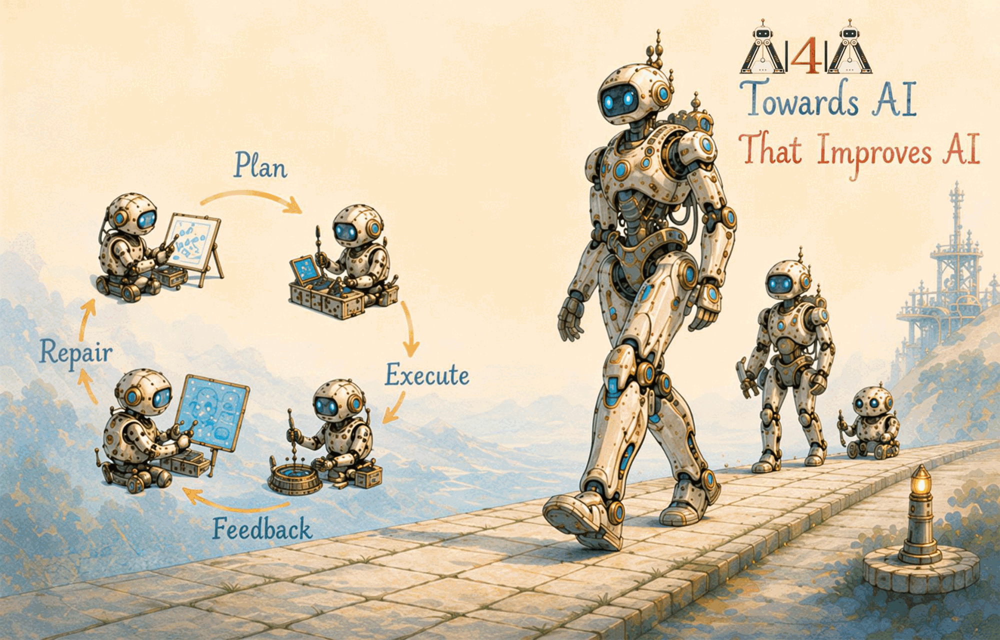
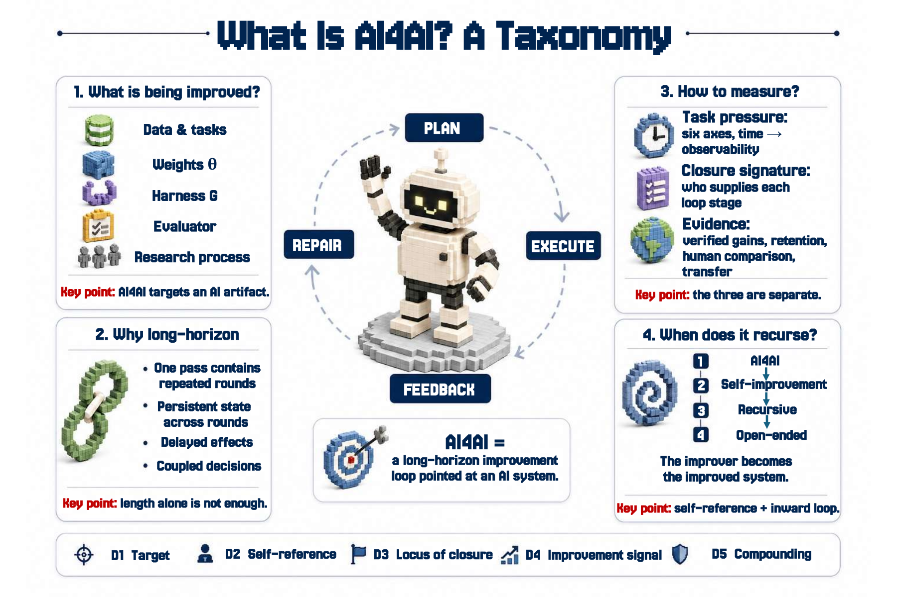
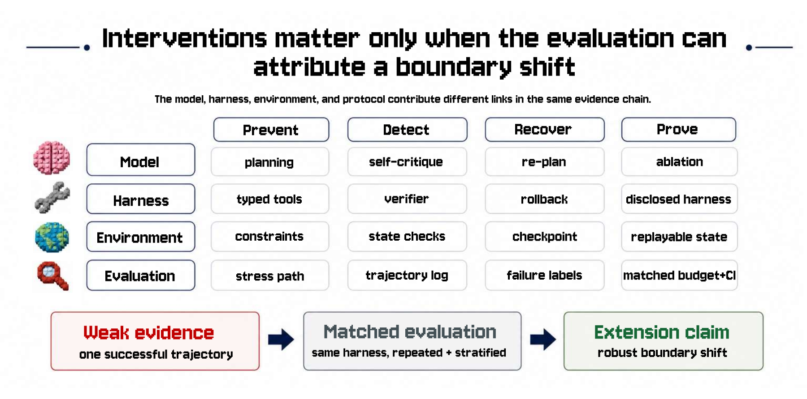
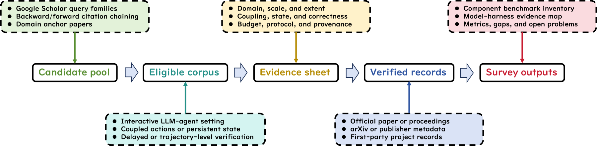

<div align="center">

<p>
  
</p>

<h1>🚀 Awesome AI4AI</h1>

<h3>🔄 Updated weekly — until humanity achieves AI4AI.</h3>

<p><strong>Follow the journey: <a href="https://github.com/KaiWU5/Awesome-AI4AI">Star ⭐</a> · <a href="https://github.com/KaiWU5/Awesome-AI4AI/subscription">Watch 👀 for weekly updates</a> · <a href="#weekly-news">Read this week's picks →</a></strong></p>

<p><strong><em>AI4AI Survey: From Long-Horizon Agents to Recursive Self-Improvement</em></strong><br>
<sub>Definitions, Reliable Horizons, and Open Problems · 23 authors · 7 institutions</sub></p>

<p>
  Top AI-for-AI papers, releases, and blogs — curated every week. <strong>Stay tuned 🔥</strong>
</p>

<p><strong>Living catalog: 2461 papers</strong> · 1065 benchmarks · 1477 harness studies · 686 model studies<br><sub>Collections overlap. The original survey covers 223 papers.</sub></p>

<p>
  <a href="assets/AI4AI-Survey.pdf"></a>
  <a href="https://www.preprints.org/manuscript/202608.2108/v1"></a>
  <a href="https://kaiwu5.github.io/Awesome-AI4AI/"></a>
  <a href="https://github.com/simple-agent-lab/RSIHub"></a>
  <a href="https://simpleagentlab.com/ai4ai/"></a>
  <a href="https://doi.org/10.20944/preprints202608.2108.v1"></a>
</p>

</div>

<br>

## Why This Repo

<table>
<tr>
<td width="33%" align="center">
  <strong>🔄 Refreshed rankings</strong><br>
  <sub>Citations, GitHub stars, and rankings refresh with maintainer updates.</sub>
</td>
<td width="33%" align="center">
  <strong>🗞️ Weekly update</strong><br>
  <sub>New papers added to the catalog, plus source-verified papers and releases selected every week.</sub>
</td>
<td width="33%" align="center">
  <strong>🧭 Survey-grounded map</strong><br>
  <sub>From long-horizon agents to recursive self-improvement.</sub>
</td>
</tr>
</table>

<p align="center">
  <strong>Star ⭐ to save the map · Watch 👀 for weekly updates · Share 🔁 with your lab</strong>
</p>

## What's New

- 📚 **2026-11-28 — 461 papers added.** Expanded Benchmarks, Harness Design, and Model Design with verified new and previously missed papers; rebuilt the full catalog and both ranking families.
- 🚀 **2026-11-28 — Latest weekly edition published.** Read the source-verified news digest below.
- 🤝 **2026-10-26 — Community contributions integrated.** Added ReCreate, Meta-Team, Agon, EvoRepair, and Harness Engineering for Language Agents to Harness Design, and PerspectiveGap to Benchmarks. Related Lists now links to three complementary community resources.
- 📄 **2026-08-30 — [Companion survey now online.](https://www.preprints.org/manuscript/202608.2108/v1)** Read *AI4AI Survey: From Long-Horizon Agents to Recursive Self-Improvement—Definitions, Reliable Horizons, and Open Problems*.
- 🔄 **Maintainer refresh.** Citations, GitHub stars, and recent-paper/yearly rankings are rebuilt from the catalog.

<details open markdown="1">
<summary><b>🗂️ Explore the full collection</b></summary>

- [📅 Weekly News · Top 10](#weekly-news)
- [📈 Live Rankings](#-live-rankings)
  - [Top Ranking Papers by Average Monthly Citations](#top-ranking-papers-by-average-monthly-citations)
  - [🏆 Most-Cited Papers by Year](#-most-cited-papers-by-year)
- [🧪 Benchmarks](#-benchmarks)
- [🛠️ Harness Design](#-harness-design)
- [🧠 Model Design](#-model-design)
- [📚 How We Curate](#-how-we-curate)
- [🔗 Related Lists](#-related-lists)
- [📄 Citation](#-citation)
- [🤝 Contributing](#-contributing)

</details>

<br>

<a id="monthly-news"></a>
<a id="weekly-news"></a>

## 📅 Weekly News · Top 10

> **Updated 2026-11-28** · Weekly news picks, refreshed every Monday alongside citation rankings.
>
> **How we select:** The top stories from the trailing 30 days, scored on publisher authority, discussion volume, whether a concrete verifiable result is reported, whether it changes what agent builders do now, whether an artifact was released, and expected durability. Only primary sources are cited, and performance claims remain attributed to their publishers.

| Date · Type | News | Why it matters |
|:--|:--|:--|
| 2026‑11‑25<br><sub>Paper</sub> | [**RoboEvo2: Recursive Robot Self-Improvement via Harness–Policy Co-Evolution**](https://arxiv.org/abs/2611.34675)<br><sub>Liu et al. · arXiv</sub> | The authors couple harness search with policy distillation, raising hybrid success from 30.4% to 90.5% on LIBERO-PRO without additional human demonstrations. On a real robot, the hybrid reaches 95% after training on 120 simulation-evolved demonstrations; the results do not imply data-free or unrestricted self-improvement. |
| 2026‑11‑25<br><sub>Paper</sub> | [**TransHarness: From Benchmark Overfitting to Transferable Harness Evolution**](https://arxiv.org/abs/2611.33757)<br><sub>Xia et al. · arXiv</sub> | The authors evolve reusable harness policies from 300 out-of-test-distribution trajectories and transfer them across tasks. With GPT-6 Astra, they report 76.4% on DeepSWE v1.1 and 95.5% on Terminal-Bench 2.1, gains of 2.4 and 5.6 points over strong baselines; mature harnesses still win on some settings. |
| 2026‑11‑23<br><sub>Model release</sub> | [**GLM-5.4: Toward Generalized Coding with Our First Loop Transformer**](https://z.ai/blog/glm-5.4?lang=en)<br><sub>Z.ai</sub> | Z.ai introduces a 750B flagship that loops 28 shared layers twice, with per-token update gates and reused attention caches. Its controlled 30B ablation reports gains with about 10% extra training compute and 10–14% fewer output tokens. Chat and coding products launch first; API access and open weights remain planned. |
| 2026‑11‑23<br><sub>Paper</sub> | [**ComputeWise: Measuring and Fixing GPU Waste by AI Research Agents**](https://arxiv.org/abs/2611.31027)<br><sub>Pakhomov et al. · arXiv</sub> | The authors replay recorded training runs in a simulated-GPU benchmark, finding that only 52% of agent GPU time serves necessary work. Validating experiment plans removes over 80% of excess time-to-answer across five models. This measures avoidable workflow overhead in replay, rather than an 80% reduction in total real-world training cost. |
| 2026‑11‑22<br><sub>Paper</sub> | [**Weight Coding: Evolving Web-Scale Recommenders through Direct Weight Edits with LLM Agents**](https://arxiv.org/abs/2611.29613)<br><sub>Hou et al. · arXiv</sub> | The authors let agents inspect and directly edit retrieval-model weights without backpropagation. On a 147M-parameter image-search model, they report up to 15 points more recall@10 using about one quarter of full fine-tuning GPU hours; production A/B tests show 8.4–10.7% more saves per user from the edited retrieval source. |
| 2026‑11‑20<br><sub>Paper</sub> | [**Language Model Harnesses can be Compositional Generalizers**](https://arxiv.org/abs/2611.28298)<br><sub>Zhang et al. · arXiv</sub> | The authors train recursive harnesses on shorter and synthetic surrogate tasks, reporting generalization to tasks 2–64 times longer. In the same harness, RLM-27B raises an eight-task average from 46.1 to 58.5 with about half as many inference tokens; this does not establish lower wall-clock or training cost. |
| 2026‑11‑18<br><sub>Model release</sub> | [**Introducing Gemini 4 Neon**](https://blog.google/innovation-and-ai/models-and-research/gemini-models/introducing-gemini-4-neon/)<br><sub>Google DeepMind</sub> | Google reports 65.2% on Terminal-Bench 4.1, 75.8% on Agents’ Last Exam 1.1 and 70.5% on Terminal-Bench-Science. On SWE-sweep, it reports 12.8% with mini-SWE-agent versus 39% with Antigravity, underscoring the influence of the harness. The November 23 page update does not reset its November 18 launch date. |
| 2026‑11‑17<br><sub>Model release</sub> | [**Introducing GPT-6.2 Astra and Sol**](https://openai.com/index/introducing-gpt-6-2-astra-sol/)<br><sub>OpenAI</sub> | OpenAI releases its new frontier and efficient models in ChatGPT Work, Codex and the API. It reports Astra gains of 5.2 points on Agents’ Last Exam and 9 points on Terminal-Bench-Science versus GPT-6 Astra, at less than one third of the benchmark task cost. |
| 2026‑11‑16<br><sub>Model release</sub> | [**Qwen4-Max: Your new teammate has arrived**](https://www.alibabacloud.com/en/press-room/alibaba-unveils-qwen4-max)<br><sub>Alibaba / Qwen</sub> | Alibaba releases its 2.4T-parameter multimodal flagship with a 1M-token context window. On its proprietary Work360 benchmark, Alibaba reports 35% fewer tokens and about 60% lower cost per task than Qwen3.8-Max at High effort. |
| 2026‑11‑09<br><sub>Model release</sub> | [**Introducing Claude Fable 5.2 and Claude Mythos 5.2**](https://www.anthropic.com/claude-fable-and-mythos-5-2)<br><sub>Anthropic</sub> | Anthropic reports 49.1% on FrontierCode 2.0 and 74.6% on Terminal-Bench-Science for Fable 5.2, plus a 30-hour formalization of Fermat’s Last Theorem. Fable is broadly available with cyber/bio safeguards; Mythos, the same underlying model with different safeguards, requires verified access. |

> **Want next week's news?** Watch the repository. Citation counts, rankings, and the weekly news picks are published with maintainer updates. [Browse past editions →](highlights/README.md)

## 📈 Live Rankings

> Last complete citation snapshot: **2026-10-17**, using Semantic Scholar and OpenAlex. Rankings are discovery aids, not quality scores; audit evidence remains independent of popularity. Last complete GitHub stars snapshot: **2026-11-08**. For papers indexed as multiple versions, retain the largest title-verified count reported by the configured sources. All yearly rankings use first public appearance year; a later venue year never moves a paper into a newer cohort.

> **Latest metric check: 2026-11-28.** Title-verified citations for 2458/2477 catalog records; 15 records retain prior verified counts and 4 records remain without a verified index count. GitHub stars refreshed for 609 records across 603 repositories. 4 configured GitHub repositories could not be refreshed; previous star counts are retained. Complete snapshot dates advance only when every relevant record is verified.

### Top Ranking Papers by Average Monthly Citations

| Paper | Venue | Date | Citations | Avg. cites/month | Code |
|:--|:--:|:--:|:--:|:--:|:--:|
| [**Kimi K3: Open Frontier Intelligence**](https://arxiv.org/abs/2607.24653) | arXiv | 2026-07 | 550 | **183.3** | [GitHub](https://github.com/MoonshotAI/Kimi-K3) · ★ 9,137 |
| [**AlphaEvolve: A coding agent for scientific and algorithmic discovery**](https://arxiv.org/abs/2506.13131) | arXiv | 2025-06 | 1753 | **109.6** | — |
| [**Terminal-Bench: Benchmarking Agents on Hard, Realistic Tasks in Command Line Interfaces**](https://arxiv.org/abs/2601.11868) | arXiv | 2026-01 | 777 | **86.3** | [GitHub](https://github.com/harbor-framework/terminal-bench-1) · ★ 2,628 |
| [**Towards End-to-End Automation of AI Research**](https://doi.org/10.1038/s41586-026-10265-5) | Nature 2026 | 2026-03 | 586 | **83.7** | [GitHub](https://github.com/SakanaAI/AI-Scientist-v2) · ★ 7,564 |
| [**Mem0: Building Production-Ready AI Agents with Scalable Long-Term Memory**](https://doi.org/10.3233/faia251160) | European Conference on Artificial Intelligence (ECAI) | 2025-04 | 1402 | **77.9** | [GitHub](https://github.com/mem0ai/mem0) · ★ 69,565 |
| [**Meta-Harness: End-to-End Optimization of Model Harnesses**](https://arxiv.org/abs/2603.28052) | arXiv | 2026-03 | 464 | **66.3** | [GitHub](https://github.com/stanford-iris-lab/meta-harness-tbench2-artifact) · ★ 1,260 |
| [**Agentic Context Engineering: Evolving Contexts for Self-Improving Language Models**](https://arxiv.org/abs/2510.04618) | arXiv | 2025-10 | 675 | **56.2** | [GitHub](https://github.com/ace-agent/ace) · ★ 1,475 |
| [**The Berkeley Function Calling Leaderboard (BFCL): From tool use to agentic evaluation of large language models**](https://proceedings.mlr.press/v267/patil25a.html) | Proceedings of the 42nd International Conference on Machine Learning | 2025 | 888 | **55.5** | [GitHub](https://github.com/ShishirPatil/gorilla) · ★ 13,090 |
| [**RRSI: Regularized Recursive Self-Improvement of Agent Harnesses**](https://arxiv.org/abs/2609.24972) | arXiv | 2026-09 | 54 | **54.0** | [GitHub](https://github.com/google-research/rrsi) · ★ 1,838 |
| [**Memory in the Age of AI Agents**](https://arxiv.org/abs/2512.13564) | arXiv preprint arXiv:2512.13564 | 2025-12 | 446 | **44.6** | — |

### 🏆 Most-Cited Papers by Year

<details open markdown="1">
<summary><b>Top 12 of 2026</b> by citations</summary>

| Paper | Date | Citations | Code |
|:--|:--:|:--:|:--:|
| [**Terminal-Bench: Benchmarking Agents on Hard, Realistic Tasks in Command Line Interfaces**](https://arxiv.org/abs/2601.11868) | 2026-01 | 777 | [GitHub](https://github.com/harbor-framework/terminal-bench-1) · ★ 2,628 |
| [**Towards End-to-End Automation of AI Research**](https://doi.org/10.1038/s41586-026-10265-5)<br><sub>Nature 2026</sub> | 2026-03 | 586 | [GitHub](https://github.com/SakanaAI/AI-Scientist-v2) · ★ 7,564 |
| [**Kimi K3: Open Frontier Intelligence**](https://arxiv.org/abs/2607.24653) | 2026-07 | 550 | [GitHub](https://github.com/MoonshotAI/Kimi-K3) · ★ 9,137 |
| [**Meta-Harness: End-to-End Optimization of Model Harnesses**](https://arxiv.org/abs/2603.28052) | 2026-03 | 464 | [GitHub](https://github.com/stanford-iris-lab/meta-harness-tbench2-artifact) · ★ 1,260 |
| [**Self-Harness: Harnesses That Improve Themselves**](https://arxiv.org/abs/2606.09498) | 2026-06 | 160 | [GitHub](https://github.com/qzzqzzb/Self-Harness) · ★ 149 |
| [**Externalization in LLM Agents: A Unified Review of Memory, Skills, Protocols and Harness Engineering**](https://arxiv.org/abs/2604.08224) | 2026-04 | 132 | — |
| [**DeepSWE: Measuring Frontier Coding Agents on Original, Long-Horizon Engineering Tasks**](https://arxiv.org/abs/2607.07946) | 2026-07 | 127 | [GitHub](https://github.com/datacurve-ai/deep-swe) · ★ 1,931 |
| [**PostTrainBench: Can LLM Agents Automate LLM Post-Training?**](https://arxiv.org/abs/2603.08640) | 2026-03 | 122 | [GitHub](https://github.com/aisa-group/PostTrainBench) · ★ 630 |
| [**ProgramBench: Can Language Models Rebuild Programs From Scratch?**](https://arxiv.org/abs/2605.03546) | 2026-05 | 115 | [GitHub](https://github.com/facebookresearch/ProgramBench) · ★ 988 |
| [**Code as Agent Harness**](https://arxiv.org/abs/2605.18747) | 2026-05 | 111 | [GitHub](https://github.com/YennNing/Awesome-Code-as-Agent-Harness-Papers) · ★ 785 |
| [**SkillOS: Learning Skill Curation for Self-Evolving Agents**](https://arxiv.org/abs/2605.06614) | 2026-05 | 99 | — |
| [**OSWorld 2.0: Benchmarking Computer Use Agents on Long-Horizon Real-World Tasks**](https://arxiv.org/abs/2606.29537) | 2026-06 | 97 | [GitHub](https://github.com/xlang-ai/OSWorld-V2) · ★ 440 |

</details>

<details markdown="1">
<summary><b>Top 12 of 2025</b> by citations</summary>

| Paper | Date | Citations | Code |
|:--|:--:|:--:|:--:|
| [**A-MEM: Agentic Memory for LLM Agents**](https://arxiv.org/abs/2502.12110)<br><sub>Advances in Neural Information Processing Systems</sub> | 2025-02 | 1763 | [GitHub](https://github.com/WujiangXu/A-mem) · ★ 1,019 |
| [**AlphaEvolve: A coding agent for scientific and algorithmic discovery**](https://arxiv.org/abs/2506.13131) | 2025-06 | 1753 | — |
| [**Mem0: Building Production-Ready AI Agents with Scalable Long-Term Memory**](https://doi.org/10.3233/faia251160)<br><sub>European Conference on Artificial Intelligence (ECAI)</sub> | 2025-04 | 1402 | [GitHub](https://github.com/mem0ai/mem0) · ★ 69,565 |
| [**Why Do Multi-Agent LLM Systems Fail?**](https://proceedings.neurips.cc/paper_files/paper/2025/hash/b1041e52d3be19f0a9bc491657488e4a-Abstract-Datasets_and_Benchmarks_Track.html)<br><sub>Advances in Neural Information Processing Systems</sub> | 2025-03 | 916 | [GitHub](https://github.com/multi-agent-systems-failure-taxonomy/MAST) · ★ 443 |
| [**The Berkeley Function Calling Leaderboard (BFCL): From tool use to agentic evaluation of large language models**](https://proceedings.mlr.press/v267/patil25a.html)<br><sub>Proceedings of the 42nd International Conference on Machine Learning</sub> | 2025 | 888 | [GitHub](https://github.com/ShishirPatil/gorilla) · ★ 13,090 |
| [**Group-in-Group Policy Optimization for LLM Agent Training**](https://arxiv.org/abs/2505.10978)<br><sub>Advances in Neural Information Processing Systems</sub> | 2025-05 | 701 | [GitHub](https://github.com/langfengQ/verl-agent) · ★ 2,461 |
| [**LLMs Get Lost In Multi-Turn Conversation**](https://arxiv.org/abs/2505.06120)<br><sub>International Conference on Learning Representations</sub> | 2025-05 | 696 | [GitHub](https://github.com/microsoft/lost_in_conversation) · ★ 311 |
| [**Agentic Context Engineering: Evolving Contexts for Self-Improving Language Models**](https://arxiv.org/abs/2510.04618) | 2025-10 | 675 | [GitHub](https://github.com/ace-agent/ace) · ★ 1,475 |
| [**SWE-Bench Pro: Can AI Agents Solve Long-Horizon Software Engineering Tasks?**](https://arxiv.org/abs/2509.16941) | 2025-09 | 569 | [GitHub](https://github.com/scaleapi/SWE-bench_Pro-os) · ★ 574 |
| [**Darwin Godel Machine: Open-ended evolution of self-improving agents**](https://openreview.net/forum?id=pUpzQZTvGY) | 2025-05 | 539 | [GitHub](https://github.com/jennyzzt/dgm) · ★ 2,550 |
| [**Memory in the Age of AI Agents**](https://arxiv.org/abs/2512.13564) | 2025-12 | 446 | — |
| [**PaperBench: Evaluating AI's ability to replicate AI research**](https://arxiv.org/abs/2504.01848) | 2025-04 | 412 | [GitHub](https://github.com/openai/frontier-evals) · ★ 1,348 |

</details>

<details markdown="1">
<summary><b>Top 12 of 2024</b> by citations</summary>

| Paper | Date | Citations | Code |
|:--|:--:|:--:|:--:|
| [**OSWorld: Benchmarking Multimodal Agents for Open-Ended Tasks in Real Computer Environments**](https://arxiv.org/abs/2404.07972)<br><sub>NeurIPS 2024</sub> | 2024-04 | 2053 | [GitHub](https://github.com/xlang-ai/OSWorld) · ★ 3,279 |
| [**τ-bench: A Benchmark for Tool-Agent-User Interaction in Real-World Domains**](https://arxiv.org/abs/2406.12045) | 2024-06 | 1844 | [GitHub](https://github.com/sierra-research/tau-bench) · ★ 1,518 |
| [**Self-rewarding language models**](https://proceedings.mlr.press/v235/yuan24d.html) | 2024-01 | 1280 | — |
| [**HippoRAG: Neurobiologically Inspired Long-Term Memory for Large Language Models**](https://arxiv.org/abs/2405.14831)<br><sub>Advances in Neural Information Processing Systems</sub> | 2024-05 | 1231 | [GitHub](https://github.com/OSU-NLP-Group/HippoRAG) · ★ 4,146 |
| [**Demystifying LLM-Based Software Engineering Agents**](https://doi.org/10.1145/3715754)<br><sub>Proceedings of the ACM on Software Engineering</sub> | 2024-07 | 1119 | [GitHub](https://github.com/OpenAutoCoder/Agentless) · ★ 2,141 |
| [**VisualWebArena: Evaluating Multimodal Agents on Realistic Visual Web Tasks**](https://arxiv.org/abs/2401.13649)<br><sub>Proceedings of the 62nd Annual Meeting of the Association for Computational Linguistics (Volume 1: Long Papers)</sub> | 2024-01 | 955 | [GitHub](https://github.com/web-arena-x/visualwebarena) · ★ 490 |
| [**WebVoyager: Building an End-to-End Web Agent with Large Multimodal Models**](https://arxiv.org/abs/2401.13919)<br><sub>Proceedings of the 62nd Annual Meeting of the Association for Computational Linguistics (Volume 1: Long Papers)</sub> | 2024-01 | 909 | [GitHub](https://github.com/MinorJerry/WebVoyager) · ★ 1,129 |
| [**Automated design of agentic systems**](https://arxiv.org/abs/2408.08435)<br><sub>ICLR 2025</sub> | 2024-08 | 873 | [GitHub](https://github.com/ShengranHu/ADAS) · ★ 1,671 |
| [**MLE-bench: Evaluating machine learning agents on machine learning engineering**](https://arxiv.org/abs/2410.07095)<br><sub>ICLR 2025</sub> | 2024-10 | 752 | [GitHub](https://github.com/openai/mle-bench) · ★ 1,807 |
| [**AndroidWorld: A Dynamic Benchmarking Environment for Autonomous Agents**](https://arxiv.org/abs/2405.14573)<br><sub>International Conference on Learning Representations</sub> | 2024-05 | 750 | [GitHub](https://github.com/google-research/android_world) · ★ 1,030 |
| [**AppWorld: A Controllable World of Apps and People for Benchmarking Interactive Coding Agents**](https://arxiv.org/abs/2407.18901)<br><sub>ACL 2024</sub> | 2024-07 | 677 | [GitHub](https://github.com/StonyBrookNLP/appworld) · ★ 561 |
| [**TravelPlanner: A Benchmark for Real-World Planning with Language Agents**](https://arxiv.org/abs/2402.01622)<br><sub>International Conference on Machine Learning</sub> | 2024-02 | 606 | [GitHub](https://github.com/OSU-NLP-Group/TravelPlanner) · ★ 575 |

</details>

<details markdown="1">
<summary><b>Top 12 of 2023</b> by citations</summary>

| Paper | Date | Citations | Code |
|:--|:--:|:--:|:--:|
| [**Reflexion: language agents with verbal reinforcement learning**](https://arxiv.org/abs/2303.11366)<br><sub>NeurIPS 2023</sub> | 2023-03 | 10200 | [GitHub](https://github.com/noahshinn/reflexion) · ★ 3,449 |
| [**Tree of Thoughts: Deliberate Problem Solving with Large Language Models**](https://arxiv.org/abs/2305.10601)<br><sub>Advances in Neural Information Processing Systems</sub> | 2023-05 | 8803 | [GitHub](https://github.com/princeton-nlp/tree-of-thought-llm) · ★ 6,087 |
| [**Generative Agents: Interactive Simulacra of Human Behavior**](https://arxiv.org/abs/2304.03442)<br><sub>Proceedings of the 36th annual acm symposium on user interface software and technology</sub> | 2023-04 | 8713 | [GitHub](https://github.com/joonspk-research/generative_agents) · ★ 22,428 |
| [**Toolformer: Language Models Can Teach Themselves to Use Tools**](https://arxiv.org/abs/2302.04761)<br><sub>Advances in Neural Information Processing Systems</sub> | 2023-02 | 8406 | — |
| [**Self-Refine: Iterative refinement with self-feedback**](https://arxiv.org/abs/2303.17651)<br><sub>NeurIPS 2023</sub> | 2023-03 | 7188 | [GitHub](https://github.com/madaan/self-refine) · ★ 856 |
| [**SWE-bench: Can Language Models Resolve Real-World GitHub Issues?**](https://arxiv.org/abs/2310.06770)<br><sub>ICLR 2024</sub> | 2023-10 | 5058 | [GitHub](https://github.com/SWE-bench/SWE-bench) · ★ 6,259 |
| [**Voyager: An Open-Ended Embodied Agent with Large Language Models**](https://arxiv.org/abs/2305.16291)<br><sub>Transactions on Machine Learning Research</sub> | 2023-05 | 4317 | [GitHub](https://github.com/MineDojo/Voyager) · ★ 7,347 |
| [**AgentBench: Evaluating LLMs as Agents**](https://arxiv.org/abs/2308.03688)<br><sub>International Conference on Learning Representations</sub> | 2023-08 | 3075 | [GitHub](https://github.com/THUDM/AgentBench) · ★ 3,834 |
| [**MemGPT: Towards LLMs as Operating Systems**](https://arxiv.org/abs/2310.08560) | 2023-10 | 2880 | [GitHub](https://github.com/letta-ai/letta) · ★ 25,571 |
| [**ToolLLM: Facilitating Large Language Models to Master 16000+ Real-world APIs**](https://arxiv.org/abs/2307.16789)<br><sub>International Conference on Learning Representations</sub> | 2023-07 | 2814 | [GitHub](https://github.com/OpenBMB/ToolBench) · ★ 5,775 |
| [**WebArena: A Realistic Web Environment for Building Autonomous Agents**](https://arxiv.org/abs/2307.13854)<br><sub>ICLR 2024</sub> | 2023-07 | 2566 | [GitHub](https://github.com/web-arena-x/webarena) · ★ 1,647 |
| [**Gorilla: Large Language Model Connected with Massive APIs**](https://arxiv.org/abs/2305.15334)<br><sub>Advances in Neural Information Processing Systems</sub> | 2023-05 | 2208 | [GitHub](https://github.com/ShishirPatil/gorilla) · ★ 13,090 |

</details>


## 🧪 Benchmarks

<p align="center">
  
</p>

> **1065 papers** · Survey-curated collection, newest first. Cross-collection papers may appear in more than one section.

**[Browse all 1065 papers →](catalog/benchmarks.md)** · Latest 20 shown below.

| Paper | Date | Citations | Code |
|:--|:--:|:--:|:--:|
| [**REE: A Scientific Research Entrance Exam for AI Agents**](https://arxiv.org/abs/2611.34646) | 2026-11 | 0 | [GitHub](https://github.com/TokenWave-AI/REE) · ★ 0 |
| [**EgoUseBench: Benchmarking Computer-Use Agents under Evolving First-Person Contexts**](https://arxiv.org/abs/2611.34466) | 2026-11 | 0 | — |
| [**EvoLink-Bench: A Benchmark for Evaluating Self-Evolving Agents in Long-Horizon Interdependent Task Streams**](https://arxiv.org/abs/2611.34400) | 2026-11 | 0 | — |
| [**Crucible: Evaluating LLM Agents in Executable Chemistry Research Environments**](https://arxiv.org/abs/2611.34254) | 2026-11 | 0 | — |
| [**MedSkill-E$^{2}$: Evaluating and Evolving Skills for Medical Agents**](https://arxiv.org/abs/2611.34250) | 2026-11 | 0 | — |
| [**PROVE: Mitigating Long-Horizon LLM Collusion with Reinforcement Learning from Verified Evidence**](https://arxiv.org/abs/2611.34215) | 2026-11 | 0 | [GitHub](https://github.com/Haochen-Luo/PROVE) · ★ 2 |
| [**Budget, Readout or Reasoning? Where Small Reasoning Models Lose Value in Auction Bidding**](https://arxiv.org/abs/2611.34068) | 2026-11 | 0 | [GitHub](https://github.com/DataismLab/bid-reasoning) · ★ 0 |
| [**Keep or Roll Back? Out-of-Loop Judges for Self-Improving VLA and End-to-End Embodied Policies**](https://arxiv.org/abs/2611.33794) | 2026-11 | 0 | [GitHub](https://github.com/zilin-huang/SealedLoop) · ★ 1 |
| [**Asset4D-Bench: Benchmarking Coding Agents for Editable 3D and 4D Reconstruction**](https://arxiv.org/abs/2611.33728) | 2026-11 | 0 | — |
| [**Interactive Proofs as a Unified Framework for Evaluating and Leveraging Verifiable Proof Generation by LLM Agents**](https://arxiv.org/abs/2611.33676) | 2026-11 | 0 | — |
| [**$\mu$-Bench: Benchmarking Multi-User Task Completion in Shared Interaction Voice Agents**](https://arxiv.org/abs/2611.34920) | 2026-11 | 0 | — |
| [**How Much Do Coding Agents Over-Edit, and Why? An Empirical Study of Unneeded Edits in Repository-Level Agent Patches**](https://arxiv.org/abs/2611.34875) | 2026-11 | 0 | — |
| [**DRBench Pro: A Knowledge-Centric Benchmark for Professional Deep Research Agents**](https://arxiv.org/abs/2611.34852) | 2026-11 | 0 | [GitHub](https://github.com/ZJU-REAL/DRBenchPro) · ★ 22 |
| [**Solve Vision with Code: Coding Agents Are Stronger Visual Reasoners Than Video Models**](https://arxiv.org/abs/2611.34813) | 2026-11 | 0 | — |
| [**How Well Do Vision-Language Scene Graphs Serve as Memory for Embodied Question Answering?**](https://arxiv.org/abs/2611.34745) | 2026-11 | 0 | — |
| [**VisualMontage: Manipulating the Beliefs of Vision-Language Agents with Authentic Image Sequences**](https://arxiv.org/abs/2611.34603) | 2026-11 | 0 | — |
| [**Recalling the Past to Answer the Present: Context-Aware Multi-Evidence Reasoning for Streaming Video Question Answering**](https://arxiv.org/abs/2611.34545) | 2026-11 | 0 | — |
| [**LUDIUS: A Benchmark for Embodied Social Intelligence in Everyday Human-Robot Interactions**](https://arxiv.org/abs/2611.34328) | 2026-11 | 0 | — |
| [**Latent-in-the-Middle: On the Security of Cross-Model Latent Communication in Multi-Agent Systems**](https://arxiv.org/abs/2611.34278) | 2026-11 | 0 | — |
| [**Agentic-Level Adversarial Purification: Revisiting Diffusion Purifiers on Native-Resolution Agentic Inputs**](https://arxiv.org/abs/2611.34181) | 2026-11 | 0 | — |

## 🛠️ Harness Design

<p align="center">
  
</p>

> **1477 papers** · Survey-curated collection, newest first. Cross-collection papers may appear in more than one section.

**[Browse all 1477 papers →](catalog/harness-design.md)** · Latest 20 shown below.

| Paper | Date | Citations | Code |
|:--|:--:|:--:|:--:|
| [**TASK Memory: Beyond Text-Only Memory with Activation Steering and Knowledge Editing against Memory Hallucination**](https://arxiv.org/abs/2611.34762) | 2026-11 | 0 | — |
| [**HoMe: Toward Practical Harness Optimization of Memory Systems for AI Assistants**](https://arxiv.org/abs/2611.34624) | 2026-11 | 0 | [GitHub](https://github.com/agentscope-ai/ReMe) · ★ 3,860 |
| [**Procedure Inference as Memory: Learning Recruiter Decision Procedures from OKF-Structured Episodes in Multi-Session Hiring Assistants**](https://arxiv.org/abs/2611.34576) | 2026-11 | 0 | — |
| [**vSFT: Learning to Verbally Tune Agents at Test Time**](https://arxiv.org/abs/2611.34440) | 2026-11 | 0 | — |
| [**Agentic Waterfall: An Intent-Driven Information Discovery Framework for Reclaiming User Control in the Attention Economy**](https://arxiv.org/abs/2611.34407) | 2026-11 | 0 | — |
| [**MeterRouter: Budget-Aware Dynamic Routing for Multi-Agent Systems**](https://arxiv.org/abs/2611.34327) | 2026-11 | 0 | — |
| [**MedSkill-E$^{2}$: Evaluating and Evolving Skills for Medical Agents**](https://arxiv.org/abs/2611.34250) | 2026-11 | 0 | — |
| [**Navigent: A Geometry-Grounded Agentic Framework for Vision Language Navigation**](https://arxiv.org/abs/2611.34249) | 2026-11 | 0 | [GitHub](https://github.com/MarsLab-Navigent/Navigent) · ★ 8 |
| [**Not Every Input Needs Everything: Unifying Expert Gating, Model Cascades, and Agent Orchestration**](https://arxiv.org/abs/2611.34112) | 2026-11 | 0 | — |
| [**Few-Shot Adaptation of Vision-Language Models via Agentic Model Editing**](https://arxiv.org/abs/2611.34036) | 2026-11 | 0 | — |
| [**PatternMiner: Automated Mathematical Discovery Through LLM-Guided Training and Interpretation of Small Models**](https://arxiv.org/abs/2611.33966) | 2026-11 | 0 | [GitHub](https://github.com/uw-math-ai/PatternMiner) · ★ 1 |
| [**EGSE: Evidence-Grounded Skill Evolution for Medical Reasoning Agents**](https://arxiv.org/abs/2611.33909) | 2026-11 | 0 | — |
| [**MetaDecomp: Adaptive Task Decomposition via Meta-Learned Procedural Memory**](https://arxiv.org/abs/2611.33822) | 2026-11 | 0 | — |
| [**TransHarness: From Benchmark Overfitting to Transferable Harness Evolution**](https://arxiv.org/abs/2611.33757) | 2026-11 | 0 | — |
| [**EVA: Evidence-seeking Visual Agent for Hallucination-Resistant Multimodal Reasoning**](https://arxiv.org/abs/2611.33706) | 2026-11 | 0 | — |
| [**Interactive Proofs as a Unified Framework for Evaluating and Leveraging Verifiable Proof Generation by LLM Agents**](https://arxiv.org/abs/2611.33676) | 2026-11 | 0 | — |
| [**SlicePlanner: Logic-Guided Agentic AI for Online QoS-Aware Network Slicing in Open RAN**](https://arxiv.org/abs/2611.33664) | 2026-11 | 0 | — |
| [**FIG-MAC: A Fine-grained Inspiration Graph Empowered Multi-Agent Collaboration for Automated Scientific Hypothesis Generation**](https://arxiv.org/abs/2611.33563) | 2026-11 | 0 | — |
| [**Solve Vision with Code: Coding Agents Are Stronger Visual Reasoners Than Video Models**](https://arxiv.org/abs/2611.34813) | 2026-11 | 0 | — |
| [**RoboEvo$^2$: Recursive Robot Self-Improvement via Harness-Policy Co-Evolution**](https://arxiv.org/abs/2611.34675) | 2026-11 | 0 | [GitHub](https://github.com/kaiknower/RoboEvo2) · ★ 5 |

## 🧠 Model Design

<p align="center">
  
</p>

> **686 papers** · Survey-curated collection, newest first. Cross-collection papers may appear in more than one section.

**[Browse all 686 papers →](catalog/model-design.md)** · Latest 20 shown below.

| Paper | Date | Citations | Code |
|:--|:--:|:--:|:--:|
| [**TASK Memory: Beyond Text-Only Memory with Activation Steering and Knowledge Editing against Memory Hallucination**](https://arxiv.org/abs/2611.34762) | 2026-11 | 0 | — |
| [**A Failure-Driven Data Flywheel for Post-Training Vision-Language-Action Models**](https://arxiv.org/abs/2611.34698) | 2026-11 | 0 | — |
| [**ZeroHero: Training Small Language Agents from Scratch**](https://arxiv.org/abs/2611.34635) | 2026-11 | 0 | [Project](https://zoyav.github.io/-ZoyaV-zerohero-demo) |
| [**vSFT: Learning to Verbally Tune Agents at Test Time**](https://arxiv.org/abs/2611.34440) | 2026-11 | 0 | — |
| [**EXPOSURE: Explaining Sources of Uncertainty in Reinforcement Learning**](https://arxiv.org/abs/2611.34248) | 2026-11 | 0 | [GitHub](https://github.com/kianaf/exposure-rl) · ★ 0 |
| [**PROVE: Mitigating Long-Horizon LLM Collusion with Reinforcement Learning from Verified Evidence**](https://arxiv.org/abs/2611.34215) | 2026-11 | 0 | [GitHub](https://github.com/Haochen-Luo/PROVE) · ★ 2 |
| [**Few-Shot Adaptation of Vision-Language Models via Agentic Model Editing**](https://arxiv.org/abs/2611.34036) | 2026-11 | 0 | — |
| [**EATS: Scaling Tool-Use Experience for Medical Reasoning Agents**](https://arxiv.org/abs/2611.33897) | 2026-11 | 0 | [GitHub](https://github.com/Limingyuan001/EATS) · ★ 0 |
| [**Diverse Alternative Reasoning Traces for Hard Math Problems**](https://arxiv.org/abs/2611.34928) | 2026-11 | 0 | — |
| [**RePace: Reasoning about Demonstration Speedup for Faster Vision-Language-Action Policies**](https://arxiv.org/abs/2611.34864) | 2026-11 | 0 | — |
| [**Repairing the Trustworthiness of Distilled Language Models**](https://arxiv.org/abs/2611.34831) | 2026-11 | 0 | — |
| [**Transferring Architecture as an Optimization Prior**](https://arxiv.org/abs/2611.34816) | 2026-11 | 0 | — |
| [**PersonaFactory: Stylistic User Prompt Augmentation with Synthetic Persona Bank**](https://arxiv.org/abs/2611.34785) | 2026-11 | 0 | — |
| [**When Every Rollout Fails: Splicing Learner-Conditioned Options into Long-Horizon Agent RL**](https://arxiv.org/abs/2611.34777) | 2026-11 | 0 | — |
| [**Collect for Coverage, Replay with Evidence: Adaptive and Efficient On-Policy Distillation for Long-Horizon Agents**](https://arxiv.org/abs/2611.34756) | 2026-11 | 0 | — |
| [**Maco-RL: Scaling Agent Capabilities with Mixed-Task Reinforcement Learning**](https://arxiv.org/abs/2611.34703) | 2026-11 | 0 | — |
| [**Find the Clue, Not the Scene: Rethinking Reasoning for Entity Recognition in Vision-Language Models**](https://arxiv.org/abs/2611.34681) | 2026-11 | 0 | — |
| [**RoboEvo$^2$: Recursive Robot Self-Improvement via Harness-Policy Co-Evolution**](https://arxiv.org/abs/2611.34675) | 2026-11 | 0 | [GitHub](https://github.com/kaiknower/RoboEvo2) · ★ 5 |
| [**DemoFoundry: Toward Scalable Photorealistic Robot Data with Coding Agents and Generative Rendering**](https://arxiv.org/abs/2611.34671) | 2026-11 | 0 | [GitHub](https://github.com/RobbinW/DemoFoundry) · ★ 8 |
| [**Do We Still Need Reinforcement Learning When We Can Read the World Model?**](https://arxiv.org/abs/2611.34656) | 2026-11 | 0 | — |

## 📚 How We Curate

<p align="center">
  
</p>

1. **Discover:** survey searches, backward/forward citation chaining, and community suggestions.
2. **Verify:** exact title and identifier checks against primary scholarly sources.
3. **Classify:** Benchmarks, Harness Design, and Model Design, allowing justified overlap.
4. **Audit when evidence permits:** stage ownership plus independent G/R/H/T coordinates.
5. **Refresh weekly:** discover and deduplicate new papers, add them to the relevant collections, refresh citations and GitHub stars, and rebuild all collection lists and rankings alongside the selected research news. The growing catalog extends the original survey; its historical paper counts and fixed evidence-audit sample remain separately identified.

## 🔗 Related Lists

- [awesome-agentic-ml](https://github.com/vicfei/awesome-agentic-ml) - Practice-oriented companion: systems and benchmarks for agents that automate data engineering, training runs, and distillation. (2026)
- [awesome-self-improving-coding-agents](https://github.com/vicfei/awesome-self-improving-coding-agents) - Vertical map of RSI for software engineering. (2026)
- [lobehub/awesome-rsi](https://github.com/lobehub/awesome-rsi) - The broad RSI research map. (2026)

## 📄 Citation

If this map or its evidence audit helps your work, please cite the companion survey:

<details markdown="1">
<summary><b>Copy BibTeX</b></summary>

```bibtex
@misc{wu2026eveai4ai,
  title   = {{AI4AI} Survey: From Long-Horizon Agents to Recursive Self-Improvement---Definitions, Reliable Horizons, and Open Problems},
  author  = {Wu, Kai and Lyu, Hao and Luo, Zhen and Wang, Chaofan and
             Ye, Siyu and Lin, Jinghao and Ji, Xiaozhong and Jiang, Boyuan and
             Wang, Shengzhi and Wang, Zihan and Ye, Yiwen and Wang, Hao and
             Wang, Zimu and Liu, Wenzhe and Wang, Ruobing and Cai, Kai and
             Xiong, Mingliang and Fang, Wen and Liu, Mingqing and
             Zhang, Yifan and Yang, Lei and Hu, Xiaobin and Liu, Qingwen},
  howpublished = {Preprints.org},
  year    = {2026},
  doi     = {10.20944/preprints202608.2108.v1},
  url     = {https://doi.org/10.20944/preprints202608.2108.v1}
}
```

</details>

## 🤝 Contributing

> **Have something to add?** Missing a paper, official code link, or stronger
> primary-source evidence? Open a pull request or use the
> **[paper-suggestion form](https://github.com/KaiWU5/Awesome-AI4AI/issues/new?template=add-paper.yml)**.
> **[Read the contribution guide →](CONTRIBUTING.md)**
